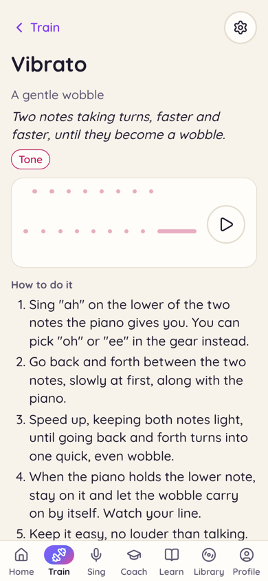
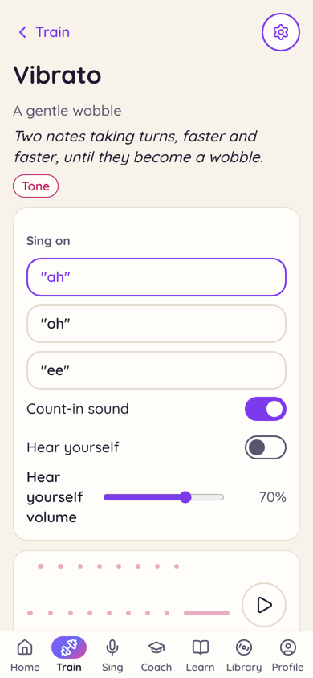
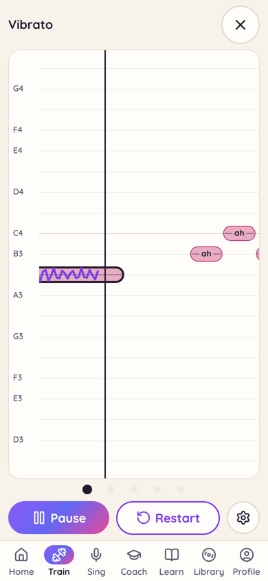
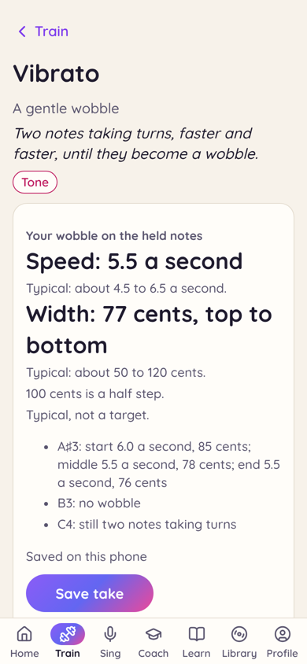

# Report, 24 Nov 2026, commit 9dc5287

Vibrato is built and live: an Advanced exercise in Tone, as you approved on 16 Nov. I built the measuring first and proved it before building the exercise around it. Main hadn't moved since b01b8ef, apart from my own 23 Nov report. Both fixes from the 23 Nov report are kept: the stuck take and the Today card count. Nothing that waits on your phone check was changed: the bubbles, the zoom and Mum's gap between rounds are as they were.

## What works

1. **Vibrato, in Tone, last in the list.** Its row reads "Advanced · Wobble measured".
2. **A round.** First a moment's quiet, then the lower note alone (the lead). Then the two notes, a half step apart, take turns: four notes at 0.6 s each, four at 0.4 s, eight at 0.2 s. Then the piano holds the lower note for 4 seconds, while your wobble carries on. Each round starts a half step higher, from two half steps above the bottom of your range to two below the top.
3. **"ah", "oh" or "ee".** "ah" is the usual one. "oh" and "ee" are in the gear, and the app remembers your choice.
4. **The wobble shows on the map.** On this exercise only, your line is drawn from every reading, so the wobble you sing is the wobble you see. Everywhere else the line is smoothed, as before. The smoothing flattens a wobble to about half its width.
5. **What it measures, on each held note:** how fast the wobble goes (cycles a second) and how wide it is (cents, top to bottom; 100 cents is a half step). Each sits beside its typical range from the project's research report: about 4.5 to 6.5 a second, and about 50 to 120 cents. The result card says "Typical, not a target." Nothing anywhere says whether it is good.
6. **Over time, as Match the note does it.** Each held note's wobble at its start, middle and end, and last time's numbers beside this time's. A held note that didn't wobble says "no wobble". One where you were still going back and forth says "still two notes taking turns".

## How the measuring was proved

The pitch line takes 20 readings a second, so a wobble of 5 a second gets only 4 readings a cycle. Taking the highest and lowest single readings misses the true top and bottom. So the app measures from whole cycles instead: over about a second of readings it fits one smooth wave, on top of the note's own slow drift. The speed is the wave that fits best, and the width is read from the wave, not from any one reading. It measures from the line's own readings, before the smoothing.

**1. Sounds of known speed and width.** 125 voice-like sounds, played through the app's own pitch reader: five notes from A2 to A4, speeds from 4 to 7.5 a second, widths from 30 to 150 cents.
- **The app's measure:** speed exact every time. Width typically within 2 cents, 7 at worst.
- **Highest less lowest single reading:** read 14 cents low on average, up to 51 cents low.
- **The smoothed line:** read 72 cents low on average. It all but hides the wobble.

**2. Real voices, with a known wobble put on them.** I took 8 real sung notes from the two test songs, 4 from each. I made each one steady, then gave it a wobble of known speed and width, by playing it slightly faster and slower in turn (a sound played 1% faster is 1% higher). That was 72 cases: speeds 4.5, 5.5 and 6.5 a second, widths 40, 70 and 110 cents.
- Speed within 0.01 a second.
- Width typically within 2 cents, 5 at worst.

**3. Telling slow turns apart from a wobble.**
- **The same 8 real notes taking turns with the half step above**, at 1, 1.5, 2 and 3 times a second: none of the 32 read as a wobble. 26 read as two notes taking turns, and 6 (at once a second) as no wobble.
- **The 8 notes made steady:** all 8 read as no wobble.

**4. The singers' own vibrato, in the test songs.** Every note the singers hold for 1.2 seconds or more, a second at a time. I compared each second with a separate, much finer measure: 500 readings a second, with the tops and bottoms of each cycle found directly.
- **Where the fine measure finds a wobble** (24 seconds), the app finds it in 15. There, speed is typically within 0.4 a second (1.5 at worst) and width within 4 cents (38 at worst).
- **The 9 it misses** are narrow, uneven wobbles of 22 to 38 cents, under the typical range. The app reports those as "no wobble".
- **Where the fine measure finds no wobble** (3 seconds), the app never claims one.

**5. Would reading more often help?** On those same seconds, reading 40 or 100 times a second found 12 and 14 of the 24, against 14 at today's 20. The misses come from how uneven those wobbles are, not from too few readings. So the reading rate is unchanged, and the change costs the phone nothing extra.

**6. In the app, a real voice through the microphone.** Three rounds:
- **A wobble of 5.5 a second and 80 cents** measured 5.5 and 77.
- **A steady hold** measured "no wobble".
- **Turns carried on through the hold** read "still two notes taking turns".
- **A second session, 6 a second and 60 cents,** measured 6.0 and 58, with last time's numbers beside it.
- **The line on the map** swung about 77 cents of the 80 sung. A build drawing the smoothed line showed about 43, and the check fails on it.

The first version wasn't good enough on real singers. It took a held note's slow drift for the wobble, and found only 2 of the 10 notes with vibrato. The second version made fast turns read as a wobble. The proofs caught both, and both are fixed above.

## The page, word for word

**Vibrato**
*A gentle wobble*
Two notes taking turns, faster and faster, until they become a wobble.

**How to do it**
1. Sing "ah" on the lower of the two notes the piano gives you. You can pick "oh" or "ee" in the gear instead.
2. Go back and forth between the two notes, slowly at first, along with the piano.
3. Speed up, keeping both notes light, until going back and forth turns into one quick, even wobble.
4. When the piano holds the lower note, stay on it and let the wobble carry on by itself. Watch your line.
5. Keep it easy, no louder than talking. If no wobble comes, hold the note steady; that's fine.
6. Stop when it stops feeling easy; you don't have to finish the climb.

**You're doing it right when** your line turns from two clear steps into one quick, even wave, and keeps waving on the held note while your volume stays the same.

**Watch out for** shaking your jaw or your head to make it wobble, pushing louder to make it wobble, and forcing it in a part of your range where it doesn't come. Leave that round and try the next.

**Why it helps:** A wobble tends to come by itself once your voice is free and easy; it isn't something you make. This lets you see yours, how fast and how wide it is, and grow it a little at a time.

**The gear:** "Sing on": "ah", "oh", "ee".

**The result card**
- Your wobble on the held notes
- Speed: 5.5 a second. Typical: about 4.5 to 6.5 a second.
- Width: 77 cents, top to bottom. Typical: about 50 to 120 cents. 100 cents is a half step.
- Typical, not a target.
- Then a line for each held note, for example: "A♯3: start 6.0 a second, 85 cents; middle 5.5 a second, 78 cents; end 5.5 a second, 76 cents", "B3: no wobble", or "C4: still two notes taking turns".
- With a last time: "Speed: 6.0 a second (last time 5.5 a second)", and "Last time kept on this phone."

A check holds the page to your rules. Outside "Watch out for", no line mentions the jaw, head, throat, voice box, belly or any muscle. No line anywhere says whether the sound is good or correct.

## What I decided

- **Lead note:** one note of the first speed (0.6 s), as everywhere.
- **Even notes:** every note within a speed is the same length. The round as a whole can't be, because speeding up is the exercise. The held note is a hold.
- **Levels:** none. Nothing is scored, and how fast the wobble goes is your own. A level that set a speed would be telling you how fast to wobble.
- **How fast the piano goes:** it stops at 2.5 back-and-forths a second, slower than a wobble. Going from there into a wobble is up to you, as you described it.
- **The bubbles** show the notes but don't fill, as on Note bends. Any octave isn't in the gear, since nothing is scored on the note.
- **The first 0.4 s of each held note isn't measured**, while the note is found.
- **Not in any routine.** It's not quiet (it's sung on a vowel), so it has no "Quiet" tag.
- **Kept on the phone:** last time's speed and width. The results list online gets the session as done, with no numbers, as for other exercises that aren't scored.

## Held

- **Saving the speed and width online**, so they follow you to a new phone. The results table has no place for a speed. Adding one changes the database, which I don't do without you. **Your decision: add it, or keep it on the phone.**
- **Whether the piano's three speeds suit you:** for your phone check.

## Not tried on a real phone

Everything was measured in Chrome made to behave like an Android phone, not on your Samsung. On the phone I haven't heard or seen:
- the round;
- the wobble on the map;
- the result card.

No one has sung this exercise for real yet. The real voices here are recordings made to follow the round. I also don't yet know whether your phone's microphone changes a wobble's width. A tap below will show it.

## What was measured

- **Unit checks:** 369 pass, 14 of them new for Vibrato. The type check is clean, and the code tidiness check finds no errors.
- **The app in a phone-like browser, real voices throughout:** first screens 15 of 15, Android 28 of 28, library 7 of 7, note map 14 of 14, Learn a song 19 of 19, takes 21 of 21, loudness 13 of 13, Train 88 of 88, and the old app all good. Train includes two new Vibrato checks: three rounds sung, and a second session with last time beside it. One Train timing check failed once while the lab was running; run alone, it passed twice.
- **Broken builds, the core:** 281, each a rule deliberately broken. The first run missed 2, both Vibrato: the hold measured from its very first moment, and the piano never speeding up. My checks for those were too loose. I tightened both, and both are now caught.
- **Broken builds, the app:** 348. The first run missed 1, which couldn't break anything as written (below). Re-aimed, it is caught, so all 348 are.
- **Test takes:** none left online on either test account.

## Mistakes of mine

- **The first measure took a note's slow drift for the wobble.** It found only 2 of the 10 held notes with vibrato in the test songs. The proof on real singers caught it, before anything was built on it.
- **My fix for that made two notes taking turns three times a second read as a wobble.** The turns proof caught it, and the turns rule fixed it.
- **A note in the code said a wobble must explain "at least half" of the movement.** The measure in fact asks for a third. I corrected the note.
- **I ticked a line on the checklist ("the map draws every reading") before a check for it existed.** The checklist test caught it. I then built the check: it measures how far the line swings, and it fails on a build that draws the smoothed line.
- **I first wrote the misses as "16 to 38 cents" wide.** On a re-run they were 22 to 38, and that is what's above.
- **I ran the lab while the browser checks were running,** against my own rule, since both lean on timing. One timing check failed. Run alone, it passed twice.
- **I misread a count of the code tidiness check as errors.** There were none.
- **Two of my Vibrato checks were too loose.** One allowed the measuring to start before the note settles. The other allowed the piano to never speed up. The broken builds caught both, and I tightened them.
- **My report first lacked the heading every report needs ("What was measured").** The report check caught it before it went anywhere.
- **I wrote a broken build that couldn't break anything.** The line stores each reading twice, once when it arrives and again when a better version comes, so dropping only the first changed nothing. It now drops both, and the check catches it.

## Your taps

Wired headphones on, as always. First, close Chrome fully: swipe it away from your recent apps, then open the app again, so you get today's version.

1. Train, Tone, Vibrato (last in the list). Read the page, tap Start and sing two or three rounds. Take turns between the two notes with the piano, speed up until it wobbles, then stay on the lower note when the piano holds it. Watch your line wobble on the map. Tap the cross. You'll see your wobble's speed and width beside the typical ranges, and each held note's start, middle and end.
2. Open Vibrato's gear, pick "oh", tap Start and sing one round. Each note should say "oh". Then tap the cross: this time last time's numbers are beside the new ones.
