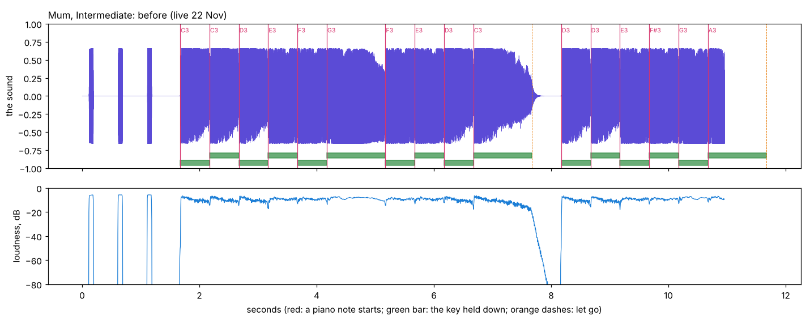
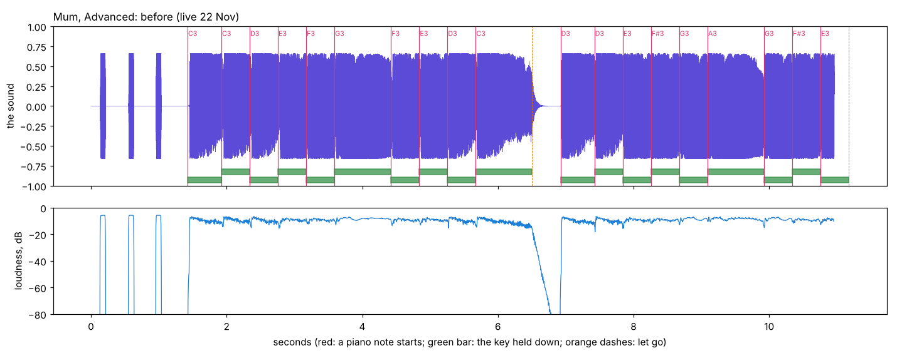
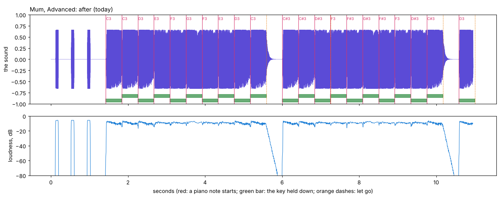
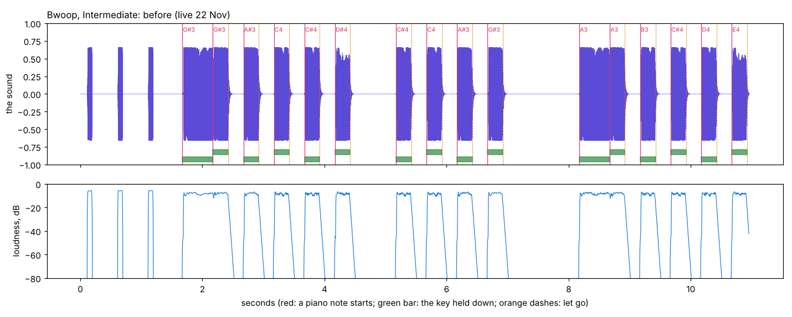
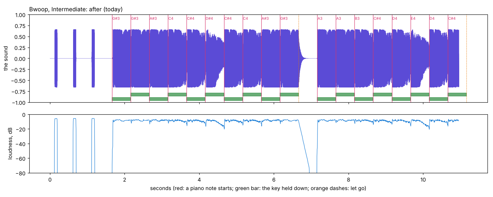
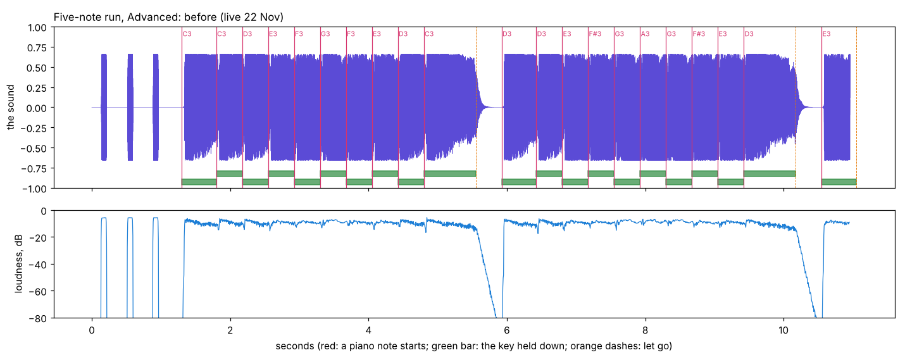
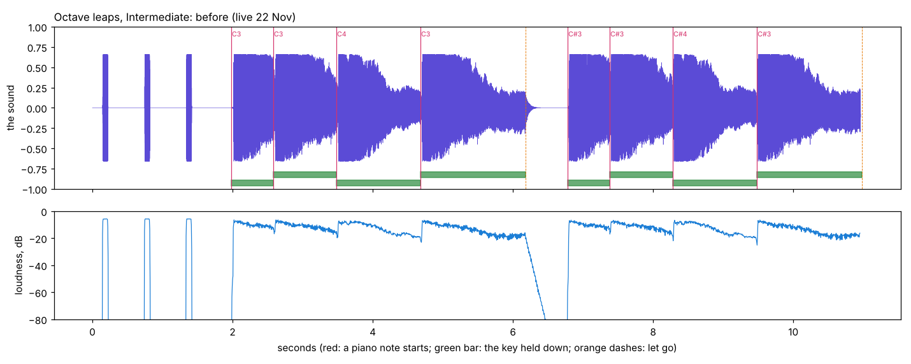
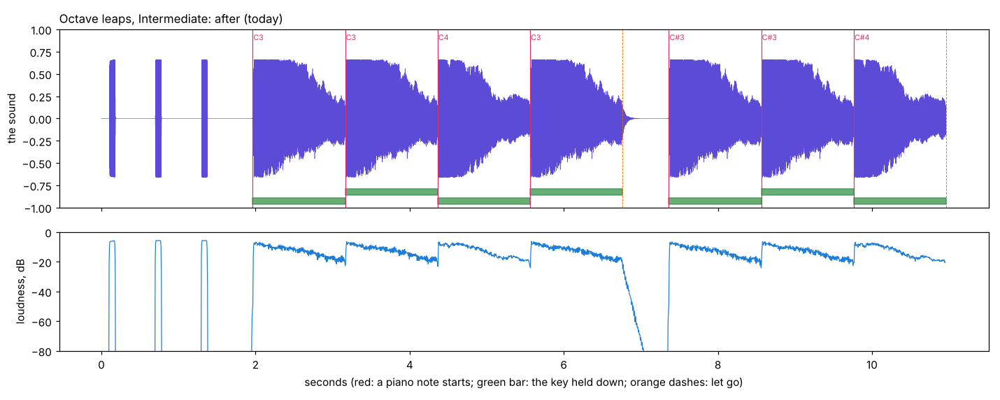

# Report, 23 Nov 2026, commit b01b8ef

Everything in your notes is built and live. Main hadn't moved since a4ce773 apart from my own 22 Nov report. Every sound change was measured by recording what the app itself plays and reading the waveform; the pictures are below.

## What works

1. **Learn a song's line.** Once the song is ready, nothing shows under its name ("Ready. Tap Start." is gone). While the singer's line is being read, that line shows how far it has got (it used to sit under the map). While the song plays the line is hidden, and its space is kept, so Start doesn't move. A problem still always shows, since it says what to do. The map takes the room the line used to have: 12.9 half steps at 360 x 740 (it was 9.8) and 16.3 at 390 x 844 (it was 13.3), with Start still above the menu.
2. **Every note the same length.** In every round, the top note and the last note are now as long as all the others, on every exercise that isn't built to hold notes. Sustained note, Messa di voce, Tongue-out with a crescendo, Hold the note, Match the tone and Vocal Function Exercises keep their long notes. The rest between rounds is unchanged: a note's length of quiet, then the lead note. Octave leaps' three notes were 1.5, 2 and 2.5 beats; they're now 2 beats each, so a round lasts as long as before.
3. **The lead note.** It now lasts exactly one note of that round at the level you pick, on every level of every exercise: for Mum, 0.625 s at Beginner, 0.5 s at Intermediate and 0.42 s at Advanced (it used to be at least 0.5 s, longer than the notes at Advanced). For a round on C: C on its own, then the round from C, with no gap between.
4. **Short notes aren't chopped.** On Bwoop, Staccato and Consonant pops the piano now plays every note whole: the key is down for the note's full beat and let go just as the next is pressed, with the same fade as every other note (a key let go, its sound falling away over about a quarter of a second). Before, each was cut off after 0.25 s while still loud, gone in 55 ms, then silence. What you sing, and the bubbles, stay short.
5. **Mum.** It now climbs a half step every round, up to the top of your range and back down to where it began, as the course's Mum does. Before, with a wide range it climbed a whole step a round and never came back down. Every difference from the course is listed below.

## Found along the way: keep or drop

- **A take could get stuck on the phone for good.** If the signal went just as a take finished going online, the take was stored, but the app never heard back. It tried again, and the store refused the second copy, since a take can't be overwritten. So it stayed "On this phone" for good, and so did every take saved after it. A test run caught it today. Now, when sending a take fails, the app checks whether the whole recording is already stored, and if it is, counts it as online and carries on. I didn't change the database or its security rules. There's a new check that cuts the answer off just as the upload ends; it fails on the app as it was and passes now. **Keep or drop?**
- **The Today card flashed the wrong count.** On Train, for someone who has never done the "Ah" tension check, the card said 8 exercises for a moment and the default length, then changed to 9 and your length. A test run caught it today. It now shows the right count from the first moment. The new check watches everything the card shows; it saw "8 then 9" on the app as it was, and only "9" now. **Keep or drop?**

## What was measured

### The waveforms

Each exercise was recorded from the app's own output, with the range set to C3 to C5 so the first round starts on C3, as the course's men's tracks do. The app's own note plan gave each note's pitch, when it starts and when its key is let go; the recording checked those starts (within 3 to 28 ms) and gave how loud each note was and how it fell away. In each picture: red lines are where a piano note starts, the green bars are how long its key is held down, the orange dashes are where it's let go, and the lower panel is the loudness.

| Exercise | Lead note | Each note's key held | Fade when let go (40 dB down) | Silence between notes in a round |
|---|---|---|---|---|
| Mum, Intermediate | 0.5 s, unchanged | 0.5 s, top and last 1.0 s → all 0.5 s | 0.18 s, unchanged | none, unchanged |
| Mum, Advanced | 0.5 s → 0.42 s | 0.42 s, top and last 0.83 s → all 0.42 s | 0.18 s, unchanged | none, unchanged |
| Bwoop | 0.5 s, unchanged | 0.25 s → 0.5 s | 0.055 s → 0.18 s | 0.2 s → none |
| Staccato | 0.5 s, unchanged | 0.25 s → 0.5 s | 0.055 s → 0.18 s | 0.2 s → none |
| Consonant pops | 0.6 s → 0.3 s | 0.25 s → 0.3 s | 0.055 s → 0.18 s | none, unchanged |
| Note bends | 0.6 s → 0.18 s | 0.18 s, first and last 0.6 s → all 0.18 s | 0.055 s → 0.18 s | none, unchanged |
| Five-note run, Advanced | 0.5 s → 0.375 s | 0.375 s, last 0.75 s → all 0.375 s | 0.18 s, unchanged | none, unchanged |
| Octave leaps | 0.6 s → 1.2 s | 0.9, 1.2 and 1.5 s → all 1.2 s | 0.18 s, unchanged | none, unchanged |

- **No note is cut off any more.** Every key is let go with the same 0.18 s fade; on Bwoop, Staccato, Consonant pops and Note bends it used to be 0.055 s, which cut the sound off while it was still loud. Each note's key is now held until the next one is pressed, so its fade runs under the start of the next: one note after another, with no silence between them.
- **Every note the same length**, and the lead note the same length as them, at every level.
- The only silence left is the rest between rounds: one note's length of quiet before the lead note.

Before is the app as it was live on 22 Nov; after is today's. Each recording is about the first 11 seconds, after the count-in's three clicks.

**Mum, Intermediate.** Before, the top note (G3) and the last (C3) held twice as long, and the second round started a whole step up, on D3. After, every note is the same length, and the second round starts a half step up, on C♯3.

**Mum, Advanced.** Before, the lead note (0.5 s) was longer than the notes of its round (0.42 s). After, it's the same.

**Bwoop.** Before, every note was cut off after a quarter of a second while still loud (the cliff in the loudness), then silence until the next. After, each note sounds for its whole beat and fades under the next.

**Staccato.** The same as Bwoop.

**Consonant pops.** Its notes are half a beat, 0.3 s. Before, each was cut at 0.25 s; after, each sounds its whole 0.3 s and fades under the next.

**Note bends.** Before, a longer first and last note with quick cut-off flicks between. After, seven even quick notes a round.

**Five-note run, Advanced.** Before, the last note held twice as long and the lead was longer than a note. After, all the same.

**Octave leaps.** Before, its three notes were 0.9, 1.2 and 1.5 s and the lead 0.6 s. After, all four 1.2 s.

**Mum, Beginner.** Every note and the lead 0.625 s.

### Every changed exercise with a real voice

Every exercise whose pattern changed was sung by a real voice in the built app, at every level, arriving 0.09 s after each piano note, as in your takes. At Beginner, each was also sung a half step off. The pass mark is the usual one: 85% or more counted when sung right, and 15% or less when a half step off.

All 40 scored exercises that move round by round were sung at every level they have: 118 levels in all. **Every level passes.** Sung right, every note counted at every level but two: Bwoop at Advanced (35 of 36, 97%) and Consonant pops at Advanced (101 of 104, 97%; it was 104 of 104 on 22 Nov). Sung a half step off at Beginner, none counted, except Consonant pops (1 of 104, 1%, as on 22 Nov).

Tension check, Chewing hum, Blah and Note bends only show your line and aren't scored, so there's nothing to count. The chromatic run and Turns have no Beginner level, as before.

### Listed lengths

Shorter rounds and Mum's climb back down change how long the routines take. At the default range: Daily warm-up 12 minutes (was 10), with the "Ah" tension check first 13 (was 11), Intermediate warm-up 16 (was 15), Advanced warm-up 14 (was 15), Quiet warm-up 12 (was 11), Cool-down 3 (was 4).

## Mum: the app and the course

Compared with the course's Mum figures in both breakdown docs (Blueprint for Men, "Track 2"; and the Intermediate course's "Mum with neck movement", block 3, which has the same timing):

| | The course | The app now | Before today |
|---|---|---|---|
| Pattern | 1-2-3-4-5-4-3-2-1 | the same | the same |
| Climb | a half step a round, up to the top and back down | the same | a whole step a round on a wide range, up only |
| Starting note | C3 for every man | one half step above the bottom of your measured range | the same |
| Top | G4 for men | the top of your measured range | the same |
| Note spacing | about 0.41 s | 0.625 s Beginner, 0.5 s Intermediate, 0.42 s Advanced | the same |
| Note length | the same for every note (the Intermediate course's top note "slightly longer") | every note the same | the top and last notes twice as long |
| A round every | 5.4 s going up, 5.3 s coming down | 6.9 s Beginner, 5.5 s Intermediate, 4.6 s Advanced | 8.1, 6.5 and 5.5 s |
| Between rounds | about 1.7 s, with the cue note about 0.8 s before the round | one note's quiet, then the lead note, then the round straight after | the same |
| How the notes ring into each other | not described in either doc | each key held until the next is pressed, then fading over about a quarter of a second under it | the same |

**Fixed today:** the climb (a half step a round, up and back), and every note the same length.

**Not changed, because they clash with decisions you've already made:**
- **Speed.** The course's 0.41 s matches Mum at Advanced (0.42 s). Intermediate is 0.5 s, because on 21 Nov you set Intermediate to today's speed with a notch either side. **Suggestion:** keep the levels; Advanced is the course's speed.
- **The gap between rounds.** The course leaves about 1.7 s between rounds, with a short pause after its cue note. The app leaves one note's quiet and then the lead, about 1 s at Intermediate. You said today that the rest between rounds stays. **Suggestion:** if you want Mum to match the course here too, I'd lengthen its rest to about 1.7 s, with the lead note ending 0.4 s before the round.
- **Starting note and top.** The course starts every man on C3 and stops at G4. The app fits Mum to your own measured range, which you chose for every exercise.

I couldn't compare how the course's notes ring into each other: neither doc describes it, and I have no recording of the course here.

## What I decided

- **Note bends:** its first and last notes were a beat long, with quick flicks in between. Since every note of a round now has to be the same length, they're as quick as the flicks: seven quick notes, note, neighbour, note and so on, 0.18 s each.
- **Short notes:** the piano plays them whole, but the sung note and its bubble stay short, as you asked on 20 Nov.
- **The fade when a key is let go:** 40 dB in 0.18 s, 60 dB in 0.28 s, like a key whose damper falls on the string. It's the fade the app already used for every note but the short ones. I haven't measured a real piano's damper; I have no recording of one here.
- **A problem on Learn a song** still shows while the song plays, because it needs to say what to do.
- **Hold notes' lead note** stays a second: one held note is 4 to 10 s, too long to be its lead.

## Held, and clashes

- The speed and the gap between rounds on Mum (above).

## Not tried on a real phone

Everything was measured in Chrome made to behave like an Android phone, not on your Samsung. On the phone I haven't heard or seen:
- the even notes;
- the shorter lead at Advanced;
- the whole short notes;
- Mum's climb back down;
- Learn a song's line.

## Checks

- 355 unit checks pass. The type check and the code-style check are clean (one old warning, from before this round, about a comment).
- In Chrome made to behave like a phone, signed in as the test singer: Train 86 of 86, Takes 21 of 21, Android 28 of 28, the browser checks 15 of 15, Learn a song 19 of 19, the note map 14 of 14, the library 7 of 7, and loudness 13 of 13, sung with a real voice.
- The old app's own checks all pass, so it is unchanged.
- Real voice: 118 levels of 40 exercises, and every level passes (above).
- Broken builds: all 262 broken rules were caught, and all 336 broken copies of the app.
- A restart of the machine stopped the broken-rule run partway, and left one rule it had broken on purpose. I put that file back as it was and ran the whole set again.
- The test takes were deleted after the runs, and the two test accounts hold none. Your and Briar's accounts weren't touched.

## Mistakes of mine

- When I made every note the same length, I didn't update two of my own checks that still expected the old lengths and Mum's old climb. The full run caught them, and I updated them.
- My first guess at why a take got stuck (the upload hanging when the signal goes) was wrong. A test disproved it, and the store's own records showed the real cause.
- My first version of the stuck-take check couldn't tell the old app from the new. I fixed it, and saw it fail on the old app before trusting it.
- I left Consonant pops out of the first real-voice list. I caught it by comparing with the full list, and sang it.
- I first wrote the real-voice totals as 46 exercises and 124 levels. The true count is 40 and 118, corrected before this report.
- When I fixed the Today card, I didn't look for other broken builds aimed at the same lines. One of them no longer broke anything you'd see, and the broken-build run flagged it. I re-aimed it, and it's caught.

## Your taps

First, close Chrome fully: swipe it away from your recent apps, then open the app again, so you get today's version. Wear your wired headphones throughout.

From 22 Nov (again, after closing Chrome):

1. Train, Agility, Five-note run, gear, Advanced, Start. Before each round you'll hear its first note on its own, as short as the round's notes, then the round. Sing each round from its first note, on time. Its first bubble should fill green.
2. While that runs, look at the map: thin bubbles with a line through the middle, and the view sliding up as the rounds climb. Every note, the last included, is the same length.
3. Agility, Note bends, Start: quick flicks between the note and its neighbour, seven even notes a round, ending on the note. Your line is shown and there's no score.
4. Pitch, Match the tone, Beginner, Start. Each tone lasts 6 s and the notes go up in order. At the end you get a score and how it landed.
5. Match the tone, Advanced: your line stays hidden while the tone plays, and appears once it stops.
6. Range: the Octave leaps row reads "Advanced · Levels Beginner to Advanced · Scored on pitch". Tap it, Start: low, high, low, all three notes the same length (they used to be three different lengths, the last the longest).
7. Agility, Three-note run, gear, Advanced, Start: a notch faster than Intermediate. Sing it through.
8. Sing, Learn a song, open one of your songs. Under its name there's nothing, or "Reading the singer's line…" with how far it has got. Tap Start: that line disappears while the song plays and nothing moves. The map's rows are as far apart as on Train, and before each phrase the view slides to show it. "Any octave" is in the sound card below.

New this round:

9. Tone, Mum, gear, Intermediate, Start. Every note is the same length, the top and the last too. Each round starts a half step higher than the one before; after the top it comes back down a half step a round.
10. Range, Bwoop, Start. The piano plays whole notes one after another, with no cut and no silence between them; what you sing is still a short "bwoop".
