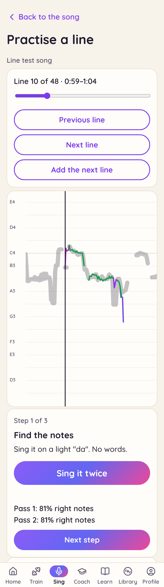
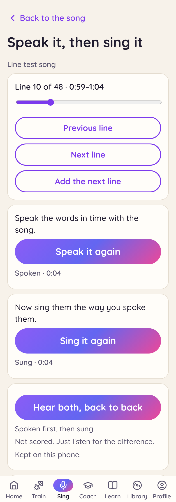
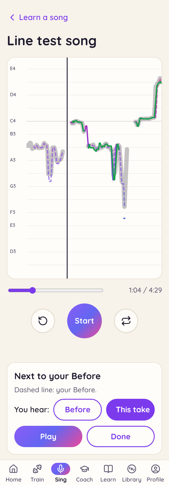

# Report, 27 Nov 2026, commit 435f832

While you were travelling, I built the three song features you approved on 16 Nov, as their own round. All three are in Learn a song, on your own songs. Nothing is sourced: no words or sound from anywhere, only what you added. Main had moved since 19e62e5 by one change only, my own 25 Nov report. Nothing that waits on your phone check was changed: the bubbles, the zoom and Mum's gap between rounds are as they were.

## What works

1. **Two new buttons on Learn a song,** under the sound settings: "Practise a line" and "Speak it, then sing it". Each opens its own page, with a way back to the song.
2. **Picking a line.** The app works out the song's lines from where the singer breathes, using the singer's line it already reads from your song. A line plays from a moment before its first note to a moment after its last. You can pick a line by sliding along the song, step to the next or previous line, or tap "Add the next line" for a longer stretch. The line you pick is kept for next time, and both new pages share it.
3. **Practise a line, in three steps, each sung twice.** One Start counts you in, then plays the line twice:
   - Find the notes: sing it on a light "da", no words.
   - On an exercise sound: pick Lip trills, Mum or Straw singing. Each comes with Train's own words, unchanged.
   - With the words: sing them, keeping the ease you had on the sound.
   Your line is drawn against the singer's on the same map as Learn a song (the same spacing, sliding, never zooming). Each time through is scored the way Learn a song scores a take. After the third step: Next line, Add the next line, or From the first step.
4. **Speak it, then sing it,** on the same line. Speak the words in time with the song; then sing them the way you spoke them. "Hear both, back to back" plays your spoken one, then your sung one. Nothing is scored, and the app never says which sounds better. Both recordings are kept on your phone the moment they're made.
5. **Your first take is your "Before".** The first take you saved of each song is marked "Before" in Your takes. Every other take's menu has two new choices:
   - "Next to your Before": both lines on the map, your Before dashed. Play runs both takes together over the music, where both were sung. You hear one at a time, and "Before" and "This take" switch between them without stopping.
   - "Make this my Before": that take becomes the Before instead. The choice is kept on your account, so it follows you to a new phone.
6. **The same rules as today:** takes are private to you, and a linked coach can read your results. Nothing about who can read or write either changed.

## What was measured

- **The lines, on two real songs** (All of Me, 4:29; Ride, 3:41), as the app read them. A silence of 0.45 s or more ends a line. A line under 1.5 s joins its nearer neighbour, and one over 8 s is cut at its longest breath. All of Me came out as 48 lines and Ride as 41; most are 2 to 8 seconds long, and the longest, sung without a break, 11 to 14 s. They follow where the singer breathes. I couldn't check them against the words, as the app has none.
- **Practise a line, with a real voice** (the singer's own voice from your song, played into the mic as you would sing it):
  - Each Start played the line exactly twice, with one count-in before the first time.
  - Sung right, the two times through scored 81% and 83% right notes. Sung wrong (the same voice seven seconds out), each scored 2%. Sung right the first time and wrong the second, they scored 79% and 0%: each time is scored on its own.
  - A run stopped in the first time through shows the second as "not sung", and the next step waits until both are sung.
  - Leaving mid-line, by the menu at the bottom: silence and the mic closed within a hundredth of a second.
- **Speak it, then sing it:** each recording took the line once (4.3 s for a 4.5 s line) and was still there after closing the page. "Hear both" played them one after the other, the second starting as the first ended, with no song under them. With the mic refused it says "No microphone, so nothing was recorded."
- **The Before, with the two test accounts:**
  - Of three takes, the first saved was marked Before, and only it.
  - Next to the Before: both lines drawn, each from its own take. Played together, only one was heard at a time, and the switch changed which one.
  - A take from another part of the song says "These two are from different parts."
  - Choosing one take as the Before and then another, with the signal slowed: the mark moved at once (about a hundredth of a second), stayed on the newer choice, and the account kept the newer one.
  - The chosen Before was kept on the account and came back when the phone forgot it.
  - The linked coach can't see it, add one or change one, and signed out no one can. With the chosen Before deleted, the first take is the Before again.
- **The database:** one new table, for the chosen Before only (details under "What I decided"). I checked its rules after adding it: only you can read or change your own. The rules for takes and results are word for word as before.
- **Both pages** fit at 390 and 360 wide with nothing scrolling sideways, every button big enough to tap, and every word from the app's own text.
- **Live:** all of this is on the live site, checked file by file against main. Opened there signed out, as a stranger would, both new pages work, and with no song chosen each says "Pick a song first." with a way back.
- **Checks:** all 396 quick checks pass, and every check in a browser made to behave like your phone passes (233 of them, across all nine groups), as do the old app's checks.
- **Broken builds:** I broke the app on purpose 690 ways, 48 of them new for these features (such as scoring both times through on the last one, playing the line once, saying which recording sounds better, or letting a coach read your Before). The checks caught every one.
- **Test takes:** none left behind on either test account, and no chosen Before left in the new table. Your account and Briar's weren't touched.

## What I decided

- **A new table for the chosen Before.** Your rule was the smallest database change, kept with the other scripts, and said here. A take can't be changed once saved. A marker in the takes table would show up as a broken take in the old app, which lists every take. So the choice has a small table of its own, as the tension check's ticks have had since 3 Nov. Keep or drop.
- **"Next to your Before" plays the two together, one heard at a time,** so you can switch at the same moment in the song. The other way would be one after the other. Keep or drop.
- **Speak it, then sing it keeps its two recordings on your phone only.** They aren't takes: they aren't put online, sent to your coach, or listed in Your takes. Keep or drop.
- **Things I added beyond the brief:**
  - The Voice and Music sliders and Hear yourself on both new pages. Keep or drop.
  - "Back a step" and "From the first step" on Practise a line. Keep or drop.
  - Practise a line remembers the exercise sound you picked. Keep or drop.

## Held

- **Practise a line's scores show on the page but aren't saved as results,** just as Learn a song's take scores aren't. So your coach doesn't see them. **Your decision: save each step's score as a result so your coach can see your practice, or leave them on the page.** I'd save them.

## Not tried on a real phone

Everything above was run in Chrome made to behave like an Android phone, with a real recorded voice, not on your Samsung. In particular: how the lines fall in your own songs, and whether two times through a line is enough or feels rushed.

## Mistakes of mine

- Four of my first checks were wrong: two expected numbers I had worked out by hand (such as where a line should start), and two word searches matched the wrong thing. Running them showed it, and I corrected them before building on them.
- **A bug of mine, fixed before it went live:** if you had already chosen a Before and then chose a different take, the account kept the new one but the page flipped back to the old one. A broken build showed my check only tried a first choice. The check now changes the choice too, with a slow signal, and the app keeps the newest one. Fixing the check took me three tries: twice the check couldn't see the problem, and broken builds showed that both times.
- One check couldn't fail: it didn't make sure each time through a line is scored on its own. A broken build showed this. It now sings the line right the first time and wrong the second, and expects two different scores.
- Three broken builds (the line's edges, and notes outside the line counting) weren't caught at first. I added checks, and they are caught now.
- One check took a "%" from the volume sliders for a score. I fixed the check; the page was right.
- In my first pictures, "This take" wrapped onto two lines, so its button was taller than "Before". That was real on the page at phone width, and it's fixed.

## Your taps

Add these to the end of your list (it ends at 3, from 25 Nov). Wired headphones on, as always. First, close Chrome fully, so you get today's version.

4. Sing, Learn a song, one of your split songs, "Practise a line". Slide to a line you know, tap "Sing it twice" and sing it on "da" both times. You'll see two scores. Tap Next step, pick Mum, and sing it twice. Tap Next step and sing it twice with the words.
5. Back, then "Speak it, then sing it": tap Speak it and speak the words in time; tap Sing it and sing them; then tap "Hear both, back to back".
6. Back on the song: if you have two saved takes, tap the three dots beside the later one and tap "Next to your Before". Tap Play, then switch between "Before" and "This take".
