# Reports for Robert

Every report, newest last. The newest is also in latest.md.

# Report, 22 Oct 2026, commit eacfce2

This report covers two rounds: the USB-C headset fix, and this housekeeping round. The housekeeping round changed nothing in how the app behaves.

## What works

The headset fix (in a computer browser that mimics Android):
- Start asks for the mic once, raw: echo, noise and volume processing off, lowest delay. It never tries another mode by itself.
- The mode the old ladder remembered is cleared. Another mode comes only from "Try another mode" in the Sound check, and only that choice is remembered.
- The mic opens first, then the sound. Sound made before the mic opened is made anew on the next Start.
- Recovering from a stall, and Test without mic, both wait for the old sound to close, wait 800 ms, start the new sound, play one silent sample and check the sound clock is moving.
- "Use the phone's own mic" picks the built-in mic by name on the very first mic request, so plugging the headset in can't switch it. The same button then reads "Let the phone choose the mic". A mic that crashed the phone is dropped and never picked again by itself.
- A safety stage after the limiter keeps loud parts together under full volume.

This round:
- Your two Drive docs, android-samsung-headset.md and android-audio-history.md, are copied into the repo unchanged.
- Two new rulebook rules: a report for you with every merge, and knowledge carried as copies, never summaries.
- This report, and a running log of every report.

## What was measured

- All browser checks pass on this build (the app itself is unchanged this round, file for file): 15 general, 26 Android, 7 library, 13 note map, 18 Learn a song, 19 takes.
- The old app's 187 checks pass.
- Every deliberately broken version of the app (113) and of its core (66, six of them new this round) was caught by a test.
- Both copied docs match your Drive files byte for byte: 998 and 11,439 bytes.
- The live site serves exactly the build on main, file for file.
- On the live site: one raw mic request per Start, the old remembered mode cleared, the phone's own mic used by name.
- Two loud parts together peaked below full volume (it was 1.03 before the safety stage).

## Not tried on a real phone

Nothing from the headset fix has been tried on a real phone yet. Whether your Samsung now plays through the USB-C headset only your phone can show.

One difference from the old app, found in the history doc, for you to decide: the old app's rebuild retried once more after 600 ms if the first try didn't start the sound. The new app tries once and then shows Sound trouble. Nothing was changed.

## Your taps

Samsung, Chrome, USB-C headset plugged in.

1. Close Chrome fully, then open:
```
https://rcaldwell91.github.io/repertoire-pro/app/
```
2. Tap Sing, then Learn a song, then your song, then Start. You should see 3, 2, 1, then hear the song in the headset.

If there's still no sound:
1. Tap Sound check, at the bottom of the Sound card.
2. Tap Start and screenshot the "What the phone says" card.
3. Tap Test without mic and screenshot the result.
4. Tap Use the phone's own mic, go back to your song and tap Start.
5. Only if it's still silent: in the Sound check, tap Try another mode once, then try your song again. Screenshot the "Mic mode" line each time.

# Report, 22 Oct 2026, commit c514001

The loudness round, after your phone test with the USB-C headset. Four changes to how the app sounds; nothing else changed.

## What works

- **The second try.** When a tap rebuilds the sound and the new sound won't start, the app closes it, waits 600 ms and makes one more. Only on that tap, never a third, never by itself.
- **Hear yourself, fixed.** Three things were wrong, and all three are fixed:
  - Switched on during the 3-2-1, or while the mic was still opening, it was lost when the song started. Now it takes whenever you switch it, and is kept while the song starts.
  - When the phone takes the mic and gives it back (plugging a headset in can do this), the old app wired the mic again a moment later; the new app didn't, so the mic could stay live and silent. Now it does the same as the old app.
  - It came back at four fifths of a raw mic's level, which is too quiet to hear at all. See the slider.
  - After a rebuild your voice was already wired onto the new sound; I checked it with a real voice and it is heard at the same level before and after.
- **A Hear yourself volume slider,** in the sound card under the switch, 0 to 100, remembered on the phone, 70 at first. At 100 your voice comes back at four times the mic's level (+12 dB). It is rounded off before it can crackle, and it joins the sound after the limiter, so it adds no delay.
- **Every song at a proper level.** The first time a song plays, the app measures its loudest moment (voice and music together) and lifts both parts by the same amount so that moment sits just under full volume (-1 dBFS). The number is kept with the song and never measured again. Sliders at 100 play at that level.
- **The way out changes nothing below 0.9.** The limiter now starts at 0.9, its own lift is taken off, and the last safety only touches peaks above 0.9.

## What was measured

On the live site before this round, a split song at sliders 100: voice peak -0.5 dBFS, average -16.7; music peak -3.4, average -18.6; together peak -0.4, average -14.6. So this song's files were already at full volume at their peaks. What the way out did to them: a half-volume tone came out at 0.81 of itself (cut by a fifth, 1.9 dB). On the new build the same tone comes out at exactly 1.000 of itself at sliders 100, 70 and 30.

A song made five times too quiet now comes out with its loudest moment at 0.891 (-1.0 dBFS, the target), voice and music lifted alike (4.37 times). Halving the kept number halves the sound, so the level is read from the song, not measured again.

Hear yourself, with a real voice in the mic at a raw mic's level (-24 dBFS): at 70 your voice comes back at 1.95 times the mic; at 50, 1.0 times; at 0, silent; at 100, 3.97 times (+12 dB), loudest sample 0.890, never over. The music alone at 100 averages -18.9 dBFS; your voice at 100 averages -11.6, so it is 7.3 dB louder than the music. The slider is still at 100 after leaving the song and coming back. After a stall and a rebuild, your voice comes back at the same 1.95 times on the new sound. When the phone gives the mic back, it is wired again once.

The second try: the first new sound was closed, and 602 ms later another was made, which played. When both tries fail, three sounds were made and still three four seconds later, and Start is shown with the sound trouble steps.

Every check passes: browser 15, Android 28 (2 new), library 7, note map 13, Learn a song 18, takes 19, loudness 8 (a new suite), 170 core tests (16 new), and the old app's 187. Every deliberately broken version is caught: 128 of the app (15 new) and 78 of its core (12 new). Each new check failed on the build before this one first.

## Not tried on a real phone

None of this has been tried on a real phone. Two things I can't settle from here:

- Whether the song itself is now loud enough on your phone at full volume. This song's files already peaked near full volume, so the level fix adds only half a decibel to it; the way out adds 1.9 dB. Quiet songs gain much more. If the song is still too quiet, the next step is the old app's v9.8 compressor, which lifts the body of the sound rather than its peaks. That's your decision.
- The second try can't be made to happen on purpose on a phone.

One difference from the old app, for you to decide: the old app remembered whether the Hear yourself switch was on between visits; the new app remembers only its volume.

## Your taps

Samsung, Chrome, USB-C headset in, phone at full volume.

1. Close Chrome fully, then open:
```
https://rcaldwell91.github.io/repertoire-pro/app/
```
2. Tap Sing, then Learn a song, then your song. In the Sound card, switch Hear yourself on, then tap Start. You should hear yourself from the first note.
3. Under the switch is the new "Hear yourself volume" slider, at 70. Slide it to 100 while singing: your voice should be clearly louder than the music, with no crackle.
4. Tap Start again, and switch Hear yourself on during the 3, 2, 1. You should hear yourself as soon as the song starts.
5. Tell me three things: is your voice loud enough at 100; is the song loud enough at both sliders 100; and is either different with the headset out.

# Report, 22 Oct 2026, commit 5d26ce8

The loudness round, after your phone test with the USB-C headset. Four changes to how the app sounds; nothing else changed. This report replaces the one written earlier today for this round, which turned out to be wrong about one thing (below, under "What was measured").

## What works

- **The second try.** When a tap rebuilds the sound and the new sound won't start, the app closes it, waits 600 ms and makes one more. Only on that tap, never a third, never by itself.
- **Hear yourself, fixed.** Three things were wrong, and all three are fixed:
  - Switched on during the 3-2-1, or while the mic was still opening, it was lost when the song started. Now it takes whenever you switch it, and is kept while the song starts.
  - When the phone takes the mic and gives it back (plugging a headset in can do this), the old app wired the mic again a moment later; the new app didn't, so the mic could stay live and silent. Now it does the same as the old app.
  - It came back at four fifths of a raw mic's level, which is too quiet to hear at all. See the slider.
  - After a rebuild your voice was already wired onto the new sound; I checked it with a real voice and it is heard at the same level before and after.
- **A Hear yourself volume slider,** in the sound card under the switch, 0 to 100, remembered on the phone, 70 at first. At 100 your voice comes back at four times the mic's level (+12 dB). It is rounded off before it can crackle, and it joins the sound after the limiter, so it adds no delay.
- **Every song brought up to a proper level, once.** The first time a song plays, the app measures its loudest moment (voice and music together) and lifts both parts by the same amount so that moment sits just under full volume (-1 dBFS). The number is kept with the song and never measured again. Sliders at 100 play at that level. One thing I did differently from your words, and it is yours to confirm: a song is brought up, never down. Your test song's voice and music together already peak a little above full volume, and turning it down to -1 dBFS made it 2.4 dB quieter than before, the opposite of what you asked for. So a song already at full volume plays as it is, and the limiter holds its peaks. Even so, measured on the live site after the merge, your song comes out 1.1 dB quieter on average than before this round (below). That is the honest result of the rules chosen: the old limiter squashed this song's peaks and lifted the rest, and "nothing changed below 0.9" takes that away. Making a full-volume song louder means squashing it on purpose, which is the old app's v9.8 compressor, and your decision.
- **The way out changes nothing below 0.9.** The limiter now starts at 0.9, its own lift is taken off, and the last safety only touches peaks above 0.9.

## What was measured

On the live site before this round, your split song at sliders 100: voice peak -0.5 dBFS, average -16.7; music peak -3.4, average -18.6; together peak -0.4, average -14.6. The two files added together peak at +0.4 dB, above full volume. What the way out did to them: a half-volume tone came out at 0.81 of itself (cut by a fifth, 1.9 dB). On the new build the same tone comes out at exactly 1.000 of itself at sliders 100, 70 and 30.

The earlier report today said this song gained half a decibel from the level fix. That was wrong: measured on the live site, it had lost 2.4 dB, because its peak is above full volume and it was being turned down. With "up, never down" it is measured on the live site again, sliders at 100: together peak -0.7 dBFS, average -15.7; before this round, peak -0.4, average -14.6. So this song is 1.1 dB quieter on average than before, because the old limiter squashed its peaks and lifted the rest, and the new way out does neither below 0.9.

A song made five times too quiet comes out with its loudest moment at 0.891 (-1.0 dBFS, the target), voice and music lifted alike (4.37 times). Halving the kept number halves the sound, so the level is read from the song, not measured again. A song already at full volume plays at exactly 1.000 of itself.

Hear yourself, with a real voice in the mic at a raw mic's level (-24 dBFS): at 70 your voice comes back at 1.95 times the mic; at 50, 1.0 times; at 0, silent; at 100, 3.97 times (+12 dB), loudest sample 0.890, never over. The music alone at 100 averages -18.9 dBFS; your voice at 100 averages -11.6, so it is 7.3 dB louder than the music. The slider is still at 100 after leaving the song and coming back. After a stall and a rebuild, your voice comes back at the same 1.95 times on the new sound. When the phone gives the mic back, it is wired again once.

The second try: the first new sound was closed, and 602 ms later another was made, which played. When both tries fail, three sounds were made and still three four seconds later, and Start is shown with the sound trouble steps.

Every check passes: browser 15, Android 28 (2 new), library 7, note map 13, Learn a song 18, takes 19, loudness 9 (a new suite), 170 core tests (16 new), and the old app's 187. Every deliberately broken version is caught: 129 of the app (16 new) and 79 of its core (13 new). Each new check failed on the build before this one first. One run of the broken builds hung once for no reason I could find and was stopped; run again, both builds were caught.

## Not tried on a real phone

None of this has been tried on a real phone. Two things I can't settle from here:

- Whether the song itself is loud enough on your phone at full volume. Your test song already peaks at full volume, so the level fix can't lift it, and it is 1.1 dB quieter on average than before this round. Quiet songs gain a lot. If you want full-volume songs louder, the next step is the old app's v9.8 compressor, which lifts the body of the sound and squashes its peaks. That's your decision; I have not built it.
- The second try can't be made to happen on purpose on a phone.

Two differences from the old app, for you to decide: the old app remembered whether the Hear yourself switch was on between visits; the new app remembers only its volume. And "up, never down", above.

## Your taps

Samsung, Chrome, USB-C headset in, phone at full volume.

1. Close Chrome fully, then open:
```
https://rcaldwell91.github.io/repertoire-pro/app/
```
2. Tap Sing, then Learn a song, then your song. In the Sound card, switch Hear yourself on, then tap Start. You should hear yourself from the first note.
3. Under the switch is the new "Hear yourself volume" slider, at 70. Slide it to 100 while singing: your voice should be clearly louder than the music, with no crackle.
4. Tap Start again, and switch Hear yourself on during the 3, 2, 1. You should hear yourself as soon as the song starts.
5. Tell me three things: is your voice loud enough at 100; is the song loud enough at both sliders 100; and is either different with the headset out.

# Report, 23 Oct 2026, commit 92be4df

After your phone test (headset in, Media volume, everything better, nothing crackled). Two of your four changes are built and live. The third, songs louder, is not built: the measurements say the plan as written would not make your song louder, so it waits on your choice below. The fourth (raise quiet songs, never turn loud ones down) was already in.

## What works

- **Hear yourself at 100 is now three times your mic (about +9.5 dB), down from four.** The slider still starts at 70, on the new scale, and the soft limit is kept.
- **Hear yourself remembers whether it was on**, between visits, like the old app. Switch it on once and it is on next time you open a song, heard from the first note; switch it off and it stays off. Its volume was already remembered.

## What was measured

Hear yourself, with a real voice in the mic at a raw mic's level: at 100 your voice comes back at 3.00 times the mic, loudest sample 0.832, never over; still 3.5 dB louder than the music at 100. At 70, 1.47 times; at 50, 0.75; at 0, silent. Switched on, then back to the song: still on, and heard at 1.47 times from the first Start. Switched off, then back: off, silent.

Song loudness. Your split song, played whole on the live site, voice and music at 100, recorded at the speaker and measured with the standard loudness meter (EBU R128): **-9.8 LUFS** integrated, peak -0.5 dBFS, average -12.9 dBFS. Music apps play at about -14 LUFS, so this song already plays about 4 dB louder than they do. Its split parts come from a loud master of the song (the two parts add back up to it exactly, -9.7 LUFS); another master of All of Me plays at -13.4 LUFS, and Ride at -15.5.

The same three songs rendered through the old app's v9.8 stage (from next.html: compressor at -12 dB, ratio 3, a gain of 1.4, limiter at -3 dB): your split song -6.8 LUFS, the other All of Me -7.3, Ride -9.3. That is 3 to 6 dB louder than now, and it pushes the peaks up to full volume (0.0 dBFS).

So "about -14 LUFS" and "louder" pull opposite ways for your song: at -14 it would come out 4 dB quieter (or, never turned down, unchanged). The v9.8 stage makes it louder, but well past -14.

Every check passes: browser 15, Android 28, library 7, note map 13, Learn a song 18, takes 19, loudness 10 (1 new), 170 core tests, and the old app's 187. The new checks failed on the previous build first, and four new deliberately broken builds and one new core one are caught. The note map check was changed: it said the switch starts off on the next visit, and now says it is remembered.

## Not tried on a real phone

None of this. Your choice on loudness, one of:

1. **Lift quiet songs to about -14 LUFS**, peaks held under -1 dBFS, never turn loud ones down. Ride would gain 1.5 dB; your split song would not change.
2. **The old app's v9.8 stage**, with peaks held under -1 dBFS: songs 3 to 6 dB louder than now (about -7 to -9 LUFS), squashed more. Much louder than music apps; the one to pick if it must be louder whatever the song.
3. **In between**: name a number (for example -11 LUFS) and I lift songs to it, never down.

Before you choose, one minute on your phone tells us whether the app or the phone is the quiet part (taps below). If YouTube is also too quiet on the headset, the limit is the phone or headset, not the app.

## Your taps

Samsung, Chrome, USB-C headset in, phone at full volume.

1. Close Chrome fully, then open:
```
https://rcaldwell91.github.io/repertoire-pro/app/
```
2. Tap Sing, then Learn a song, then your song. Hear yourself should be as you left it. Switch it on if it is off.
3. Tap Start and sing. The slider under the switch is "Hear yourself volume": at 100 your voice should be a little less loud than last time.
4. Tap Pause, then go back and open the song again: Hear yourself is still on.
5. The loudness question: play the same song in YouTube on the same headset at full volume, then in the app with voice and music at 100. Which is louder, or are they about the same? Then tell me 1, 2 or 3 above.

# Report, 23 Oct 2026, commit b26e2aa

Your choice, option 2: the old app's v9.8 loudness stage is built and live. Songs at sliders 100 come out about 3 dB louder, with peaks held under -1 dB. Hear yourself at 100 was raised so it stays over the louder music.

## What works

- **The old app's v9.8 loudness stage, as it was.** Everything goes in at 0.9; a compressor lifts the body of the sound (-12 dB, knee 6, ratio 3, 4 ms, 220 ms); 1.4 raises it all; a limiter holds the peaks (-3 dB, ratio 20, 1 ms, 60 ms). The numbers are copied from the old app; its own tuning tests (loud.js, test_loud.js) are not in the repo, so only the numbers survive.
- **Peaks held under -1 dB.** After the limiter, a ceiling rounds off anything near the top, running at twice the sound's rate so peaks can't slip through between the samples either.
- **Hear yourself at 100 is now six times your mic (about +15.6 dB).** At three times, the louder music swallowed it (2.8 dB under the music). At six it is 2.6 dB over the music; that's what I set. The slider still starts at 70, which is now about what 100 was before. Your voice skips the compressors and goes only through the ceiling, which adds 2.7 ms.
- **The stage's own delay is counted.** The compressors look 6 ms ahead each and the ceiling adds 2.7 ms: 14.7 ms in all, measured. The app now allows for it when it works out where you are in the song and where a take sits. Before this round 6 ms of it went uncounted.
- Quiet songs are still lifted first, never loud ones turned down.

## What was measured

Your split song, played whole on the live site, voice and music at 100, recorded at the speaker and read with the standard loudness meter (EBU R128):

| | Loudness | Peak (true) | Average |
|---|---|---|---|
| Before | -9.7 LUFS | -0.5 dBFS | -12.9 dBFS |
| After | -6.8 LUFS | -1.4 dBFS | -9.8 dBFS |

So it is 2.9 dB louder on the meter and 3.1 dB louder on average, near -7 LUFS as the render said, with its peaks pulled down from -0.5 to -1.4 dB. Rendered the same way, the other All of Me goes from -13.4 to -7.3 LUFS and Ride from -15.5 to -9.3.

In the tests: the first 30 seconds of your song come out 3.9 dB louder than the song's own files (-7.4 LUFS), true peak -1.5 dBFS. With everything at 100 at once (the song, and your voice back at 100), peaks stay at -1.5 dBFS; Ride's loud chorus too. Hear yourself, with a real voice at a raw mic's level: at 70, 2.94 times the mic; at 100, 5.5 times (the ceiling rounds off its loudest moments), 2.6 dB over the music at 100, loudest sample 0.81.

Every check passes: browser 15, Android 28, library 7, note map 13, Learn a song 18, takes 19, loudness 11, 170 core tests, and the old app's 187. Each new check failed on the build before this one first. All 134 deliberately broken versions of the app and 83 of its core are caught. Two broken versions slipped through at first, and I made the checks stronger:
- With the compressor removed, the song was still 2.6 dB louder, and my check allowed 2.5. It now holds your 3 to 6 dB.
- The ceiling at the plain rate: rendered offline it lets Ride's chorus reach -0.7 dB, but in the browser the difference was too small to see. It is now guarded by a core test instead.

Three existing checks changed, each for this round's rules:
- The two "never clips" checks now say under -1 dB, not under full volume.
- The note map check switches Hear yourself off and on again on the next visit, because the switch is remembered now.

## Not tried on a real phone

None of this. Two things to listen for:
- At full phone volume with the headset, this is about 3 dB louder than your last test. If it is too loud, the phone's own volume brings it down.
- Hear yourself at 70 is now about where 100 was. If it is too loud, slide it down; it remembers.

## Your taps

Samsung, Chrome, USB-C headset in, phone at full volume.

1. Close Chrome fully, then open:
```
https://rcaldwell91.github.io/repertoire-pro/app/
```
2. Tap Sing, then Learn a song, then your song. Voice and music at 100. Tap Start: the song should be clearly louder than before, enough to feel, with no crackle.
3. With Hear yourself on, sing. Slide "Hear yourself volume" to 100: your voice should sit clearly over the music, with no crackle.
4. Tell me: is the song loud enough without hurting, and where do you like the Hear yourself slider?

# Report, 23 Oct 2026, commit 27231a2

The Train tab is built and live: the old app's exercises and routines, a preview for each, the singing screen with bubbles, the range check, and results saved.

## What works

- **Train**: the daily warm-up at the top (the old app's beginner routine, 9 minutes, 7 exercises), your range, then the exercises in five groups: Warm-up orange, Breath teal, Tone pink, Agility blue, and Range in the same blue, as you said. The other four routines are at the bottom.
- **Every exercise of the old app**: all 27, with its group, level and pattern, plus the old app's range check as its own exercise. The old app's words are kept where they fit: names and syllables as they were. The long what-and-how text is shortened to one line each, because every line in the app is held to eight words. Octave leaps keep their safety line: "Never first. If it cracks, do sirens."
- **The preview**: the name, tags (group, level, "Quiet" if it works at hum volume, and what the app can measure), a "Hear the notes" button that plays only when tapped, with no mic, a one-line goal, a one-line how, Any octave, and a big Start. The tab bar is hidden on exercise screens.
- **The singing screen**: a 3-2-1 count-in, then the bubbles: smaller, the syllable inside, a white ring on the note to sing now. Your line runs in the voice gradient, and each bubble fills green with the share of it you sang on the note. The close button is the only control. The piano plays each note on the nearest shipped sample, retuned, as you said.
- **How each kind runs**:
  - Sung exercises climb your range the way the old app did: from one note above your lowest, a half step each time, at most 14 times.
  - Held notes are five notes spread through your range.
  - The hiss times itself from your first sound and stops after a second of quiet.
  - The Farinelli breath counts in, suspend and out.
  - Guided ones show the how and a clock, with Done.
  - Sirens show your line, with no score.
- **The score**: only what was measured. A note counts as hit when half of it is sung within a semitone of it; the green fill uses the same rule. Octave exact, unless Any octave is on. A sung exercise shows "x of y notes" and the %, the hiss its seconds, and anything else says it isn't scored.
- **After each exercise**: Try again, and Next. In a routine, Next reads "Next: [name]" and opens that step paused, with End session; nothing ever starts by itself.
- **Your range**: one source. It is this app's own; if this app has none, the old app's range on the phone; then your account's (the old app saved it there). Until then A2 to A4, shown as "Not measured yet". The range check (four seconds low, four high) keeps the result on the phone and on your account.
- **Saved straight away**: every result is saved on the phone, and online in the old app's results table when you are signed in. Its security rules are unchanged: you write your own, and a coach who teaches you can read them.
- **Mic refused**: the exercise still plays, "Carry on without it" is offered, and nothing is scored.

## What was measured

All with a real voice: one steady sung note from your split song, found by the test's own pitch reader, shifted onto each note an exercise asks for. Never a tone.
- Mum sung right: 18 of 18 notes. Three semitones off: 0 of 18. An octave down: 0 of 18 octave exact, 18 of 18 with Any octave.
- Sustained note, five 8-second holds: 4 of 5 (the test voice is a 0.7-second note stretched to 8 seconds, so one hold wavers).
- The hiss, six seconds of voice: timed at 5.9 seconds; the result stays, the mic closes.
- The range check, sung low and high: kept exactly as sung (F3 to G♯4). Mum then starts on the note one above the bottom: heard at the speaker and read by the test, 54.1, where 54 is wanted.
- Close: silence and the mic closed within 1 ms. Nothing plays before Start; a routine waited on its step, not moving on.
- Saved: on the phone with the numbers; online, signed in as the test singer, the row reached the account.

Every check passes: Train 19 (new), browser 15, Android 28, library 7, note map 13, Learn a song 18, takes 19, loudness 11, 195 unit tests, and the old app's 187. Each new check failed on the build before this one first. All 148 broken builds of the app and 105 of the core were caught, 37 of them new for Train.

The old-app checklist has a new Train section: 29 rules ticked, each with its test, and 8 left out on purpose with the reason. The whole checklist is now 146 ticked, 30 left out with reasons, and none crossed.

## Not tried on a real phone

None of it. Things I decided that you may want to change:
- The old app's long explanations (why, watch for, care) are not shown, as 1b's preview asks.
- Held notes: five notes spread evenly through your range, so one run can be compared with the next. The old app picked ten at random.
- Sirens: no sine glide (the app plays only the piano), and not scored.
- Not in this round: the pitch tools and ear drills (Match the note, Keyboard, Hold the interval) and the voice-type range presets.
- Two test results are left on the test singer's account ("Straw phonation", no score): deleting them needs your approval in the database tool, so I left them.

## Your taps

Samsung, Chrome, headphones in.

1. Close Chrome fully, then open:
```
https://rcaldwell91.github.io/repertoire-pro/app/
```
2. Tap Train. Under "Your range", tap the line, then Start, and sing "ooh": low until the bar fills, then high.
3. Back on Train, tap Mum. Tap "Hear the notes", then Start. After 3, 2, 1, sing each bubble on "mum".
4. When it ends, read your score, then tap Next.
5. Tap Train, then "Start the warm-up" for the daily routine. Each step waits for your Start.

# Report, 24 Oct 2026, commit 98af4df

Your design pass on Train is built and live, with your new rule in the rulebook: every screen has one stated goal.

## What works

- **The rule**: it is in the rulebook in your words. Every screen file now starts with its one-line goal, and a check fails the build if a screen has none.
- **Train**: the warm-up card with Start and one line, "More routines", under it; then five cards, Warm-up, Breath, Tone, Agility and Range, each in its colour with a simple picture. Nothing else. Tapping a card opens that group's list, with the rows as before: the level, "Quiet" where it works at hum volume, and what is measured. The range check lives in Range, and its row shows your range, or "Not measured yet". "More routines" opens the other routines and the cool-down.
- **The exercise page**: back, the name, its group as the only tag, the pattern card, Goal, How and a big Start. The pattern card draws the notes as small bars with one play button; as it plays, the current bar lights and the syllable shows under the card ("mum"). The level, Quiet and "Scored on pitch" tags have left this page.
  - The gear in the top corner opens the sound sheet: Any octave (off at first, remembered for that exercise alone), Count-in sound, Hear yourself and its volume.
  - "More about this" opens the old app's why, watch for and care, in its own words.
- **The singing screen**: the note map fills the screen, top to bottom, with the ladder of note names at the left. Every bubble shows its syllable; the one to sing now is bigger, with the ring. The dots along the bottom are one per repeat, filling as you go. Close is the only control. The score, Try again and Next come only at the end.
- **The count-in sound**: a short, soft beep on each of 3, 2, 1, on at first. It is one setting for the whole app, "Count-in sound", remembered, in the exercise's sound sheet and in Learn a song's sound card. It goes through the conductor like every other sound, so it is silenced by Close with the rest, and it never counts toward a score or a take.
- **Kept from last time**: held notes spread evenly, sirens unscored, the long explanations behind "More about this". The two test results stay on the test account.

## What was measured

All on the built app, in a Chrome made to behave like Android; the singing with a real voice, never a tone.
- Train: the page holds the title, the warm-up card and the five cards, and nothing else; each card in its colour with a picture; 0 exercise rows on it. The tab bar shows on Train and on a group's list, and hides on an exercise.
- The groups' lists: Warm-up 4, Breath 5, Tone 10, Agility 5, Range 4 (all 28), each title in its colour; Mum's row reads "Beginner · Quiet · Scored on pitch"; the range check's row shows the range kept.
- The exercise page: the group tag alone; 9 bars for Mum's pattern, none lit before the tap; nothing played before the tap; on the button the notes played with the mic not asked, a bar lit and "mum" showed under the card; a second tap stopped it.
- The sound sheet: Any octave off, Count-in sound on, Hear yourself off at 70; Any octave switched on for Mum stayed on for Mum and off for Mee.
- The count-in: 3 beeps before the first note with the sound on, 0 with it off, off remembered after reopening; Close during the count-in: no more sounds, silence and the mic closed. On Learn a song: 3 beeps before the song with it on, 0 off.
- The singing screen: the view covers the whole screen (844 of 844 px), the map 740 px of it; every bubble on screen carries its syllable; 8 note names at the left; bubbles 36 px, the current one 47 px; the dots one per repeat, the first marked current, then done.
- The sung checks still pass with a real voice: Mum 18 of 18, three semitones off 0 of 18, an octave down 0 of 18 exact and 18 of 18 with Any octave, the held notes 4 of 5, the hiss 5.9 of 6 seconds, the range check kept as sung, close within 1 ms.

Every check passes: Train 24 and the online save (6 new checks, 3 rewritten), Learn a song 19 (1 new), browser 15, Android 28, library 7, note map 13, takes 19, loudness 11, 212 unit tests (17 new), and the old app's 187. All 169 broken builds of the app and 106 of the core were caught; 25 of them are new for this round (24 app, 1 core), and each new check failed on its broken build first.

One thing to say plainly: in the first full run, the loudness check that holds peaks under -1 dB failed once on the Hear-yourself stretch, with the same loudness and the same sample peak as the pass but a true peak at 0. Run again on its own it passed with the usual numbers. A dropout in the test's own recording under load fits that; the sound itself did not change this round. Three other checks had to be re-pointed, because they counted the count-in's beeps as the song's own sounds; they pass now.

The checklist has the new rules with their tests: 152 ticked, 30 left out with reasons, none crossed.

## Not tried on a real phone

None of it. Things I decided that you may want to change:
- The ring on the current bubble is white in the dark theme, as you said, and ink in the light theme, where white would vanish.
- The old app's long texts are longer than the eight-word rule allows for instructions. They are kept as they were, as explanations: the copy check still bans the jargon words in them, but not their length.
- The gear shows only on exercises that count in; on a breath cycle or a guided one there is nothing to set. On exercises without notes, the sheet has only Count-in sound.
- The old app's "myth" and "note" paragraphs are not shown; you asked for why, watch for and care.
- The beep is a high soft tone, under a tenth of a second.
- The sound sheet and "More about this" open in place on the page, under one tap, with no pop-up.

## Your taps

Samsung, Chrome, headphones in.

1. Close Chrome fully, then open:
```
https://rcaldwell91.github.io/repertoire-pro/app/
```
2. Tap Train. You should see the warm-up card and five coloured cards, nothing else. Tap Tone, then Mum.
3. Tap the play button on the pattern card: watch the bar light and "mum" appear under it.
4. Tap the gear. Check that Count-in sound is on. Tap the gear again to close it.
5. Tap Start. You should hear three soft beeps with 3, 2, 1, then the notes. Sing each bubble on "mum". Watch the dots along the bottom.
6. Tap the close button mid-exercise: it should go silent at once.
7. Tap "More about this" and read the old app's words.
8. Tap Sing, Learn a song, your song, and look in the sound card for "Count-in sound". Turn it off and tap Start: no beeps.

# Report, 25 Oct 2026, commit 4a92afe

Your fixes to the Train design pass are built and live: the pattern as a melody line, the singing screen zoomed to the notes being sung, every How line rewritten, the hummingbird, and a sixth group, Articulation.

## What works

- **The pattern card**: each note is a short dash at its pitch height, low notes low and high notes high, like a melody line; longer notes are wider. The current dash still lights as it plays, and the syllable shows under the dashes, inside the card, so there is no gap between the card and Goal.
- **The singing screen**: the note map zooms to the notes of the repeat being sung, with about three semitones of room above and below, and glides smoothly up as the pattern climbs. The bubbles are bigger to match. The note names stay at the left.
- **How lines**: all rewritten to say what to do with the body, breath or mouth, in one plain sentence of up to 14 words, never which sound and never how many notes. A check holds every How to that, and the copy check lets a How run to 14 words while everything else stays at eight. The full list is below.
- **Agility**: its picture is a hummingbird, a line drawing in Agility's blue, in the same stroke style as the others.
- **Articulation**: a sixth group, "Clear words while singing", in its own yellow (in the rulebook's colour list now), with its card and picture on Train and its own list. Seven exercises in our own words, each with notes and scored on pitch:
  - Five vowels: mah, meh, mee, moh, moo on one held note, then a half step up.
  - Red leather, Unique New York and Peter Piper: each tongue twister on the five-note scale up and down, the words running on note by note, round and round.
  - Consonant pops: puh, buh, tuh, duh on short repeated notes.
  - Tip of the tongue: up on la, down on ta.
  - Lips and tongue: "mommy made me mash my M&Ms", one syllable a note.
- **Everything else** from the design pass is as it was.

## The How lines, old and new

- **Steady hiss**: was "Breathe in low, then hiss out evenly." → now "Breathe in low and wide, then let the air out slow and even."
- **Farinelli breath**: was "Suspend without closing your throat." → now "Hold the breath with your throat open and ribs wide, nothing gripping."
- **Lip trills**: was "Lips loose, blow steadily, then add voice." → now "Keep your lips loose and the air steady so they keep fluttering."
- **Straw phonation**: was "Glide from low to high and back." → now "Seal your lips round the straw and let no air escape."
- **Humming: M, N, NG**: was "Lips together, jaw not clenched, soft." → now "Lips together, jaw loose, and feel the buzz in your face."
- **Sirens**: was "Slow enough to hear every part." → now "Slide slowly through your break without pushing or getting louder."
- **Mum**: was "Hum, open to a relaxed "uh", close." → now "Keep the hum buzzing in your lips as you open."
- **Mee**: was "Bright, but not squeezed. Jaw not clamped." → now "Keep it bright without spreading into a smile, and let the jaw hang."
- **Noo**: was "Round the lips properly. Keep it light." → now "Round your lips fully and keep the sound light as you climb."
- **Loo / Lah**: was "Jaw still. Only the tongue tip taps." → now "Keep your jaw still so only the tip of your tongue moves."
- **Gee (or Kee)**: was "Buzzy and light. Tight? Switch to "kee"." → now "Let the back of your tongue pop lightly into the vowel."
- **Staccato**: was "Light and bouncy, from the breath." → now "Bounce each note from your breath, light, with the jaw still."
- **Bratty Nay**: was "Keep it light and buzzy, never heavy." → now "Make it bright and nasal, never heavy, as you cross the break."
- **Bratty Bay**: was "Octave up, top note repeated, back down." → now "Let your lips pop open each time and stay bright, not heavy."
- **Wah**: was "Round the lips, stay quiet, come down." → now "Round your lips and stay quiet, like a small cry coming down."
- **Octave leaps**: was "Never first. If it cracks, do sirens." → now "Stay light on the low note and float up without reaching."
- **Slack-jaw La-Ga**: was "A knuckle under your chin feels the jaw." → now "Hang your jaw still, and a knuckle under your chin will feel it."
- **Tongue-out singing**: was "Pull the tongue toward your chin." → now "Stick your tongue out and down toward your chin, and keep it there."
- **Tongue-out with a crescendo**: was "If the tongue pulls in, back off." → now "Keep your tongue out as you grow louder, backing off if it pulls in."
- **Blah**: was "Let it be as floppy as it wants." → now "Let your jaw and tongue flop, because sloppy is the point."
- **Yawn-sigh**: was "Yawn, then sigh down on "ah"." → now "Start a real yawn, then let it fall into a sigh."
- **Messa di voce**: was "Only the volume changes. Pitch stays put." → now "Swell from soft to full and back while only the volume changes."
- **Sustained note**: was "Keep your line flat and level." → now "Keep the breath steady so the note stays flat and level."
- **Nine-tone scale**: was "Slow enough that every note is distinct." → now "Keep the air flowing so every step stays separate and even."
- **Descending five-tone**: was "Start light, and stay light coming down." → now "Start light at the top and stay light coming down."
- **Octave repeat**: was "Repeat four as easy as repeat one." → now "Keep the top as easy the last time as the first."
- **Vocal Function Exercises**: was "Soft and engaged. Every day beats hard." → now "Keep it soft and engaged, because gentle every day beats hard once."
- **Five vowels** (new): "Change only the shape of your mouth and keep the breath and tone steady."
- **Red leather** (new): "Move your tongue tip lightly and keep the air flowing through the words."
- **Unique New York** (new): "Keep your jaw loose and let the lips and tongue do the work."
- **Peter Piper** (new): "Pop the lips lightly from the breath, never from the throat."
- **Consonant pops** (new): "Release each consonant with a small puff of air, jaw still."
- **Tip of the tongue** (new): "Flick only the tip of your tongue and keep the jaw hanging still."
- **Lips and tongue** (new): "Keep your lips and tongue quick and light while the air stays steady."
- **Range check**: was "Sing low until the bar fills, then high." → now "Sing comfortably at your bottom and then your top, never straining."

## What was measured

All on the built app, in a Chrome made to behave like Android; the singing with a real voice, never a tone.
- The pattern card for Mum: 9 dashes; the top note's dash the highest, the first and last level at the bottom; every dash under 10 px tall; the two-beat last note's dash wider than the first's; 14 px from the card to Goal. The dashes light in turn and "mum" shows under them, with the mic not asked.
- Five vowels: five level dashes, and under them in turn: mah, meh, mee, moh, moo.
- The singing screen: the view sat three semitones round the first repeat's notes (54 to 67), then three round the second (55 to 68), moving in steps of at most 0.063 of a semitone a frame, never a jump; bubbles 48 px, the current one 62 px; 8 note names at the left.
- Train: six cards in six colours, Agility's a hummingbird; the lists: Warm-up 4, Breath 5, Tone 10, Agility 5, Range 4, Articulation 7, each title in its colour.
- The sung checks still pass with a real voice: Mum 18 of 18, three semitones off 0 of 18, an octave down 0 exact and 18 with Any octave; the held notes 4 of 5; the hiss 5.9 of 6 seconds; the range check kept as sung; close within 1 ms.
- Contrast: the yellow on both themes is in the contrast check, which passes at 3:1 or better everywhere.

Every check passes: Train 25 and the online save (1 new check, 4 extended), browser 15, Android 28, library 7, note map 13, Learn a song 19, takes 19, loudness 11, 221 unit tests (9 new), and the old app's 187. All 177 broken builds of the app and 112 of the core are caught; 14 are new for this round. One of the new ones slipped through at first: Articulation given Tone's pink still passed the Train check, which only compared each card with its own colour. The check now demands five different colours with Range matching Agility, and that broken build is caught.

The checklist has this round's rules with their tests: 157 ticked, 30 left out with reasons, none crossed.

## Not tried on a real phone

None of it. Things I decided that you may want to change:
- The three tongue twisters are three exercises, one each, so a singer can pick one. The words run on note by note round the exercise, as the twister is practised, rather than starting again on each repeat.
- Articulation's yellow: bright yellow in the dark theme, a deep mustard in the light one, where bright yellow would not read on cream.
- Articulation's picture is a head speaking, from the same icon set as the others.
- A phrase's single syllables may be everyday words ("and", "my"), so the How check flags two of them in a row, not one.
- The range check's How is about singing comfortably at each end; the screen itself says when to sing low and high.

## Your taps

Samsung, Chrome, headphones in.

1. Close Chrome fully, then open:
```
https://rcaldwell91.github.io/repertoire-pro/app/
```
2. Tap Train: six cards now, Agility with a hummingbird, Articulation in yellow.
3. Tap Tone, then Mum. Tap the play button on the pattern card and watch the dashes light along the melody line with "mum" under them.
4. Tap Start and sing. Watch the map stay zoomed on the notes and glide up as the pattern climbs.
5. Tap Train, Articulation, Five vowels. Tap play on the card and watch mah, meh, mee, moh, moo. Tap Start and sing them.
6. Read a few How lines on the exercise pages and tell me any that confuse.

# Report, 27 Oct 2026, commit 8c67ac0

Your four Train changes are built and live: Agility's quick run, La-Ga a syllable a note, the Today card, and plain words.

## What works

- **Agility's picture**: five faint staff lines (35%), five solid dots each on a different line or space rising like a quick run, and one smooth curve through them, in Agility's blue, the same stroke weight as the other pictures. It replaces the hummingbird.
- **Syllables per note**: La-Ga alternates one syllable a bubble, la, ga, la, ga, and every repeat starts on la. I checked every exercise against the old app's syllable strings:
  - "la-ga la-ga" (La-Ga) is the only one that alternates a note at a time.
  - "mmm / nnn / ng" (Humming) is three hums, so it now changes each repeat: a repeat on mmm, the next on nnn, the next on ng, then round again.
  - The rest, like "loo · lah" or "bah · hoo", list other ways to sing the same exercise, not a pattern. The first is sung, as the old app did. One exception, kept as before: Tongue-out singing is sung on "uh", which is what the old app's own instructions say to sing.
  - A check now compares every sung syllable with the old app's strings, so a wrong one fails the build.
- **Today**: the top card is now "Today": what to do next, its name, length and Start, with "More routines" under it. It reads one source, which asks in this order: what a coach assigned, today's day of a program they bought, their own plan. The first two don't exist yet and answer "nothing", so it shows their own plan; with none, the daily warm-up. When coaching and programs are built, they plug into that source and the card doesn't change. If one of them can't answer (offline, say), it is skipped, never a blank card.
- **Plain words**: no singer jargon in any exercise's name, goal or How, held by a check with a list of words like break, legato, staccato, crescendo, engaged and phonation. A renamed exercise keeps its old name only behind "More about this", as "Also called ...". All the changes are listed below.
- Everything else is as it was.

## Each exercise's syllables, note by note

One repeat of each (in a range of C3 to F4), and the next repeats where they differ.

- **Steady hiss**: no notes to sing on (a timed hiss).
- **Breath counts**: no notes to sing on (breath counts).
- **Lip trills**: brrr brrr brrr brrr brrr brrr brrr brrr brrr brrr brrr brrr brrr brrr (every repeat)
- **Straw singing**: no notes to sing on (guided, with a clock).
- **Humming: M, N, NG**: mmm mmm mmm mmm mmm mmm mmm mmm mmm | then nnn nnn nnn nnn nnn nnn nnn nnn nnn | then ng ng ng ng ng ng ng ng ng
- **Sirens**: no notes to sing on (a slide, your line only).
- **Mum**: mum mum mum mum mum mum mum mum mum (every repeat)
- **Mee**: mee mee mee mee mee mee mee mee mee (every repeat)
- **Noo**: noo noo noo noo noo noo noo noo noo (every repeat)
- **Loo / Lah**: loo loo loo loo loo loo loo loo loo (every repeat)
- **Gee (or Kee)**: gee gee gee gee gee gee gee gee gee (every repeat)
- **Short bouncy notes**: bah bah bah bah bah (every repeat)
- **Bratty Nay**: nay nay nay nay nay nay nay (every repeat)
- **Bratty Bay**: bay bay bay bay bay bay bay bay bay bay (every repeat)
- **Wah**: wah wah wah (every repeat)
- **Octave leaps**: ma ma ma ma ma ma ma (every repeat)
- **Slack-jaw La-Ga**: la ga la ga la ga la ga la (every repeat)
- **Tongue-out singing**: uh uh uh uh uh (every repeat)
- **Tongue out, getting louder**: no notes to sing on (guided, with a clock).
- **Blah**: no notes to sing on (guided, with a clock).
- **Yawn-sigh**: no notes to sing on (guided, with a clock).
- **Soft, loud, soft**: ah, ah, ah, ah, ah, one long note each.
- **Sustained note**: ee, ee, ee, ee, ee, one long note each.
- **Nine-note scale**: lah lah lah lah lah lah lah lah lah lah lah lah lah lah lah lah lah (every repeat)
- **Five notes down**: oo oo oo oo oo (every repeat)
- **Octave repeat**: buh buh buh buh buh buh buh buh buh buh (every repeat)
- **Long soft notes**: no notes to sing on (guided, with a clock).
- **Five vowels**: mah meh mee moh moo (every repeat)
- **Red leather**: red lea ther yel low lea ther red lea | then ther yel low lea ther red lea ther yel | then low lea ther red lea ther yel low lea
- **Unique New York**: u nique New York u nique New York u | then nique New York u nique New York u nique | then New York u nique New York u nique New
- **Peter Piper**: Pe ter Pi per picked a peck Pe ter | then Pi per picked a peck Pe ter Pi per | then picked a peck Pe ter Pi per picked a
- **Consonant pops**: puh buh tuh duh puh buh tuh duh (every repeat)
- **Tip of the tongue**: la la la la la ta ta ta ta (every repeat)
- **Lips and tongue**: mom my made me mash my M and Ms (every repeat)
- **Range check**: no notes to sing on (the range check).

## Plain words: every change

Names (the old name now only behind "More about this"):
- Farinelli breath → Breath counts
- Straw phonation → Straw singing
- Staccato → Short bouncy notes
- Tongue-out with a crescendo → Tongue out, getting louder
- Messa di voce → Soft, loud, soft
- Nine-tone scale → Nine-note scale
- Descending five-tone → Five notes down
- Vocal Function Exercises → Long soft notes

How lines:
- Sirens: "Slide slowly through your break without pushing or getting louder." → "Slide slowly through where your voice flips, without pushing or getting louder."
- Bratty Nay: "Make it bright and nasal, never heavy, as you cross the break." → "Make it bright and nasal, never heavy, as you pass where your voice flips."
- Long soft notes: "Keep it soft and engaged, because gentle every day beats hard once." → "Keep it soft but steady, because gentle every day beats hard once."

Goals (the same check reads them):
- Breath counts: "In for a count, suspend, out. Silent." → "In for a count, hold, out. Silent."
- Loo / Lah: "A legato scale where only the tongue moves." → "A smooth scale where only the tongue moves."
- Mee: "The bright, narrow vowel, started softly." → "A bright "ee", started softly."
- Sustained note: "One note, held soft but engaged." → "One note, held soft and steady."
- Unique New York: "Crisp consonants without losing the line." → "Crisp words while the sound keeps flowing."

Kept on purpose, for you to decide: "Octave" in Octave leaps and Octave repeat (most people know the word from school music), Lip trills, Sirens, Bratty Nay and Bay, Slack-jaw La-Ga, and Articulation, your name for the group.

## What was measured

All on the built app, in a Chrome made to behave like Android; the singing with a real voice, never a tone.
- Train: the page is the title, the Today card and the six group cards. The card reads "Today", "Daily warm-up", "9 min · 7 exercises", Start and More routines. Start opened the daily warm-up at its first step.
- Today follows its source: with an own plan kept on the phone (set by the test, since nothing in the app sets one yet), the card showed "Cool-down", "3 min · 3 exercises", and Start opened the cool-down; with none, the daily warm-up again.
- Agility's picture: 5 staff lines at 35%, 5 solid dots at 5 different heights, one curve, stroke 2.
- La-Ga's pattern card, note by note as it played: la, ga, la, ga, la, ga, la, ga, la.
- "Long soft notes": the old name is nowhere on the page, and More about this says "Also called Vocal Function Exercises."

Every check passes: Train 27 and the online save (2 new checks, 3 extended), browser 15, Android 28, library 7, note map 13, Learn a song 19, takes 19, loudness 11, 231 unit tests (10 new), and the old app's 187. All 186 broken builds of the app and 120 of the core are caught; 17 are new for this round.

To say plainly: six of the new broken builds slipped past my checks the first time, and I fixed the checks, not the builds:
- Three broken pictures (staff lines at full strength, hollow dots, two dots on one line) still passed, because a picture that failed the check fell back to its own label, which reads "run". Now a failing picture reads "wrong", with what failed.
- Three broken Today cards still passed, because the Today check sat inside the Train page's block and never ran when asked for on its own. Now it runs.
All six are caught now, and the checks still pass on the real build.

The checklist has this round's rules with their tests: 160 ticked, 30 left out with reasons, none crossed.

## Not tried on a real phone

None of it. Things I decided that you may want to change:
- The staff lines use the same stroke weight as the rest, as you asked; at the card's size they sit close together and read as a soft blue block behind the run. Thinner staff lines would make it airier, if you'd like that.
- The own plan is kept on the phone, but nothing in the app lets the singer choose one yet; until then Today is always the daily warm-up.
- Humming changes hum each repeat, not each note: you can't switch from M to NG mid-scale.
- A result saved before a rename keeps its old name in the results list; new ones use the new name. The exercise behind them is the same.

## Your taps

Samsung, Chrome, headphones in.

1. Close Chrome fully, then open:
```
https://rcaldwell91.github.io/repertoire-pro/app/
```
2. Tap Train. The top card reads "Today", "Daily warm-up". Look at Agility's new picture.
3. Tap Agility, then Slack-jaw La-Ga. Tap play on the pattern card: la, ga, la, ga under the dashes. Tap Start and sing them.
4. Tap Train, then Breath, then Long soft notes. Tap "More about this": it says "Also called Vocal Function Exercises."
5. Tap Train, then Warm-up, then Sirens, and read the How.

# Report, 28 Oct 2026, commit f374d27

Your content round is built and live: the fixes from your audit, the new exercises, and a seventh group, Pitch, with Sing the interval, Match the note and Hold the note.

## What works

Fixes:
- **Octave leaps** is a true leap: the low note, straight up the octave, back down, on "ma" (1-8-1, as the old app's own Octave Leaps ladder had it).
- **Tongue twisters** now fit their pattern exactly: a syllable a note, the phrase ending on the last note, and the same every repeat. Red leather and Peter Piper have seven syllables, so they sing on 1-2-3-5-3-2-1. Unique New York has four, so it is said twice, up then down, on 1-2-3-5, 5-3-2-1. Note by note below.
- **Long soft notes** is Stemple's four steps, each twice:
  1. "ee" held on F4 (higher voices) or F3 (lower), as long as you can;
  2. a slide up on "knoll", lowest to highest;
  3. a slide down, highest to lowest;
  4. "ol" held on C, D, E, F and G from C4 (higher) or C3 (lower).
  
  Higher or lower comes from your range: higher when its middle is D4 or above. Each part starts on your tap and waits for Next. The holds count only while you're on the note, and stop after a second off it. The seconds held show as you sing and at the end, for steps 1 and 4.
- **Bratty Bay** is gone (it sang Octave repeat's pattern); Octave repeat takes its place in the advanced routine. Its saved results stay in the results list.
- **Loo / Lah** is now **Loo**, on "loo". **Straw singing** says "You'll need a straw." **Agility's staff lines** are half the stroke, so the run reads clearly.

New exercises, in our own words:
- Warm-up: **Buzzing** ("vvv" one repeat, "zzz" the next, beginner), **Raspberry slide** (beginner, unscored, your line shown), **Tongue trill** (rolled r, intermediate).
- Breath: **Breath pulses** ("ha-ha-ha" from the belly, beginner, guided with a clock).
- Tone: **Goo** on 1-3-5-3-1 (beginner), **Guh** on 1-3-5-8-5-3-1 (intermediate).
- Agility, all on "my", a syllable a note, faster at higher levels: **Five-note run** (beginner), **Five-note minor run** (intermediate), **Skipping run**, the pentatonic one (intermediate), **Half-step run**, the chromatic one (advanced), **Little turns**, 3-2-1 turns stepping up (advanced).
- Range: **Big climb**, up an octave and a half and back on "nay" (advanced).

The new group, **Pitch**, in the same blue as Agility and Range (blue means pitch), with an ear for its picture:
- **Sing the interval**: a note plays, the jump shows in words ("A fifth up"), you sing the note it lands on. Ten jumps a round, both notes in your range, scored like every bubble (half the note within a semitone; octave exact unless Any octave). Its level is in the sound sheet and remembered: Beginner a step and an octave up; Intermediate adds a third and a fifth; Advanced adds a fourth, sixth and seventh, and jumps down.
- **Match the note**: the old app's. A note plays, you sing it back. Ten notes, from one above the bottom of your range to one below the top, never the same twice running. A hit is holding it 1.2 seconds within a semitone, as the old app had it.
- **Hold the note**: the old app's Hold a note. Ten notes, every third out at an edge of your range. Each plays, then you hold it five seconds; it counts as held when 70% of that is within 35 cents. After each note it waits for Next.

## Each exercise's syllables, note by note

One repeat of each (in a range of C3 to G4), and the next where it differs.

**Warm-up**

- Lip trills: brrr brrr brrr brrr brrr brrr brrr brrr brrr brrr brrr brrr brrr brrr (every repeat)
- Buzzing: vvv vvv vvv vvv vvv vvv vvv vvv vvv | then zzz zzz zzz zzz zzz zzz zzz zzz zzz
- Raspberry slide: a slide, your line only.
- Tongue trill: rrr rrr rrr rrr rrr rrr rrr rrr rrr (every repeat)
- Straw singing: guided, with a clock.
- Humming: M, N, NG: mmm mmm mmm mmm mmm mmm mmm mmm mmm | then nnn nnn nnn nnn nnn nnn nnn nnn nnn | then ng ng ng ng ng ng ng ng ng
- Sirens: a slide, your line only.

**Breath**

- Steady hiss: a timed hiss.
- Breath counts: breath counts.
- Breath pulses: guided, with a clock.
- Soft, loud, soft: ah, ah, ah, ah, ah, one long note each.
- Sustained note: ee, ee, ee, ee, ee, one long note each.
- Long soft notes: Stemple's steps: "ee" held; "knoll" up; "knoll" down; "ol" held on C, D, E, F, G.

**Tone**

- Mum: mum mum mum mum mum mum mum mum mum (every repeat)
- Mee: mee mee mee mee mee mee mee mee mee (every repeat)
- Noo: noo noo noo noo noo noo noo noo noo (every repeat)
- Gee (or Kee): gee gee gee gee gee gee gee gee gee (every repeat)
- Bratty Nay: nay nay nay nay nay nay nay (every repeat)
- Wah: wah wah wah (every repeat)
- Tongue-out singing: uh uh uh uh uh (every repeat)
- Tongue out, getting louder: guided, with a clock.
- Yawn-sigh: guided, with a clock.
- Goo: goo goo goo goo goo (every repeat)
- Guh: guh guh guh guh guh guh guh (every repeat)

**Agility**

- Loo: loo loo loo loo loo loo loo loo loo (every repeat)
- Short bouncy notes: bah bah bah bah bah (every repeat)
- Slack-jaw La-Ga: la ga la ga la ga la ga la (every repeat)
- Blah: guided, with a clock.
- Nine-note scale: lah lah lah lah lah lah lah lah lah lah lah lah lah lah lah lah lah (every repeat)
- Five-note run: my my my my my my my my my (every repeat)
- Five-note minor run: my my my my my my my my my (every repeat)
- Skipping run: my my my my my my my my my (every repeat)
- Half-step run: my my my my my my my my my my my my my my my (every repeat)
- Little turns: my my my my my my my my my my my my (every repeat)

**Range**

- Octave leaps: ma ma ma (every repeat)
- Five notes down: oo oo oo oo oo (every repeat)
- Octave repeat: buh buh buh buh buh buh buh buh buh buh (every repeat)
- Big climb: nay nay nay nay nay nay nay nay nay nay nay (every repeat)
- Range check: the range check.

**Articulation**

- Five vowels: mah meh mee moh moo (every repeat)
  - note by note: mah on 1, meh on 1, mee on 1, moh on 1, moo on 1
- Red leather: red lea ther yel low lea ther (every repeat)
  - note by note: red on 1, lea on 2, ther on 3, yel on 5, low on 3, lea on 2, ther on 1
- Unique New York: u nique New York u nique New York (every repeat)
  - note by note: u on 1, nique on 2, New on 3, York on 5, u on 5, nique on 3, New on 2, York on 1
- Peter Piper: Pe ter Pi per picked a peck (every repeat)
  - note by note: Pe on 1, ter on 2, Pi on 3, per on 5, picked on 3, a on 2, peck on 1
- Consonant pops: puh buh tuh duh puh buh tuh duh (every repeat)
- Tip of the tongue: la la la la la ta ta ta ta (every repeat)
  - note by note: la on 1, la on 2, la on 3, la on 4, la on 5, ta on 4, ta on 3, ta on 2, ta on 1
- Lips and tongue: mom my made me mash my M and Ms (every repeat)
  - note by note: mom on 1, my on 2, made on 3, me on 4, mash on 5, my on 4, M on 3, and on 2, Ms on 1

**Pitch**

- Sing the interval: note names: the app plays a note, you sing the jump shown.
- Match the note: note names: the app plays a note, you sing it back.
- Hold the note: note names: ten notes, each held five seconds.

## What was measured

All on the built app, in a Chrome made to behave like Android; the singing with a real voice, never a tone.
- Sing the interval: ten jumps sung right, 9 of 10; the same voice three semitones off, 1 of 10. The jumps shown as they came: "A step up", "An octave up". The level picked in the sound sheet was remembered.
- Match the note: ten notes sung back, 9 of 10, every note inside the range.
- Hold the note: ten notes held, 10 of 10; after each, it waited for Next, with nothing playing.
- Match the note never repeats a note running: checked over 200 rounds on a range of five notes.
- Long soft notes: for the test's range, the lower notes (F3, from C3); 16 parts; each hold sung for 3 seconds measured 2.8 to 2.9 seconds, steps 1 and 4 alike.
- The fixes: Octave leaps' three notes an octave apart and back; Red leather's seven notes and Unique New York's eight, each syllable on its own note in order; "You'll need a straw."; "Loo"; Bratty Bay's page says it is not here; a Bratty Bay result saved before stays in the results list after a new one.
- Train: seven cards, five colours (Range and Pitch in Agility's blue); the lists: Warm-up 7, Breath 6, Tone 11, Agility 10, Range 5, Articulation 7, Pitch 3; the staff lines at half the stroke.

Every check passes: Train 34 and the online save (8 new checks, 3 extended), browser 15, Android 28, library 7, note map 13, Learn a song 19, takes 19, loudness 11, 248 unit tests (17 new), and the old app's 187. All 200 broken builds of the app and 132 of the core are caught; 26 are new for this round.

To say plainly, four broken builds slipped past at first, and each taught something:
- **Match the note could repeat a note.** The old app drew again only once, so a repeat could still get through, and my test said "never twice running" without checking it. Now the note is drawn until it differs, and a test checks it on a narrow range.
- **A stale La-Ga build.** It pointed at a syllable mode I'd removed this round, so the build behaved exactly like the real one. Now it breaks a mode that exists.
- **The interval check followed the page.** It sang whatever targets the page listed, so a build that scored the starting note passed. Now the test works out each target itself, from the starting note and the jump's words.
- **A Hold the note build that couldn't run.** It "moved on by itself" with a script click, which the conductor rightly refuses, since nothing starts without a real tap. Now the build skips the wait for Next on screen.

All four are caught now, and the checks still pass on the real build.

The checklist has this round's rules, and the old app's Match the note and Hold a note rules, each with its test: 174 ticked, 32 left out with reasons, none crossed.

## Not tried on a real phone

None of it. Things to know, and things I decided that you may want to change:
- **Your audit doc wasn't reachable from here**: not in your Drive by its title or text, and not among your artifacts. So the checklist cites only the source I could check myself, Stemple et al. (1994) for Long soft notes. The other source lines wait on the doc. Paste it or share it with me and I'll add them.
- Plain names for the runs: Skipping run (the pentatonic one), Half-step run (the chromatic one), Little turns, and Big climb for the octave-and-a-half arpeggio, since "pentatonic", "chromatic" and "arpeggio" are jargon.
- The old app counted Match the note and Hold a note in any octave, always. Here they're octave exact unless Any octave is on, as everywhere else in the app. The old app's Replay and Skip buttons aren't here either: close is the only control while singing.
- Long soft notes saves the longest "ee" hold as its number, the one Stemple tracks; all the holds show on screen.
- Every part of Long soft notes and Hold the note counts in with 3, 2, 1 (and the beep, if on).
- A jump wider than your whole range (an octave, in a range under an octave) is centred on your range, so one of its notes falls just outside.
- Sing the interval draws a new round each time you open it; Try again sings the same round.
- Two test results are still on the test account, as you said.

## Your taps

Samsung, Chrome, headphones in.

1. Close Chrome fully, then open:
```
https://rcaldwell91.github.io/repertoire-pro/app/
```
2. Tap Train: seven cards, Pitch with an ear. Tap Pitch, then Sing the interval. Tap the gear, pick Beginner, close it, tap Start. Sing the note each jump lands on.
3. Tap Train, Pitch, Match the note. Start, and sing each note back.
4. Tap Train, Pitch, Hold the note. Start, hold the note, then Next for each.
5. Tap Train, Breath, Long soft notes. Start, hold "ee" softly as long as you can; then Next through the slides and the "ol" notes. Read your times at the end.
6. Tap Train, Range, Octave leaps: tap play on the pattern card, and hear the jump straight up.
7. Tap Train, Articulation, Red leather: tap play, and watch the words land one per note.

# Report, 29 Oct 2026, commit fde8bfa

Your phone-testing round is built and live: Pause, Restart and the gear while singing, takes on exercises, the proper names back as titles, shapes in Sing the interval, and a note readout in Vocal Function Exercises.

## What works

- **While singing, every exercise has the same controls along the bottom**: Pause, Restart and the gear, with Close at the top.
  - **Pause** stops the sound and the mic at once. The button then says **Resume**.
  - **Resume** counts in again (3, 2, 1) and carries on from the start of the repeat you were in. What you sang before it still counts.
  - **Restart** goes back to the first repeat, with the score cleared.
  - **The gear** opens the same sound sheet as the exercise page: Hear yourself and its volume, Any octave, Count-in sound. It works while paused, and what you set there holds when you resume.
  - For the exercises that go a part at a time (Hold the note, Vocal Function Exercises), Resume plays that part again from its start. The hiss and the range check start their step again. Breath counts and the guided ones just hold their clock and carry on.
  - The controls are built once, and where they sit is set in one place, so the path map can move them later without touching any exercise.
  - The note map is smaller, by the height of the controls. The dots stay under it.
  - RULEBOOK 1b now says this, in your words, in place of "✕ as the only control".
- **Takes on exercises.** Every exercise sung over piano notes records your voice while you sing: your voice only, the same recorder as Learn a song. If you pause and resume, the stretches join into one take, each in its place.
  - At the end, next to the score: **Save take**, Try again, Next. A saved take is kept on the phone at once, then goes online, private to you. With no signal it waits on the phone and goes up when you're back online.
  - It goes into the same takes table as your song takes, marked as an exercise, with the exercise in it. It doesn't show in the Sing tab's list of song takes.
  - On the exercise page, one line, **Your takes**, opens that exercise's takes. Tapping one plays your voice over the exercise's piano notes, in time. Only play for now: no send, no delete.
- **Names**: the proper name is the title again, with the plain name as a small line right under it, on the exercise page and in the group's list. The "Also called" lines are gone. The jargon check now leaves titles alone, but still holds the plain name, Goal and How to plain words.
  - Vocal Function Exercises / Long soft notes
  - Messa di voce / Soft, loud, soft
  - Pentatonic run / Skipping run
  - Chromatic run / Half-step run
  - Three-note turns / Little turns
  - Octave-and-a-half arpeggio / Big climb
  - Staccato / Short bouncy notes
  - Farinelli breath / Breath counts
  - Straw phonation / Straw singing
  - Nine-tone scale / Nine-note scale
  - Descending five-tone / Five notes down
  - Tongue-out with a crescendo / Tongue out, getting louder
- **Sing the interval** sings shapes now. A note plays; the shape shows in words ("A fifth up", "Up the chord: 1, 3, 5"); you sing its notes from it.
  - Beginner: a step, 1-5, an octave.
  - Intermediate adds a third and 1-3-5.
  - Advanced adds a fourth, sixth and seventh, and the shapes going down (a step, third, 1-5, 5-3-1 and an octave down).
  - The note map shows the whole turn at once: the note you hear, drawn hollow, and every note you'll sing. You see the next note before it comes, and the map moves on to the next turn as it starts.
- **Vocal Function Exercises**: while you hold a note, a small readout shows the note you're singing and how close you are: On the note, A bit high, or A bit low. "On" is within half a semitone, as on the old app's interval card.

## What was measured

All on the built app, in a Chrome made to behave like Android, sung by a real voice, never a tone.
- Pause in the second repeat of Mum: silence and the mic closed within a millisecond, and nothing at the speaker for the 1.5 seconds checked after. Resume counted in, then carried on at 6.50 s, where the second repeat starts. The end score was 18 of 18: the first repeat, sung before the pause, still counted.
- The take from that run: 12.1 seconds from the very start, the whole 12-second exercise in one take, both stretches joined. It plays back as your voice over all 18 piano notes.
- Restart: 10 notes hit before it, 0 straight after, back to the first repeat, then 18 of 18 sung through.
- The gear while paused: the sheet with its four settings; Count-in sound switched off there, and Resume counted in without a beep.
- Hold the note paused on note 1: Resume played note 1 again. Breath counts paused on 3 stayed on 3 for two seconds, then carried on.
- Sing the interval at Intermediate (10 shapes, 12 notes): 11 of 12 sung right; the same voice three semitones off, 1 of 12. All five Intermediate shapes were shown in words. In 226 of 227 looks while singing, the map showed the whole turn. Advanced drew shapes going down.
- Vocal Function Exercises: the readout said the note and "On the note" on 12 of 12 holds. Sung 0.8 of a semitone high it said "F♯3 A bit high"; sung low, "E3 A bit low". The holds still timed at 2.8 to 2.9 seconds for 3 seconds sung.
- Signed in as the test singer: a take saved with no signal stayed on the phone, listed as "On this phone. Saves online when connected.". Back online it went up, as one row marked "exercise" with no coach. Without signing in the recording couldn't be opened (400); signed in as the singer it could (200). The test take was deleted afterwards.
- Every page: the proper names as titles, the plain names under them, in the list too, and no "Also called".

Every check passes: Train 42 and the signed-in 4 (11 new checks, 4 extended), browser 15, Android 28, library 7, note map 13, Learn a song 19, takes 19, loudness 11, 255 unit tests (7 new), and the old app's 187. All 227 broken builds of the app and 142 of the core are caught; 43 are new for this round.

To say plainly, one broken build slipped past at first. It changed how a resumed stretch is joined into the take, and every test still passed. On a closer look it couldn't fail: it gave exactly the same take, because the resumed stretch writes over the same place either way. I replaced it with one that really breaks the rule, keeping the earlier stretch past where the resumed one ends. I added a test for that case, and it's caught.

The interval check works out every shape's notes itself, from the note heard and its own table of shapes, so it doesn't just follow what the page lists.

The checklist has this round's rules, including the old exercise bar's (read from the old app): 187 ticked, 34 left out with reasons, none crossed.

## Not tried on a real phone

None of it. Things I decided that you may want to change:
- Takes are only for the exercises sung over piano notes. The hiss, sirens, breath counts, Hold the note and Vocal Function Exercises don't record a take yet.
- The old exercise bar resumed from the exact moment you paused. Here it's the start of the repeat, as you asked. Its Record button, "Pause take" and Listen aren't here: your voice is recorded through every sung exercise instead.
- Learn a song's singing screen keeps its own play bar; the new controls are on the exercise screens.
- If the phone takes the sound away mid-exercise (a call, hiding the app), it still goes back to the exercise page, as before, rather than to Paused.
- Each signed-in test run saves one more test Straw result on the test account, as before.

## Your taps

Samsung, Chrome, headphones in.

1. Close Chrome fully, then open:
```
https://rcaldwell91.github.io/repertoire-pro/app/
```
2. Tap Train, Tone, Mum, Start. In the second repeat tap Pause: the notes stop. Tap the gear, look, tap it again. Tap Resume: 3, 2, 1, and it carries on from the start of that repeat. Sing to the end.
3. At the end tap Save take. Tap back, then Your takes on Mum's page, and tap the take: your voice over the piano.
4. Start Mum again, and part way through tap Restart: back to the first repeat, score cleared.
5. Tap Train, Pitch, Sing the interval. Tap the gear, pick Intermediate, close it, tap Start. Watch the words above the map, and sing each shape from the note you hear.
6. Tap Train, Breath, Vocal Function Exercises: the name on top, "Long soft notes" under it. Start, hold "ee" softly, and watch the note and "On the note" under the seconds.

# Report, 3 Nov 2026, commit 6497b3b

The Train update from your 3 Nov spec is built and live, with your answers to the plan.

## What works

- **The exercise page**, on every exercise: the title, the plain line under it, You'll need, How to do it as numbered steps, then Start. Behind "More about this", in this order: You're doing it right when, Watch out for (the old care points at its end, so nothing is lost), Why it helps.
- **Six rewrites** with your spec's words: Slack-jaw La-Ga, Bratty Nay, Straw, Tongue-out singing, Mum and Messa di voce. Every point of ours the spec didn't list is kept. Straw's "accents" clause is gone and the water warning is in Watch out for. Tongue-out's cloth line and "Overdo the brat, not the volume." are in your words.
- **Six new exercises**, in their places:
  - Warm-up opens with Posture check and "Ah" tension check.
  - Cheek puffs and Chew and hum come after Straw.
  - Tongue-forward hum comes after Humming.
  - Tongue-out bright "a" is in Tone, after Tongue-out with a crescendo.

  Train has 55 exercises now.
- **Levels inside one exercise**, picked in the gear's sheet and remembered for that exercise:
  - La-Ga: Beginner 1-2-3-2-1, Intermediate five-note, Advanced Big climb's arpeggio, all at 132.
  - Bratty Nay: Beginner five-note, Intermediate the octave, both at 120.
  - Straw: the same three, at 110, 110 and 120.

  The list row shows the span ("Beginner to Advanced"). A routine uses its own level, capped at the exercise's top. So the Intermediate warm-up sings La-Ga's five-note scale and Bratty Nay's octave, the Advanced one Straw's arpeggio, and the Cool-down Straw at 1-2-3-2-1.
- **A half step every round** with no 14-round cap, for the spec's climbing exercises only. A two-octave range on La-Ga at Beginner is 20 rounds. The rest of Train is as it was.
- **Line shown, not scored**: Straw, Cheek puffs, Chew and hum and the tension check. The bubbles show and your line draws, but nothing fills and there is no score. The result says "Not scored. The line was there to watch." and the list row says "Not scored". Save take still works.
- **The movement cue**, one line above the map:
  - Mum: "Keep your head loose and your shoulders rolling."
  - Straw: "Keep turning your head slowly."
  - Cheek puffs: "Keep rolling your shoulders."
  - Chew and hum: "Keep chewing."
  - Tongue-forward hum: "Keep your head moving slowly."

  It is there before the count-in, so the map never changes size.
- **The tension check.** After the last round comes "Tick where you felt tension." with the six spots. Each tick is kept the moment it's tapped: on the phone, then on your account. A new check clears the old ticks. Stopping early still shows the list once a round has been sung.
- **Reminders.** Later exercises show one reminder line, rotating through your ticks, one more each time an exercise starts. A reminder that contradicts the exercise never shows (for example, no "Open tall, not wide." on Bratty Nay or with closed lips). There is none on Posture check, the tension check or Sing the interval. On the five cue exercises, the cue wins.
- **Posture check**: its steps and a one-minute clock, no pitch line, not scored. You'll need: a wall.
- **The ticks are private.** They're kept in a small table of their own on your account, which only the singer can read or change. The database itself enforces that, not just the app. They don't go on the profile, because a coach can read their singer's profile.
- **Narrow phones**: Pause, Restart and the gear now share the width on a 360 px phone. Before this, Pause and the gear ran off the edges.

## What was measured

All on the built app, in a Chrome made to behave like Android, with a real voice where something was sung.
- La-Ga's page in order: title, plain line, You'll need, five numbered steps, Start. Behind More about this: doing it right, watch out, why.
- Levels: La-Ga 5 notes at first, 11 at Advanced and remembered. Bratty Nay 9 notes with two levels. In the Intermediate warm-up La-Ga sings 9 notes, with no picker there.
- Climb: a two-octave range gives La-Ga 20 rounds, a half step each. Mum stays within 14.
- Cheek puffs sung by a real voice: the line drawn (31 points), no bubble filled, no score, Save take offered.
- The cue line on all five, the map the same size before and during the count-in.
- Tension check: the six spots, none ticked at first, the old ticks cleared; Jaw and Face kept on the phone at once.
- Reminders with Jaw and Face ticked:
  - Mee showed "Let your jaw hang loose.", then "Keep your face still.", then the jaw line again.
  - Chew and hum showed its cue instead.
  - Sing the interval showed nothing.
  - Bratty Nay showed nothing when only its two contradicting spots were ticked.
- Signed in as the test singer:
  - The ticks reached the account as Chin and Neck.
  - As the singer's linked coach (the second test account), I tried three things. Reading them returned nothing. Changing them changed nothing. Adding a row for the singer was refused (403).
  - Signed out, the request was refused (401).
  - On a new phone the ticks came back.
  - The test row was deleted afterwards.
- At 360 px wide every control along the bottom is inside the screen.

Every check passes: Train 51 and the signed-in 5, browser 15, Android 28, library 7, note map 13, Learn a song 19, takes 19, loudness 11, 267 unit tests, and the old app's 187. All 249 broken builds of the app and 155 of the core are caught; 35 are new for this round.

To say plainly:
- **The ticks could land out of order.** Two quick ticks were sent at once, and the older one could arrive last. The signed-in check caught the account holding only "chin" after "chin" and "neck" were ticked. Saves now go one at a time.
- **Pause and the gear ran off a 360 px screen.** This came from the last round and was missed because the checks ran at 390 px. A new check at 360 px failed on the old build and passes now.
- **One old broken build stopped testing anything.** It broke Mum's How line, which is numbered steps now. It's moved to an exercise that still has one How line, and it's caught.

The checklist has this round's rules, including the old app's body warm-up rules (nothing on the throat, no head rolled back, nothing held long): 202 ticked, 35 left out with reasons, none crossed.

Screenshots at 360 px wide, the narrowest phone width tested, are in the repo's REPORTS folder, dated 3 Nov: La-Ga's page, Cheek puffs' page, the tension tick list, and Mum's singing screen with its cue. Lines that wrapped there: Mum's cue (two lines). On La-Ga's and Cheek puffs' pages, You'll need, the plain line and most steps run to two to four lines, as long sentences do on a narrow screen.

## Not tried on a real phone

None of it. Things I decided, and things left open:
- **Straw and Cheek puffs stay unscored** until your real-phone test with a straw, as you said.
- **The plain line and You'll need** may run to 14 words, as How did. Several of the spec's descriptions are longer than the old eight-word cap.
- **Cheek puffs' bubbles say "oo"**, as Straw's do; the spec gave no syllable.
- **Posture check** isn't marked Quiet: it makes no sound, and the plan didn't list it as Quiet.
- **Mum's cue wraps to two lines** at 360 px. No other cue, reminder or tick label wraps there.
- **The Cool-down is still listed as 3 minutes.** Straw is sung now, so it may run a little longer on a wide range.
- **Database change.** The table is the one change, as the plan said. Its definition is kept in the repo, under the web folder's database scripts, dated 3 Nov.
- **Leaked password protection** is off. Supabase's security check lists this, and it isn't from this round.

## Your taps

Samsung, Chrome.

1. Close Chrome fully, then open:
```
https://rcaldwell91.github.io/repertoire-pro/app/
```
2. Tap Train, Warm-up: Posture check and "Ah" tension check are at the top. Open "Ah" tension check, tap Start, sing the "ah" rounds. At the end, tick where you felt tension.
3. Tap Train, Tone, Mee, Start: one reminder from your ticks shows above the map. Close, and Start again: the next one shows.
4. Tap Train, Agility, Slack-jaw La-Ga. Read the page, tap the gear, pick Advanced, close it, tap Start.
5. Tap Train, Warm-up, Cheek puffs, Start: the cue line, your line, no score at the end.
6. When you have a straw: Train, Warm-up, Straw phonation, Start. The line shows but isn't scored yet. Tell me how the line follows you, and I'll switch scoring on.

# Report, 14 Nov 2026, commit b22aea8

The Train review is built and live: your 4 Nov review with your 13 Nov answers, the three things you found on your phone, and the two scoring checks from the plan.

## What works

**The three things you found**

- **A. The button that did nothing.** Since 3 Nov, Next looked for the exercise in the wrong way. It always went to the first exercise in the group, which is Posture check. On Posture check itself, Next tried to go to the screen you were already on, so nothing happened. Next now finds the exercise by name: the tension check goes on to Lip trills, Posture check to Neck and shoulder release. A new check failed on the old build and passes now. I then tapped every button on every Train screen: none does nothing. A button that can't act yet is greyed out with a line saying what to do.
- **B. The menu at the bottom is on every screen**, exercises included. Tapping it while an exercise runs stops the piano and the mic at once. The rounds you sang are kept as a result, without showing the result screen. In a routine, leaving is the same as Close. The Train tab always opens the Train list. At 360 px wide, Pause, Restart, the gear, the cue and the map all fit, the map keeps its size, and nothing under a finger moves.
- **C. The note timing** is explained under "What was measured". The tool to measure it from your takes is built. Bubbles and scoring are unchanged.

**What Back does from an exercise today:** it goes to the screen you were on before, one step at a time. So after Next, Back goes to the previous exercise, not the list.

**The review**

- **Every exercise has the review's words**: steps, doing it right, watch out and why. Today's words stay where the review says so. Your accepted fixes are in: Buzzing, "Pause, throat open", Sustained note, Octave repeat, and Neck release with no hand.
- **Three new exercises:** Neck and shoulder release after Posture check, Three-note steps, and Match the tone. Train has 58 exercises.
- **Climbing exercises end** "Stop when it stops feeling easy; you don't have to finish the climb." In the Cool-down: "Stop whenever you like."
- **Rounds you didn't sing don't count.** A silent note inside a sung round is still a miss. The result says how many rounds it counted.
- **Close gives a result** once a round is sung, for the rounds sung.
- **Levels:**
  - Lip trills: five-note, octave, octave-and-a-half, all at 100.
  - The five-note, minor and pentatonic runs: 100, 130, 160.
  - The chromatic run and the three-note turns: 130 and 160 only.
  - Nine-tone scale: 130 and 160.
  - The four tongue twisters: 100 and today's speed.
  - Match the note: Beginner, Intermediate, Advanced.
- **Routines:** each step has its own level. The Daily warm-up has Match the note before Yawn-sigh, and starts with the tension check for anyone who has never done it. The Cool-down steps down from the middle of your range. Listed lengths are worked out from the exercises for your range.
- **Match the note:**
  - Beginner goes in order with no time limit. It counts once you've held the note 1.2 s, then waits for you to tap Next.
  - Intermediate gives five seconds a note.
  - Advanced hides your line until the note plays again.
  - Each try shows your first try, the time to settle and how close it settled.
- **Sing the interval:** five seconds a note at Beginner. Your song cues show under the shape the first three times.
- **Hold the note** shows the note's bubble and your line.
- **Match the tone:** a plain tone, made by the phone at the piano's loudness. Your line shows but isn't scored. If your line is the tone itself, it says "I can hear the tone. Put your headphones in."
- **Numbers that grow:**
  - Steady hiss shows your best, not a set target.
  - Farinelli's counts grow from 4 to 8.
  - The range check shows your old range beside the new one.
  - Vocal Function Exercises: the goal is your best hiss, and your longest "ee" shows day by day.
- **Tongue-out with a crescendo** stays at least five half steps below your top. Blah is on notes, with your line shown.
- **Straw and Cheek puffs are scored**, after your straw test.
- **Staccato and Consonant pops:** a short note counts once 0.1 s of it is on the note and most of what's heard is on it. This is the fix in the plan, after the lab found the old rule failed.

## What was measured

All on the built app, in a Chrome made to behave like Android, with a real voice wherever something was sung.

**The two scoring checks in the plan**, with real sung sounds cut from a real song recording (never a tone):
- **Staccato and Consonant pops, before the fix.** Staccato notes sung right for 0.1, 0.15, 0.2 and 0.3 s counted 0, 2, 6 and 5 times in 10. Consonant pops counted 82% at 0.1 s. That's a fail, as the plan expected.
- **After the fix,** at 0.1, 0.15, 0.2 and 0.3 s:
  - Staccato sung right: 30, 30, 30 and 29 of 30.
  - Consonant pops sung right: 72 of 72 at every length.
  - Both sung three half steps off: none counted.
  - The pass mark was 9 in 10 or better, and 1 in 10 or fewer off. Both pass.
- **The runs and the Nine-tone scale, at every level they have (100, 130, 160):** every note counted when sung right, when sung 80 ms late, and when sliding into each note with a real slide from the same recording. Sung three half steps off, sliding or not, none counted. The pass mark was 85% and 15%.
- These are lab results. Whether real singers' runs and short notes score fairly needs your takes (question 1).

The full lab results are in the repo's REPORTS folder, dated 14 Nov.

**C, the note timing, from the code:**
- The bubble and the scoring window start exactly when the piano note is heard. So you're right: part of each note goes by before a singer can react.
- This app doesn't assume a fixed delay. The old app assumed 100 ms for the whole trip. This one asks the phone how late its sound is and how late its mic is, and allows for both.
- If the phone doesn't report the mic's delay (common on Android Chrome), the app allows none. With Bluetooth, the reported delay is often too small. In both cases your line would be drawn later than you sang.
- The measurement: for every note sung with the piano, how long after the note your voice was on it, as the whole spread, not one average. A saved take now keeps the delays the phone reported, so the two can be told apart.
- Checked with a real voice: sung exactly on time, the measure reads a typical note 0.05 s after the piano; sung 0.25 s late, 0.31 s. So the measure itself reads about 0.05 s late, and I'll allow for that when I read your takes.

**A and B, on the built app:**
- Next from the tension check opens Lip trills, and from Posture check, Neck and shoulder release. The new check failed on the 13 Nov build and passes now.
- Every button on every exercise page, and every control while singing in one exercise of each kind, was tapped. None did nothing. Each greyed-out button had its line saying why.
- Singing Mum, after a round, the Train tab was tapped. Sound and mic were off within 150 ms and still off 1.5 s later, the Train list opened, and the round sung was kept as a result.
- At 360 px wide, while singing, the controls and the cue sit above the menu, and the map is the same height before the count-in and while singing (489 px).

**Every check passes on the final build:**
- Train 74, including the signed-in ones.
- Browser 15, Android 28, library 7, note map 13, Learn a song 19, takes 19, loudness 11.
- 292 unit tests, and the old app's 187.
- All 282 broken builds of the app and 182 of the core are caught; 60 are new this round.
- The test takes those checks saved on the test account were deleted afterwards.

**The checklist** has this round's rules: 229 ticked, 38 left out with reasons, none crossed.

**Screenshots at 360 px wide** are in the repo's REPORTS folder, dated 14 Nov: Straw's page, and Straw while singing, with the menu. On the page, You'll need and most steps run to two lines. While singing, the cue fits on one line.

## What I decided, and things to say plainly

- **Beginner Match the note waits for you to tap Next** after each held note, in the Daily warm-up too. The app never starts a sound without a tap.
- **Octave-and-a-half arpeggio, step 2,** says "Sing "nay" up the big climb and back, bright and light." The review's "arpeggio" is on the jargon list.
- **The bubbles are smaller with the menu showing:** 39 px on a 390 x 844 phone, 44 px before. The rule is at least 40 px. The map is 61 px shorter to make room.
- **Straw and Cheek puffs are scored.** Any lag (C) affects every scored exercise the same way, so it doesn't make these two less fair than the rest.
- **The lab voice had a flaw.** It sometimes moved a real sung sound up an octave and a half, which garbles it. That cost two right Staccato notes. It now uses sounds sung near each note. The app wasn't the cause.
- **Short notes:** the first fix counted 0.1 s on the note. I added the plan's second half: most of what's heard must be on the note.
- **Database change:** the one new column you approved, for how close Match the note settled. It can be left empty, and who can read or write results is unchanged. Its definition is in the repo's database scripts, dated 13 Nov.
- **No take of yours has been read.**
- **The broken builds found three gaps in the checks**, now closed:
  - A cap on bubble size could slip through.
  - Match the note could score a different note from the one it played.
  - One moment wasn't covered: Beginner Match the note waiting for Next, with Pause greyed out.

  Each is caught now.
- **Two setup mistakes of mine, both caught before anything went live:**
  - A restart cut a check off mid-way, and I saved a deliberately broken line into the work. The checks caught it, and it never reached main.
  - I ran some checks with the wrong recordings, which made them look failed. They pass with the right ones, and the repo now says which recording each check needs.
- **Your Fix 1 message** (On my way, start with fewer crew) is for the moving app. It isn't in this chat's code, so I didn't start it.

## Not tried on a real phone

None of it.

## Your taps

Samsung, Chrome. Before each sung step, tell me in a word how you sang it (for example "all on pitch", or "missed the top notes"), so I can set your line against it.

1. Close Chrome fully, then open:
```
https://rcaldwell91.github.io/repertoire-pro/app/
```
2. **A, the button.** Tap Train, Warm-up, "Ah" tension check, Start. Sing a round, then tap Close (tick a spot if you like). The button at the bottom should read "Next: Lip trills", and tapping it should open Lip trills. Then go back to Warm-up, open Posture check, Start, tap Done, then Next: it should open Neck and shoulder release.
3. **B, the menu.** Tap Train, Tone, Mum, Start. After a round or two, tap Home at the bottom while it's still playing: the piano and the mic should stop at once. Tap Train: you should get the Train list.
4. **Staccato.** Tap Train, Agility, Staccato, Start. Sing the notes short and bouncy. At the end, tap Save take.
5. **Consonant pops.** Tap Train, Articulation, Consonant pops, Start. At the end, tap Save take.
6. **Five-note run at 160.** Tap Train, Agility, Five-note run. Tap the gear, pick Advanced, close it, tap Start. At the end, tap Save take.
7. **Timing.** Tap Train, Tone, Mum, Start, sing it through, and tap Save take. With the Staccato, Consonant pops and Five-note run takes, that gives me slow, short and fast notes to measure, so no other exercise is needed.
8. **Match the tone, without headphones.** Tap Train, Pitch, Match the tone, Start, and sing along through the phone's speaker. Tell me whether "I can hear the tone. Put your headphones in." showed.
9. **Match the tone, with headphones.** The same again with headphones in. That line should not show, and your line should follow your voice.


## Two questions

1. May I read the takes you save in the steps above (Staccato, Consonant pops, the Five-note run at 160, and Mum), read only, and nothing else on your account? Only those saved after this build.
2. What were you listening through when you found the timing: the phone's speaker, wired headphones, or Bluetooth?

# Report, 16 Nov 2026, commit 64c91cc

Your 16 Nov additions are built and live: four new exercises, Tongue trill's Advanced level, the added lines on seven exercises, and bubbles back to 40 px. Main hadn't moved since 14 Nov except for my two report commits, so this round was built on exactly what went live then.

Still on hold, as you said: none of your takes have been read; bubbles and scoring timing are as they were; Match the tone is still unscored.

## What works

**Bubbles back to 40 px, with the menu showing.** On a 390 x 844 phone they're 40 px and still fit inside their rows. The room came from the map's own margin: it had 14 px of empty space above the top note and below the bottom one, now 6 px, and those 16 px went to the rows. The menu, Pause, Restart, the gear and the cue are all unchanged. On a 360-wide phone the map is shorter (463 px tall on a 360 x 740 phone), so no margin could reach 40 there. Instead, bubbles never go under 40 px, so on that phone a bubble stands a little taller than its row. That never hides another bubble, since no two notes sound at once. Back is unchanged.

**Four new exercises, Train 58 to 62, none in a routine.**
- **Find your resting note** (Warm-up, Beginner, Quiet), straight after the "Ah" tension check. It runs like Sirens: your line on the map, Done to finish, not scored. After each slide the screen says, for example, "Slide 1: came to rest on A2." At Done: "Your slides came to rest on A2, A2 and G♯2." A slide that never settled gets your line: "That slide didn't come to rest on a note. Try again and let it settle." It names a note and nothing else.
- **Three-note run** (Agility, Beginner 100, Intermediate 130), before Five-note run. Its row says "Beginner to Intermediate". 3-2-1 then 1-2-3 each round, a half step higher each round. Scored, with the runs' steps and "my", plus its own doing-right line.
- **Note bends** (Agility, Advanced, on "ah", at 100), after Three-note turns. The note, four flicks, then the note held. Up one round, down the next. Your line is shown, not scored.
- **Bwoop** (Range, Advanced, not Quiet, at 120), straight after Descending five-tone. "Bwoop" in the title, on every bubble and in every line. It starts in the middle of your range and climbs a half step a round to your top. Scored with the short-note rule.
- All three that climb end with "Stop when it stops feeling easy; you don't have to finish the climb."

**Tongue trill: Intermediate to Advanced.** Advanced is the same pattern and speed, through puffed cheeks. At Advanced, step 3 and the doing-right line are yours. At Intermediate everything reads as before.

**Added lines** on Humming, the three tongue-out exercises, Cheek puffs, Mum and Breath pulses, as written. Sounds and movement cues are unchanged.

**Reminders.** No reminder contradicts a new one:
- No "Open tall, not wide." on Find your resting note (closed lips) or Bwoop (rounded and closed lips).
- No "Keep your face still." on Tongue trill at Advanced, where the cheeks puff, just as on Cheek puffs.

## What was measured

All on the built app, in a Chrome made to behave like Android, with a real voice wherever something was sung.

**Bubbles**, measured while Mum was being sung, menu showing:
- 390 x 844: 40 px bubbles on 42.5 px rows (39 px before).
- 360 x 740: 40 px on 34.5 px rows (32 px before).
- 360 x 800: 40 px on 39.2 px rows (36 px before).
- Everything else on the screen is where it was: the cue, the map's top and bottom, the dots, Pause, Restart, the gear and the menu.

**Find your resting note, with a real voice.** I took real sung sound from the song recording and bent it down by a set amount until it settled on a note I chose, with the voice's own wobble kept.
- 12 slides, three per go, settling on notes from G♯2 to G♯3: all 12 were named right.
- 3 slides that kept sliding and never settled: none was named.
- In the singing-screen check, two slides were named C3 and B2 as each ended, then the third got your line. At Done the result read "Your slides came to rest on C3 and B2."

**Bwoop, with a real voice.** I used real short sung sounds from the recording, over that singer's own range (C♯3 to G♯4), so Bwoop ran from the middle of the range to the top: 7 rounds, 63 notes.
- Sung right at 0.1, 0.15, 0.2 and 0.3 s a note: 63 of 63 every time, twice over with different sounds.
- Sung three half steps off: 0 of 63.
- That passes the mark set for Staccato and Consonant pops (9 in 10 or better, 1 in 10 or fewer off). So Bwoop is scored.
- The lab's sounds are real sung syllables from the song, not the word "bwoop" itself. Your phone is the first time it hears a real "bwoop".

**On the built app:**
- Tongue trill's row reads "Intermediate to Advanced". Step 3 and the doing-right line change with the level picked in the gear.
- The four new rows sit in their places with their levels: "Beginner · Quiet · Not scored", "Beginner to Intermediate · Quiet · Scored on pitch", "Advanced · Quiet · Not scored", "Advanced · Scored on pitch".
- Note bends goes up, then down, by rounds.
- Next from the "Ah" tension check now opens Find your resting note, since it comes straight after it.

**Every check passes on the final build:**
- Train 77, including the signed-in ones.
- Browser 15, Android 28, library 7, note map 13, Learn a song 19, takes 19, loudness 11.
- 312 unit tests, and the old app's 187.
- All 290 broken builds of the app and 204 of the core are caught; 30 are new this round.
- The test takes those checks saved on the test account were deleted afterwards.

**The checklist** has this round's rules: 238 ticked, 38 left out with reasons, none crossed.

**Screenshots** are in the repo's REPORTS folder, dated 16 Nov: Mum while singing at 390 x 844 and at 360 x 740, Bwoop while singing, and Find your resting note after a slide and at its result.

**To say plainly:**
- **One take check failed once in a full run, and I couldn't make it happen again.** It saves a take with no signal, then checks it goes up once the signal is back. It has failed twice, each time in a full run (13 Nov and today), and passed in every other run. Today it passed with the checks before it, and in the next full run. I haven't found the cause, so I haven't changed the app. The check now records what the phone held if it fails again.
- **One loudness check failed once, then passed.** With a song and your voice both at 100, the loudest point between samples reached -0.4 dB, where the limit is -1. On the re-run it was -1.4 dB. Ride's chorus alone was -1.1 dB both times, only just inside. Nothing in the sound changed this round. I think the safety stage that rounds off the loudest peaks is too close to the limit, and it's worth its own small round. I haven't touched it.
- **Mistakes of mine, caught before anything went live:**
  - Two of my own unit tests couldn't fail. One built its test sound from the very number the broken build changes, so the sound vanished. One never had a slide that settles twice. The broken builds caught both, and both are fixed.
  - Six old broken builds aimed at lines I changed this round. One of them stopped testing anything once bubbles had a 40 px floor. All are re-aimed, and a new check (Straw's bigger bubbles at 360 wide) now catches the bubble one.
  - The live line in my Find your resting note check could never fail. The page's wait says "no" on a timeout instead of stopping, and I'd written it so every answer read as "yes". A broken build that hides the line caught it. It's fixed, and the check passes on the real app.

## What I decided, and wording I changed

- **Bubbles on a 360-wide phone stand a little taller than their rows.** No margin could reach 40 px there without hiding the menu, shrinking a control or changing the zoom you set on 25 Oct (three notes of room above and below). A taller bubble never hides another, because no two notes sound at once. If you'd rather keep them inside their rows and accept smaller bubbles on narrow phones, say so.
- **Every "hmm" is read, including the first easy sigh in step 1.** The app can't tell a sigh from a slide. So if you do step 1 and then three slides, the result names four notes. The steps are as you wrote them.
- **Note names** are written as the app writes them everywhere else: G♯2, not G#2.
- **Humming's new step** is the last of its own steps. The climbing line ("Stop when it stops feeling easy…") still comes after it, as on every exercise that climbs.
- **Note bends and Three-note run are Quiet**, like the other runs. You didn't say for Note bends, and its steps say "Keep it quiet".
- **Three-note run climbs a half step every round**, as you wrote. The other runs at a wide range can step up more than a half step, to keep to 14 rounds.
- **Bwoop starts in the middle** the way the Cool-down does: halfway up your range, less half the pattern's span. It then climbs a half step a round until the top of the pattern reaches your top.
- **Your "didn't come to rest" sentence** is nine words, and the app's limit for a screen line is eight. I kept your words exactly, and the word check allows that one sentence by name.
- **No wording was changed.** Every step and line went in as written.

## Held

Nothing. The new Humming step, a fingertip resting under the chin, matches the old app's own body warm-up, which has the same check: "Rest a thumb gently in the soft place under your chin — no pressure, just resting". No line in this round is on the jargon list. No sound was changed.

## Not tried on a real phone

None of it.

## Your taps

Samsung, Chrome. This covers the 14 Nov steps (you haven't confirmed doing them) and this round's. Before each sung step, tell me in a word how you sang it (for example "all on pitch", or "missed the top notes"), so I can set your line against it.

1. Close Chrome fully, then open:
```
https://rcaldwell91.github.io/repertoire-pro/app/
```
2. **The button.** Tap Train, Warm-up, "Ah" tension check, Start. Sing a round, then tap Close (tick a spot if you like). The button at the bottom should read "Next: Find your resting note" (it read Lip trills on 14 Nov; the new exercise comes in between). Tap it: Find your resting note opens. Then go back to Warm-up, open Posture check, Start, tap Done, then Next: Neck and shoulder release opens.
3. **The menu, and the bubble size.** Tap Train, Tone, Mum, Start. While it plays, look at the bubbles: they should look a touch bigger than last time. After a round or two, tap Home at the bottom: the piano and the mic should stop at once. Tap Train: you should get the Train list.
4. **Staccato.** Tap Train, Agility, Staccato, Start. Sing the notes short and bouncy. At the end, tap Save take.
5. **Consonant pops.** Tap Train, Articulation, Consonant pops, Start. At the end, tap Save take.
6. **Five-note run at 160.** Tap Train, Agility, Five-note run. Tap the gear, pick Advanced, close it, tap Start. At the end, tap Save take.
7. **Timing.** Tap Train, Tone, Mum, Start, sing it through, and tap Save take. With the Staccato, Consonant pops and Five-note run takes, that gives me slow, short and fast notes to measure.
8. **Match the tone, without headphones.** Tap Train, Pitch, Match the tone, Start, and sing along through the phone's speaker. Tell me whether "I can hear the tone. Put your headphones in." showed.
9. **Match the tone, with headphones.** The same again with headphones in. That line should not show, and your line should follow your voice.
10. **Find your resting note.** Tap Train, Warm-up, Find your resting note, Start. Do the three slides, then Done. Tell me the notes it named, and whether that's where your voice felt it came to rest.
11. **Bwoop.** Tap Train, Range, Bwoop, Start. Sing it as the steps say. Tell me the score, and whether that matches how you sang it.
12. **Note bends.** Tap Train, Agility, Note bends, Start. Tell me whether your line showed the flicks, and whether the piano's flicks were clear enough to copy.

## Two questions, again

1. May I read the takes you save in the steps above (Staccato, Consonant pops, the Five-note run at 160, and Mum), read only, and nothing else on your account? Only those saved after the 14 Nov build.
2. When you noticed the timing, were you listening through the phone's speaker, wired headphones, or Bluetooth?


# Report, 17 Nov 2026, commit 151bf8d

This round's three fixes are built and live: Learn a song plays louder, a take now keeps its Save however it ends, and Find your resting note has your new steps. Main hadn't moved since 64c91cc apart from my own report commit, so this round was built on exactly what went live on 16 Nov.

Still on hold, as you said: none of your takes have been read, bubbles and scoring timing are unchanged, and Match the tone is still unscored.

## 1. Learn a song was too quiet

**What I measured first.** This was on the built app, in a Chrome made to behave like Android, with the test songs and every slider at 100.
- With the microphone open, the song came out at -7.8 LUFS. That's the standard loudness measure, and -7.8 is as loud as a loud pop record.
- With the microphone refused, it was also -7.8 LUFS.
- With Hear yourself on at 42, it was -7.7 LUFS.
- So the app sends the phone the same loud song whether the microphone is open or not. Nothing in the app turns it down when the microphone opens.

**Whether your phone turns it down: confirmed in Chrome's code, not on your phone.** Android Chrome switches to the quieter call-style sound only when the app asks for "cleaned-up" microphone sound (echo and noise removal). The app asks for raw sound, which keeps the phone on normal media volume. I checked this in Chrome's own source code. I can't test your phone from here, though, and two things could still put it on call-style sound:
- an older Chrome;
- the mic mode having been changed by hand in Sound check ("Try another mode"), which the phone remembers.

Taps 13 and 14 below check both in a few seconds. If your phone turns out to be on call-style sound, that's the real cause, and I'll fix it next round.

**What I changed.**
- **Voice and Music now go to 200%.** 200% sends the song in at twice its own level, as the old app's Hear me did. Hear yourself and Your take still stop at 100.
- **How much louder,** measured on the built app over the same 15 seconds of the song:
  - before, at full slider (100): -7.8 LUFS;
  - now, at full slider (200): -6.6 LUFS.
  - That's **1.2 dB louder**: a small step you'll hear side by side, not a big jump.
- **Why not more:** the song was already close to the loudest a phone can play without distortion. I tried four times its level: that gained only 0.4 dB more, and the song came out audibly squashed. So I stopped at 200%, where it gets louder and still sounds clean. Tap 15 asks you to judge that by ear.
- At 100, the song is 0.2 dB quieter than before, too little to hear.

**The stage that rounds off the loudest peaks.** Peaks now stay under -1 dB, measured between samples.
- **Before:** with a song and your voice both at full, the 16 Nov build reached **+0.1 dB** in a live check today, above the limit. (On 16 Nov the same check had reached -0.4 dB.)
- **Why:** when that stage rounds off a peak, the sound rings a little past it, by up to about 2 dB, and the stage's ceiling sat too close to the limit to allow for that.
- **My first fix wasn't enough.** I lowered the ceiling a little and tested it offline at the wrong rate: 48,000 samples a second, where your phone's Chrome plays at 44,100. In one live run, a song at 200 plus your voice at full reached exactly -1.0 dB, right at the limit. I lowered the ceiling further and retested at the phone's rate.
- **Offline now:** three songs (yours, the same made five times quieter, and Ride's chorus), sliders from half to 200, your voice back at full and lined up with the song 16 different ways. Worst peak: -1.5 dB.
- **Live, in the app, four full runs, every check passing every time:**
  - the song alone: no higher than -2.2 dB at 100, -2.5 at 200;
  - Ride's chorus: no higher than -1.9 at 100, -2.5 at 200;
  - a song plus your voice at full: no higher than -1.6, with the song at 100 or at 200.
- **The check itself:** it now notices if its own recorder misses a stretch of sound, since the join could look like a peak that isn't there. None was missed in any run. Its reading matched the standard meter to within 0.1 dB.

**What it costs.**
- The very loudest moments of the song are rounded off a little more.
- Your own voice at the very top of Hear yourself (100) comes out a little quieter: now 2.4 dB over the music, where it was 2.8. At your 42, the song and your voice together measured 0.2 dB quieter than before.
- I loosened one check for this. It required your voice at the top of Hear yourself to be within 10% of six times the microphone, and 2.5 dB over the music. It now allows 15%, and 2 dB over the music. Six times the microphone is what you asked for on 23 Oct, and now it comes out at 5.3.

## 2. The missing Save

**The cause, confirmed.** A take waiting for Save or Try again lived only in the app's memory. It was lost in two ways:
- when the page was reloaded: the app closed and opened again, or Chrome throwing the page away while the phone was locked, which Android Chrome does to save memory;
- when something else was sung in between.

Now the waiting take is also kept on the phone, with your line, until you save it or throw it away. It comes back when the song opens.

**Every way a take can end**, checked on the built app, each with a real sung take:

| How it ended | Take and Save still there? |
|---|---|
| Stop | Yes, before and after the fix |
| The song reaching its end | Yes, before and after |
| Try again | Thrown away, with Undo for 6 seconds, as before |
| The menu at the bottom, mid-song, then back to the song | Yes, before and after |
| Back, mid-song, then the song again | Yes, before and after |
| The phone locked, or the app hidden, mid-song | Yes, before and after |
| Leaving the song and coming back | Yes, before and after |
| The app closed and opened again, or Chrome throwing the page away while locked | **Lost before; now kept.** The same take, the same score, and it plays |
| Something else sung in between (a Train exercise), then back | **Lost before; now kept** |

- Once a take is saved, or thrown away and its Undo has passed, it doesn't come back.
- On a 360-wide phone, Save is on the screen.
- The new check failed on the 16 Nov build (the last two rows) and passes on the fix.
- **A second bug that check found.** A take brought back after closing the app read "too little sung to score" instead of its score. The app worked out the score before it had finished reading the song's own line again, then kept that. It now works it out again once the line is ready, and the take shows the same score it had before (for example 84%).
- **When the take card appears:** only once the song has stopped, after it played with the microphone open for at least a second. It doesn't wait for singing: if you didn't sing, the card says "too little sung to score".

## 3. Find your resting note

Your new steps are in, word for word. The first sigh is now the first slide, so three slides name three notes. The 16 Nov note about step 1's sigh no longer applies.

## Bubbles on a 360-wide phone

Unchanged, as you said: 40 px, a little taller than their rows.

## Checks

All on the built app, in a Chrome made to behave like Android, with a real voice wherever something was sung.

- **Every check passes on the final build:** Train 77, browser 15, Android 28, library 7, note map 13, Learn a song 19, takes 20, loudness 13, 316 unit tests, and the old app's 187.
- **Every broken build is caught:** 300 of the app and 209 of the core.
  - 15 are new this round, for the louder sliders, the peaks and the kept take. Two older ones were re-aimed at the new ceiling.
  - A machine restart cut one run short partway; I restarted it from where it stopped.
- **The test takes** those checks saved on the test account were deleted afterwards. The test account now holds none.
- **The checklist** has this round's rules: 242 ticked, 38 left out with reasons, none crossed.
- **Live:** all 27 app files match the tested build. The old app is unchanged. The live app shows the new Find your resting note steps word for word.

## Mistakes of mine

All caught before anything went live.
- **I briefly undid my working changes while a loudness run was using the built app.** They were back within seconds, but a run going at that moment may have loaded the old build. I didn't count that run and ran fresh ones.
- **I tested the peak stage at the wrong rate.** I used 48,000 samples a second where your phone's Chrome plays at 44,100. So my first, smaller lowering of the ceiling looked safe offline, but reached exactly -1.0 dB in one live run. I lowered it further and retested at the right rate.
- **My first version of the check for a skipped stretch of recording flagged almost every stretch.** The recorder's timestamps wobble slightly, which is normal. The count was obviously impossible, so I fixed it before trusting any result.
- **One check couldn't fail.** The check that the song is as loud with the microphone open as with it refused would have passed even if the app turned the song down whenever the microphone was open. A broken build showed it. The check now also measures against the song's own files.

## Your taps

Samsung, Chrome. These are the 11 from 16 Nov, then this round's. Before each sung step, tell me in a word how you sang it (for example "all on pitch" or "missed the top notes").

1. Close Chrome fully, then open:
```
https://rcaldwell91.github.io/repertoire-pro/app/
```
2. **The button.** Tap Train, Warm-up, "Ah" tension check, Start. Sing a round, then tap Close. The button at the bottom should read "Next: Find your resting note". Tap it: Find your resting note opens. Then go back to Warm-up, open Posture check, Start, tap Done: Next: Neck and shoulder release opens.
3. **The menu, and the bubble size.** Tap Train, Tone, Mum, Start. While it plays, look at the bubbles: a touch bigger than on 14 Nov. After a round or two, tap Home at the bottom: the piano and the mic should stop at once. Tap Train: you should get the Train list.
4. **Staccato.** Tap Train, Agility, Staccato, Start. Sing the notes short and bouncy. At the end, tap Save take.
5. **Consonant pops.** Tap Train, Articulation, Consonant pops, Start. At the end, tap Save take.
6. **Five-note run at 160.** Tap Train, Agility, Five-note run. Tap the gear, pick Advanced, close it, tap Start. At the end, tap Save take.
7. **Timing.** Tap Train, Tone, Mum, Start, sing it through, and tap Save take.
8. **Match the tone, without headphones.** Tap Train, Pitch, Match the tone, Start, and sing along through the phone's speaker. Tell me whether "I can hear the tone. Put your headphones in." showed.
9. **Match the tone, with headphones.** The same again with headphones in. That line should not show, and your line should follow your voice.
10. **Find your resting note, with the new steps.** Tap Train, Warm-up, Find your resting note, Start. Read the steps: the first says to sigh out an easy "hmm" and let it slide down. Do three slides with a pause between, then Done. It should name three notes. Tell me the notes, and whether that's where your voice felt it came to rest.
11. **Bwoop.** Tap Train, Range, Bwoop, Start. Sing it as the steps say. Tell me the score, and whether it matches how you sang.
12. **Note bends.** Tap Train, Agility, Note bends, Start. Tell me whether your line showed the flicks, and whether the piano's flicks were clear enough to copy.
13. **Mic mode.** Tap Profile, Sound check. Under Start it says "Mic mode: …". Tell me what it says. It should be "raw (best for pitch)".
14. **Media or call.** Open a song in Learn a song, with the phone's volume all the way up and Hear yourself as you like it. Tap Start. While it plays, press the phone's volume-up button once and look at the bar that appears: tell me whether it's for media (a music note) or for a call (a phone handset).
15. **How loud a song plays now.** In the same song, slide Voice and Music to the right: they now go to 200%. Tell me whether 200% is loud enough, and whether it sounds clean or squashed.
16. **The save, after closing the app.** In the same song, sing about 20 seconds and tap Pause. The take card shows with Save. Close Chrome fully, open the app again and open the same song: the take card should be back, with Save. Tap Hear it, then Save.
17. **The save, with something sung in between.** Sing about 20 seconds of the song again and tap Pause. Without saving, tap Train, sing a round of Mum, then go back to Learn a song and open the same song: the take card should be back. Tap Save.

## Two questions, again

1. May I read the takes you save in the steps above (Staccato, Consonant pops, the Five-note run at 160, and Mum), read only, and nothing else on your account? Only those saved after the 14 Nov build.
2. When you noticed the timing, were you listening through the phone's speaker, wired headphones, or Bluetooth?


# Report, 20 Nov 2026, commit 8b3d87f

All seven parts of this round are built and live. Main hadn't moved since 151bf8d apart from my own report commits, so this round was built on exactly what went live on 17 Nov.

## What works

1. **The timing.** Each note's bubble now starts a short pause after its piano note: 0.14 s on the map's clock, which is about 0.09 s of real time. The white line, the start of the bubble and the moment the app starts checking are one and the same moment. The pause comes from your takes (below), not a picked number.
2. **The lead note.** Before every round, the first round included, the piano plays that round's first note on its own, in the rest before the round. It isn't scored and has no bubble. This is on every exercise that moves round by round, and the listed lengths include it.
3. **The note map.** There's now one spacing between notes everywhere: 30 px from one half step to the next, on every exercise and every round. If a round doesn't fit, the map moves to follow the notes; it never zooms. Each bubble is exactly the band that counts (within half a half step either side), with a thin line at the note's centre. Where a syllable doesn't fit inside a bubble, it sits just above it.
4. **Bwoop.** The piano notes are short and clipped (a quarter of a second at most), and the bubbles are as short as the notes. Staccato and Consonant pops have the same short piano notes. The sound is still "bwoop".
5. **Note bends.** It's now a fast twitch: note, neighbour, note, neighbour, note, neighbour, note. The flicks are back to back, about 0.18 s each. The piano plays it the same way, with short notes. Your line is shown, and nothing is scored.
6. **Match the tone.**
   - Holds are now 4 s after 2 s to find the note, down from 8 s.
   - Levels work like Match the note: Beginner goes up in order, a whole step a time; Intermediate and Advanced are random notes. At Advanced your line stays hidden until the tone stops, so you go by the wobble alone.
   - It's scored now. A note counts when you hold it within about a third of a half step for most of its 4 s (the same rule as Steady notes). The result also shows how it landed: first try, time to settle, and how close.
   - Its page now says its job: "hear the wobble between your voice and the tone, and make it disappear".
7. **A fault I found and fixed: Sustain's last hold never counted.** Every piano note is a recording about 3 s long, and an exercise ended when the last recording ran out. So Sustain's last 8 s hold was cut off about 3 s in, and could never count. The build before had this too. A run now lasts until its last note's full length.

## What was measured

### Your takes (read only)

I read only the takes saved on your account after the 14 Nov build, and nothing else. There were three, all from this morning:
- Consonant pops, scored 52%;
- Five-note run at 160, scored 59%;
- Bwoop, scored 53 of 81. That's Briar's take, so it's the only Bwoop take saved.

I found no Match the tone take on your account. The recordings themselves are kept private, so I couldn't play them back. I measured from the pitch line the app saves with each take instead.

**Two voices.** None of the three lines jumps between octaves, so I found no take with two voices and left none out. Briar sang Bwoop at the piano's octave; Pops and the Five-note run were an octave above it. One limit: a second voice in the same octave wouldn't show in a saved line.

**When the voice arrives on each note.** I looked at the notes after the first of each round, in the Five-note run and Bwoop: 144 notes, 117 of them reached.
- Half arrive by 0.14 s after the piano, measured on the saved line, which reads about 0.05 s late. So a real voice arrives about 0.09 s after the piano.
- One in four arrive by 0.105 s, three in four by 0.19 s, and nine in ten by 0.24 s.
- The Five-note run on its own: half by 0.13 s, nine in ten by 0.165 s.
- Bwoop on its own: half by 0.14 s, nine in ten by 0.34 s. Bwoop's slide makes it arrive later.

**The first note of each round, on its own.** Here's what the takes show:
- The voice comes in on time: 0.0 to 0.3 s after the piano, like the other notes.
- But it lands on the wrong note. Over the first note of a round, the voice was a median 1.25 half steps off in the Five-note run, 1.2 in Pops and 0.9 in Bwoop, mostly sharp. On the other notes it was about 0.3 off.
- Only 1 of 8, 2 of 10 and 3 of 9 first notes were within half a half step.

**So the cause is mainly the first note being off pitch,** because nothing gave the round's new starting note beforehand. That's what the lead note now fixes. A smaller part was the scoring window starting the instant the piano played, which cost every note about 0.14 s of its time. That's what the pause fixes. The pitch reader starting up after silence wasn't the cause: its first reading came about 0.03 s after the voice.

**Why 0.14 s.** That's when half of all notes arrive, on the same clock the map draws with. The bubble keeps its full length; it just starts and ends 0.14 s later.

### The new timing with a real voice, sung from silence at each round

This is a real sung voice moved onto each note, never a tone, played into the app from silence at the start of every round. I tried three arrival times: on the beat, at 0.09 s after the piano (the arrival your takes show), and late at 0.2 s.

| Exercise | Right, on the beat | Right, at 0.09 s | Right, late (0.2 s) | Three half steps off |
|---|---|---|---|---|
| Five-note run, Beginner | 54 of 54 | 54 of 54 | 54 of 54 | 0 of 54 |
| Five-note run, Intermediate | 54 of 54 | 54 of 54 | 54 of 54 | 0 of 54 |
| Five-note run, Advanced | 54 of 54 | 54 of 54 | 54 of 54 (before: 23) | 0 of 54 |
| Mum | 54 of 54 | 54 of 54 | 54 of 54 | 0 of 54 |
| Nay, Intermediate | 7 of 7 | 7 of 7 | 7 of 7 | 0 of 7 |
| Nine-tone scale, Advanced | 17 of 17 | 17 of 17 | 17 of 17 (before: 6) | 0 of 17 |
| Sustain | 5 of 5 (before: 4) | 5 of 5 (before: 4) | 5 of 5 (before: 4) | 0 of 5 |

The first note of every round counted in every "right" row, and in no "off" row. Wrong notes still score nothing. "Before" is the build that was live, run the same way: it lost late voices at speed, and always lost Sustain's last hold.

### Short notes, with real short sung syllables (0.1 to 0.3 s each)

| | Right (eight tries per exercise) | Late (0.2 s) | Three half steps off |
|---|---|---|---|
| Bwoop | 98 to 100% | 62 of 63 | 0% |
| Staccato | 97 to 100% | 30 of 30 | 0% |
| Consonant pops | 96 to 100% | 103 of 104 | 0% |

Most of the few misses came with the shortest sounds (0.1 s); the rest came with the longest (0.3 s).

**Briar's Bwoop take, scored again.** It scored 53 of 81, and the old rule still gives 53. The new short bubbles give 49 of 81. With the pause but the old, longer bubbles, it would still be 53, so the 4 she loses are notes she reached late, after the short bubble had ended. Of the 32 she misses now:
- 25 are off pitch, most by half to one half step and a few by more;
- 3 were on the note only part of the time;
- 4 are those late notes.

So her score mostly reflects pitch, not timing.

### Match the tone's hold length

I chose 4 s because a wobble you can hear needs time to show. Ten cents off near A3 beats about 1.3 times a second, so 4 s gives five wobbles: enough to hear one, adjust, and hear it stop. Holding 8 s added waiting, not hearing.

## Not tried on a real phone

Everything above was measured in Chrome made to behave like an Android phone, not on your Samsung. On the phone, I haven't heard:
- the lead notes;
- the short piano notes;
- Note bends' speed;
- Match the tone's new holds.

I also haven't seen the new map spacing there. Screenshots at 390 and 360 wide are in the repo.

## Checks

- The unit tests: 329 of 329 pass.
- Every browser suite passes: Train 81, browser 15, Android 28, library 7, note map 13, song 19, takes 20, loudness 13.
- The old app: 187 of 187.
- Broken builds:
  - I broke the app's core rules 224 ways, and the checks caught all 224.
  - I broke the app itself 313 ways, and the checks caught all 313.
  - New this round: no lead note, a lead on another note, no pause, a whole-second pause, short notes ringing, a changing zoom, a map with its own spacing, a run that ends when the recording runs out, the round's dot lit late, a syllable crossed by its note's line, and Match the tone's level, score and hidden line.

## Mistakes of mine

- The 17 Nov report was missing the sections the rulebook asks for ("What works", "What was measured", "Not tried on a real phone", "Your taps"). The check that requires them failed after that merge, and I didn't catch it before going live. This report has them, and the check passes again.
- My first try at "one zoom" gave every map the same 16 half steps. Because maps differ in height, the gap between notes still varied from 15 to 31 px. The browser check caught it before anything went live, and it's now one fixed spacing.
- When I made a round's dot light up from its lead note, I didn't change the Close button to count rounds the same way. Closing the tension check during the second round's lead note skipped its tick list. The full check run caught it before anything went live, and it's fixed. My first guess at the cause was wrong, which cost one extra full run.
- Two broken builds got past the map check: a current bubble bigger than the band, and fewer note names. The check looked during the lead note, when no bubble is current, and asked for only six names. It now looks while a note is being sung and wants every white key named. Both are caught now.
- My first run of the broken builds gave the loudness checks the wrong voice recording, so 22 of them couldn't start. I ran those 22 again with the right one.

## Your taps

1. Train, Five-note run, Advanced, Start. Before each round you'll hear its first note on its own, then the round. Sing each round from its first note, on time. Its first bubble should now fill green.
2. While that runs, look at the map: thin bubbles with a line through the middle, one row tall, and the view sliding up as the rounds climb.
3. Bwoop, Start: the piano notes should sound short and clipped, and the bubbles should be short. Sing it through and look at the score.
4. Note bends, Start: a quick flick between note and neighbour, three times, ending on the note, with short piano notes. Your line is shown and there's no score.
5. Match the tone, Beginner, Start. Each tone lasts 6 s and the notes go up in order. At the end you get a score and how it landed.
6. Match the tone, Advanced: your line stays hidden while the tone plays, and appears once it stops.


# Report, 21 Nov 2026, commit 63dd31f

All four parts of this round are built and live. Main hadn't moved since 8b3d87f apart from my own 20 Nov report, so this round is built on exactly what went live on 20 Nov.

## What works

1. **Tab labels.** Every tab in the bottom menu now shows its icon with its name underneath: Home, Train, Sing, Coach, Learn, Library, Profile. The selected tab keeps its icon in the coloured pill, and its name is in bold. All seven names fit whole at 360 wide, at 13 px; "Library" is the tightest, at 45 of its 50 px. Nothing is shortened. The singing screen still fits at 360 wide: Pause, Restart, the gear, the cue and the map all sit whole above the menu on every exercise.
2. **The note map.** The map slides up and down as you rise and never zooms. Every exercise and every round uses the same spacing, 30 px a half step. At least 13 half steps now show on every exercise at both widths (numbers below).
3. **The singer's line during the lead note.** It draws while the lead note plays, before the round starts, and nothing is scored then. A real voice singing only the lead notes drew its line before the first round's first note, and again during the second round's lead.
4. **Levels on every scored exercise.**
   - Each level has its own band that counts, and every bubble is drawn as exactly that band, so what you see is what's scored. Beginner's bubbles are taller than today's, Advanced's thinner.
   - Beginner is a notch slower, Intermediate is today's speed, and Advanced is a notch faster.
   - It's one level setting in the gear, remembered for each exercise, as before.
   - Exercises that had one level now have all three. Ones whose levels already change the pattern keep that, with the band added on top: Lip trills, Straw, La-Ga, Bratty Nay, Match the note, Match the tone, Tongue trill and Sing the interval. Ones with speed levels keep their speeds, with the band added.
   - Chromatic run and Three-note turns still have no Beginner. No exercise's sound changed, and the timing pause is the same at every level. Exercises that aren't scored are unchanged.
   - Every result now says the level it was sung at ("Sung at Advanced"). Match the note's "last time" compares only with the same level. In routines, each step keeps the level the routine gives it.

## What was measured

### The bands, from real singing

I took every note held 0.3 s or longer by the two real singers in the test songs: 296 notes. For each band, I counted how many of them would count sung right, and how many would count if they'd been a half step off.

| Band (either side of the note) | Sung right, counted | A half step off, counted |
|---|---|---|
| 0.30 of a half step | 93% | 0% |
| 0.35 (Advanced) | 97% | 0% |
| 0.50 (Intermediate, today's) | 99.7% | 0% |
| 0.65 (Beginner) | 100% | 0% |
| 0.70 | 100% | 0% |
| 0.75 | 100% | 1.7% |
| 0.80 | 100% | 4.4% |

- **Beginner: 0.65.** No note sung a half step off counts at 0.70 or below; at 0.75 some start to. I took one step inside that for safety.
- **Advanced: 0.35.** 97% of real held notes still count, and all 53 held 0.8 s or longer do. At 0.30 it drops to 93%, and at 0.25 to 81%.

**Hold the note and Match the tone** need 70% of the hold in the band, not half, and today's band is 0.35. Beginner is 0.5: every real note held 0.8 s or longer counts, and none sung a half step off. Nothing narrower than 0.35 works for Advanced: at 0.35 only 64% of those real long notes count already, because of their natural vibrato. So Advanced keeps 0.35 on those two, and Hold the note, which had one level, gets Beginner and Intermediate only.

### The speeds

A notch is a fifth of the speed (why under "What I decided"). Beats a minute, Beginner / Intermediate / Advanced:
- 80 / 100 / 120: Wah, Octave leaps, Five vowels, Consonant pops
- 88 / 110 / 132: Humming, Tongue-out singing, Tongue-out bright "a", Three-note steps, Buzzing, Cheek puffs, Tongue-forward hum
- 90 / 112 / 134: Octave repeat
- 96 / 120 / 144: Mum, Mee, Noo, Gee, Goo, Guh, Staccato, Descending five-tone, Bwoop, Octave-and-a-half arpeggio, Tip of the tongue
- 104 / 130 / 156: Loo

Held notes (Sustained note, Messa di voce, Tongue-out with a crescendo) keep their length at every level.

### Every level with a real voice

Every level of every scored exercise was sung by a real voice in the built app, with the voice arriving 0.09 s after each piano note, as in your takes. That's 48 exercises and 131 levels. At Beginner, each was also sung a half step off. The pass mark is the usual one: 85% or more counted when sung right, and 15% or less when a half step off.

- **Every level passes, so every level ships.**
- Sung right: every level counted 100%, except Bwoop at Advanced, at 94% (34 of 36 notes). Its notes are short, so the narrower band costs a little there.
- A half step off at Beginner: no note counted on every exercise, except Bwoop (1 of 36), Consonant pops (1 of 104) and Sing the interval (1 of 9). All are well under 15%.
- Match the note, Hold the note and Match the tone are sung one note at a time, so they had their own check: every level 100% right, and 0% at Beginner a half step off.

### The note map

Half steps in view on every exercise, at 390 x 844 and at 360 x 740:
- All the exercises sung over the piano: 18.5 to 20.3 at 390, and 15.0 to 16.9 at 360.
- Sing the interval: 18.3 at 390, 14.9 at 360.
- Hold the note, Match the tone, and Match the note at Beginner: 16.7 at 390 and 13.3 at 360, after the fix below. Before it they showed 8 to 16 at 360, and their view changed height while you sang.

The map's spacing never changes anywhere. What varied on those three screens was the map's height: the count-in sat under the map instead of over it, and the panel under the map grew and shrank as its words changed. Now the count-in is over the map, as on every other exercise, and the panel is compact and always the same height. The note's name sits on the same row as "Note 1 of 10" and is smaller than before. Sing the interval's prompt lines now keep their room from the start, so its map doesn't change size either.

**Learn a song and the Pitch Tracker.** Learn a song doesn't follow this rule today: its map fits the whole song's range at once, so its spacing changes from song to song and it never slides. The Pitch Tracker isn't built in the new app yet; its door on Sing is greyed out.

## What I decided

- **A notch is a fifth of the speed.** I couldn't find your 28 Oct note in the repo or the session's history, so I took the middle of the steps Train's own speed levels already use: the runs go 100, 130, 160 (23 to 30%), and the tongue twisters' Beginner is 9 to 17% below today's.
- **Held notes keep their length.** A longer hold is harder, not easier, so on Sustained note, Messa di voce and Tongue-out with a crescendo the level changes only the band.
- **Each exercise starts at its lowest level until you pick another,** as levels do today. So Mum, for one, now starts at Beginner: slower, with taller bubbles.
- **Routines:** each step keeps the level the routine gives it. So the Daily warm-up's Mum, Mee and Descending five-tone are now at Beginner (slower and wider), and the Advanced warm-up's steps at Advanced (faster and narrower). Listed lengths changed: Daily 10 minutes (was 9), Quiet 11 (was 10), Cool-down 4 (was 3), Advanced 15 (was 16); Intermediate stays 15.
- **Sing the interval** keeps its own level (which jumps it uses), and the band goes with it.
- **The level is saved in the result's name online** ("Mum · Advanced"), because the results table has no level column and I didn't change the database without asking. On the phone it's kept as its own field.
- **Match the note results saved before today** don't have a level, so "last time" doesn't compare with them.

## Held, and clashes

- **The spacing.** You said to fix the spacing for everything if fewer than 13 half steps showed anywhere. Fewer did show, but only on three screens, and the cause was their map's height, not the spacing. To fit 13 into those maps as they were, the spacing would have had to drop to about 19 px a half step everywhere, making every bubble about a third smaller. That would go against 20 Nov's "bubbles easy to see at 360 wide". So I kept 30 px and gave those three maps their room instead. **Suggestion:** keep it this way; say if you want the spacing smaller anyway.
- **"A little over an octave."** At 30 px the map shows 15 to 17 half steps at 360 wide and 18 to 20 at 390, more than a little over an octave. Showing about 13 at 390 would need about 40 px a half step, but then a 360-wide phone would show only 11 or 12. **Suggestion:** keep 30 px.
- **A level column for results.** **Suggestion:** with your OK, I'll add a level column to the results table, so your coach can sort by level without reading it out of the name.
- **Exercises with two levels keep two:** the four tongue twisters and Three-note run (no Advanced), Nine-tone scale (no Beginner), Bratty Nay (no Advanced) and Tongue trill (no Beginner). You said existing levels keep theirs. **Suggestion:** give each its missing level, a notch slower or faster as everywhere else.
- **Hold the note has no Advanced, and Match the tone's Advanced has the same band as its Intermediate,** because nothing narrower passes real held notes (above).
- **The exercise list now says "Beginner to Advanced" on every scored exercise,** so it no longer shows how hard each one is on its own. For example, Octave leaps was tagged Advanced. **Suggestion:** say if you want that difficulty tag back beside the level span.

## Not tried on a real phone

Everything was measured in Chrome made to behave like an Android phone, not on your Samsung. On the phone I haven't seen or heard:
- the tab names;
- the bubbles at each level;
- Beginner's and Advanced's speeds;
- the new layout of Hold the note, Match the tone and Match the note at Beginner.

Screenshots at 360 wide are in the repo: the tabs, Mum at Beginner and at Advanced, and Hold the note.

## Checks

- The unit tests: 338 of 338 pass.
- Every browser suite passes: Train 83, browser 15, Android 28, library 7, note map 13, song 19, takes 20, loudness 13.
- The old app: 187 of 187.
- The real-voice level check: 131 of 131 levels pass (above).
- Broken builds:
  - I broke the app's core rules 237 ways, and the checks caught all 237.
  - I broke the app itself 323 ways, and the checks caught all 323.
  - New this round: tab names on the selected tab only, names too small or cut off at 360, the selected tab not marked, no line during the lead note, Advanced no narrower than today, Beginner so wide a half step off counts, a score or bubble that ignores the level's band, Beginner no slower, Advanced no faster, one-level exercises left with one level, an unscored exercise given levels, Hold the note given an Advanced that real held notes fail, the level not remembered, and a result without its level or a "last time" from another level.

## Mistakes of mine

- After I renamed the exercise list in the code, my map measurer silently measured nothing, because it looked for the list by its old name. I caught it from its empty output and fixed it before taking any numbers.
- On my first run of the app's broken builds, I gave the loudness ones the wrong voice recording again (the same slip as 20 Nov), because I counted where they sit in the list wrongly. Seven older ones also no longer fitted the lines I'd changed. I fixed both and ran them all again. One new broken build also named a second check that can't tell the difference at Intermediate; the levels check catches it, so I took the second one off it.
- My first real-voice check of every level skipped Match the note, Hold the note and Match the tone without saying so, because they're sung one note at a time rather than over the piano. I caught it reading the list of what it covered, and wrote a second check for those three.

## Your taps

1. Look at the bottom menu: every tab should show its name under its icon, with Train highlighted. Tap each tab once.
2. Train, Five-note run, gear, Advanced, Start. Before each round you'll hear its first note on its own, then the round. Sing each round from its first note, on time. Its first bubble should fill green.
3. While that runs, look at the map: thin bubbles with a line through the middle, and the view sliding up as the rounds climb.
4. Mum, gear, Beginner, Start. Sing it for a round or two and note the taller bubbles and the slower speed. Close. Then gear, Advanced, Start: thinner bubbles and faster. At the end the result should say "Sung at Advanced".
5. Bwoop, Start: the piano notes should sound short and clipped, and the bubbles short. Sing it through and look at the score.
6. Note bends, Start: a quick flick between note and neighbour, three times, ending on the note, with short piano notes. Your line is shown and there's no score.
7. Match the tone, Beginner, Start. Each tone lasts 6 s and the notes go up in order. At the end you get a score and how it landed.
8. Match the tone, Advanced: your line stays hidden while the tone plays, and appears once it stops.


# Report, 22 Nov 2026, commit a4ce773

Everything you answered on 21 Nov is built and live, and Learn a song's map now follows Train's rule. Main hadn't moved since 63dd31f apart from my own 21 Nov report. One clash on small phones is under "Held, and clashes".

## What works

1. **The spacing.** It stays 30 px a half step, as you said.
2. **A level column for results.** The results table has a level column, and it can be left empty. Who can read or write results is exactly as before. Its definition is in the repo's database scripts, with the others. Results saved before it existed have no level. A result's name is plain again ("Mum", not "Mum · Advanced"), because the level now has its own place. Checked online: a real voice sang Mum at Intermediate on the test account, and the result reached the table as "Mum", level 2.
3. **The missing levels.** Every two-level exercise now has three, a notch slower or faster as everywhere else:
   - Advanced, a notch faster than Intermediate: Red leather 144, Unique New York 132, Peter Piper 144, Lips and tongue 134, Three-note run 156. Bratty Nay's Advanced is its Intermediate octave pattern at 144 (Intermediate is 120).
   - Beginner, a notch slower than Intermediate: Nine-tone scale 104, Tongue trill 96.
   - Chromatic run and Three-note turns still have no Beginner. Every new level passed the real-voice check, so all of them ship.
4. **The difficulty tag.** Each exercise's own difficulty is back beside its level span. Octave leaps reads "Advanced · Levels Beginner to Advanced · Scored on pitch"; Mum reads "Beginner · Levels Beginner to Advanced · Quiet · Scored on pitch". Exercises without levels show their difficulty alone, as before.
5. **Hold the note and Match the tone** keep the levels they had.
6. **Learn a song's map follows the same rule as Train's.**
   - It's 30 px a half step and never zooms.
   - It slides up and down with the song's notes, moving a moment before them: every note of the next 2 seconds is in view, wherever the map can hold it.
   - It stays put while the notes fit and moves only when they won't, gliding over up to 0.6 s.
   - The song's line, your line and the scoring are unchanged; only the view changes.

## What was measured

### Every new level with a real voice

Each new level, and the levels next to it, was sung by a real voice in the built app, arriving 0.09 s after each piano note, as in your takes. At Beginner it was also sung a half step off. The pass mark is the usual one: 85% or more counted when sung right, and 15% or less when sung a half step off.

| Exercise | Beginner | Intermediate | Advanced |
|---|---|---|---|
| Red leather | 100 a minute: 100% right (42 of 42), 0% a half step off | 120 a minute: 100% right (42 of 42) | **144 a minute: 100% right (42 of 42)** (new) |
| Unique New York | 100 a minute: 100% right (48 of 48), 0% a half step off | 110 a minute: 100% right (48 of 48) | **132 a minute: 100% right (48 of 48)** (new) |
| Peter Piper | 100 a minute: 100% right (42 of 42), 0% a half step off | 120 a minute: 100% right (42 of 42) | **144 a minute: 100% right (42 of 42)** (new) |
| Lips and tongue | 100 a minute: 100% right (54 of 54), 0% a half step off | 112 a minute: 100% right (54 of 54) | **134 a minute: 100% right (54 of 54)** (new) |
| Three-note run | 100 a minute: 100% right (54 of 54), 0% a half step off | 130 a minute: 100% right (54 of 54) | **156 a minute: 100% right (54 of 54)** (new) |
| Bratty Nay | 120 a minute: 100% right (54 of 54), 0% a half step off | 120 a minute: 100% right (7 of 7) | **144 a minute: 100% right (7 of 7)** (new) |
| Nine-tone scale | **104 a minute: 100% right (17 of 17), 0% a half step off** (new) | 130 a minute: 100% right (17 of 17) | 160 a minute: 100% right (17 of 17) |
| Tongue trill | **96 a minute: 100% right (54 of 54), 0% a half step off** (new) | 120 a minute: 100% right (54 of 54) | 120 a minute: 100% right (54 of 54) |

Bratty Nay's Intermediate and Advanced were checked on 7 notes each. Its octave pattern fits only one round in the test voice's range, which was the same on 21 Nov.

### Learn a song's map

Three songs, each read by the app itself:
- All of Me and Ride, the two test songs;
- a wide-range song made from All of Me's real voice and music, cut into ten passages each moved up or down by up to an octave without changing its speed. It spans 44 half steps, over three and a half octaves, with shifts of up to 8 half steps between passages.

Every 0.05 s of each song, I checked whether each note of the next 2 seconds was in view. While each played, I also checked that the view on screen was where it should be (it never differed by more than a hundredth of a half step).

| Song | Screen | Half steps shown | Moves | Instant moves | Notes it could have shown but didn't | Jumps from one note straight to the next, wider than the map |
|---|---|---|---|---|---|---|
| All of Me | 390 x 844 | 13.3 | 36 (8.0 a minute) | 13 | 0 | 1 (0.08% of upcoming notes), in view 0.05 to 0.05 s before sung |
| All of Me | 360 x 740 | 9.8 | 157 (34.9 a minute) | 123 | 0 | 7 (2.30% of upcoming notes), in view 0.00 to 0.40 s before sung |
| Ride | 390 x 844 | 13.3 | 45 (12.2 a minute) | 24 | 0 | 3 (0.66% of upcoming notes), in view 0.05 to 0.30 s before sung |
| Ride | 360 x 740 | 9.8 | 143 (38.8 a minute) | 119 | 0 | 11 (3.44% of upcoming notes), in view 0.00 to 0.55 s before sung |
| Wide range | 390 x 844 | 13.3 | 58 (13.4 a minute) | 25 | 0 | 2 (0.80% of upcoming notes), in view 0.05 to 0.70 s before sung |
| Wide range | 360 x 740 | 9.8 | 170 (39.2 a minute) | 133 | 0 | 14 (3.31% of upcoming notes), in view 0.00 to 0.90 s before sung |

- **Upcoming notes the map could have shown, but didn't: none, on every song, at both widths.**
- **Instant moves.** Sometimes the note just sung and a note in the next 2 seconds are further apart than the map is tall, so they can't share the screen. Then the view moves the instant that note ends, so the next ones show up as early as they possibly can. That's the only time it moves without gliding. The last column counts the sharpest of these: a jump from one note straight to the next that's wider than the map, and how early the far note was in view.
- **The moves.** Most are small, and a move comes about 2 s before the notes it's for (the median).

### How tall the map is

At 30 px a half step, the map's height decides how much it shows. Until now it was a fixed 260 px on every phone: 8 half steps. That's too few: with the new movement, 6 to 8% of the next 2 seconds' notes still couldn't be shown, because so many leaps were wider than the map. So it now takes the height the screen allows while Start stays above the menu:
- 13.3 half steps at 390 x 844;
- 9.8 at 360 x 740.

To make room, "Any octave" moved from under the map into the sound card, next to Hear yourself, as in Train's gear.

## What I decided

- **The tag's wording:** "Advanced · Levels Beginner to Advanced". "Levels" keeps the two from reading as one. Say if you want other words.
- **Nine-tone scale and Tongue trill** now start at their new Beginner, but their own difficulty stays Intermediate, as it was.
- **Bratty Nay's Advanced** is its octave pattern, a notch faster, since its Intermediate already moved up to the octave.
- **How the song map moves:** it keeps the next 2 seconds in view and stays at least half a half step clear of its top and bottom where there's room. Of the settings I measured on the real songs, these moved the least without leaving an upcoming note out (a margin of a whole half step moved 1.6 to 2.7 times as often).
- **Any octave** moved into the sound card to give the map room (above).

## Held, and clashes

- **The song map on a 360 x 740 phone.** There, the song screen has room for 9.8 half steps. Every upcoming note the map can hold stays in view, but the view moves often: 35 to 39 times a minute, mostly small instant steps. At 390 x 844 (13.3 half steps) it's 8 to 13 times a minute. On the real songs, moves drop sharply from about 13 half steps up (5 to 10 a minute at 15). **Suggestion:** on Learn a song, drop "Ready. Tap Start." once the song is ready (Start says it) and show the reading progress in that same line. That gives a 360 x 740 phone about 12 half steps. I haven't done it, because you said only the view changes.
- **Found while doing this:** "Ready. Tap Start." stays on screen while the song plays. It was like this before this round. **Suggestion:** hide it while the song plays.

## Not tried on a real phone

Everything was measured in Chrome made to behave like an Android phone, not on your Samsung. On the phone I haven't seen or heard:
- the new levels' speeds;
- the difficulty tags;
- Learn a song's map moving with a song;
- Any octave in its new place.

Screenshots at 390 and 360 wide are in the repo: the three songs on Learn a song, and the list's tags.

## Checks

- The unit tests: 348 of 348 pass.
- Every browser suite passes: browser 15, Android 28, library 7, note map 13, song 19, takes 20, loudness 13, Train 85 (with the online checks).
- One Train online check failed once and then passed: a take saved with no signal hadn't reached your account within 60 seconds of the signal coming back. On the rerun it went up and was private to the singer. Nothing that uploads takes changed this round.
- The old app: 186 of 187 (its checks stop at the first failure, so I ran the part after it on its own: 52 of 52). One check fails in both runs today: when a song he opens interrupts the Library's background reading, the background reading should wait where it stopped, but it carried on about 5 seconds further. It passed on 21 Nov, and the old app and its checks are exactly as they were then; nothing this round touches them. I haven't found why it behaves differently today, and the old app is frozen, so I've left it.
- The real-voice level check: all 24 levels of the 8 changed exercises pass (above).
- The real-song map check: all 3 songs at both widths pass (above).
- Broken builds:
  - I broke the app's core rules 253 ways, and the checks caught all 253.
  - I broke the app itself 328 ways, and the checks caught all 328.
  - New this round: the level not reaching the results table, the level back in the name, an unscored exercise keeping a level; each missing level left out, or no faster or slower than the level next to it; Chromatic run given a Beginner; Bratty Nay's Advanced on the wrong pattern; the starting level shown as the difficulty, or the difficulty left out; and the song map pinned, squeezing the song in again, not looking ahead, jumping instead of gliding, gliding while a note it would push off is sung, chasing brief slips, moving for every phrase, and letting a note it could show fall out.

## Mistakes of mine

- My first version of the song map's movement left some upcoming notes out of view that it could have shown, and moved in many tiny steps. Two causes: it kept a whole half step clear of the edges even when the notes only fitted without that, and when the notes ahead exactly filled the map, a rounding hair made it think nowhere fitted, so it didn't move at all. The real-song check caught both; I rewrote the movement and measured it again.
- The map worked out its movement from the song's line while the line was still being read, and never again, because the line fills in place. The note map suite caught it (the view was up to 7 half steps from where it should be); it now works it out again as the line grows.
- I first wrote the song map's height without measuring the song screen: at 260 px the map held only 8 half steps on every phone. I caught it from the first numbers, before going further.
- I started the app's broken builds without first checking that each still fitted the code. Two older ones were aimed at lines I'd changed, and the run stopped part-way. I re-aimed them, checked all 328 fit, and ran the rest.
- One of the new broken builds (the map chasing brief octave slips) wasn't caught at first, because my check counted moves but not where the view sat. I tightened the check.

## Your taps

From 21 Nov:

1. Look at the bottom menu: every tab should show its name under its icon, with Train highlighted. Tap each tab once.
2. Train, Agility, Five-note run, gear, Advanced, Start. Before each round you'll hear its first note on its own, then the round. Sing each round from its first note, on time. Its first bubble should fill green.
3. While that runs, look at the map: thin bubbles with a line through the middle, and the view sliding up as the rounds climb.
4. Tone, Mum, gear, Beginner, Start. Sing a round or two and note the taller bubbles and slower speed. Close. Then gear, Advanced, Start: thinner bubbles and faster. At the end the result should say "Sung at Advanced".
5. Range, Bwoop, Start: the piano notes should sound short and clipped, and the bubbles short. Sing it through and look at the score.
6. Agility, Note bends, Start: a quick flick between note and neighbour, three times, ending on the note, with short piano notes. Your line is shown and there's no score.
7. Pitch, Match the tone, Beginner, Start. Each tone lasts 6 s and the notes go up in order. At the end you get a score and how it landed.
8. Match the tone, Advanced: your line stays hidden while the tone plays, and appears once it stops.

New this round:

9. Range: the Octave leaps row should read "Advanced · Levels Beginner to Advanced · Scored on pitch".
10. Agility, Three-note run, gear, Advanced, Start: a notch faster than Intermediate. Sing it through.
11. Sing, Learn a song, open one of your songs, Start. The map's rows are as far apart as on Train. Before each phrase the view slides to show it, and it never shrinks. "Any octave" is now in the sound card below.


# Report, 23 Nov 2026, commit b01b8ef

Everything in your notes is built and live. Main hadn't moved since a4ce773 apart from my own 22 Nov report. Every sound change was measured by recording what the app itself plays and reading the waveform; the pictures are below.

## What works

1. **Learn a song's line.** Once the song is ready, nothing shows under its name ("Ready. Tap Start." is gone). While the singer's line is being read, that line shows how far it has got (it used to sit under the map). While the song plays the line is hidden, and its space is kept, so Start doesn't move. A problem still always shows, since it says what to do. The map takes the room the line used to have: 12.9 half steps at 360 x 740 (it was 9.8) and 16.3 at 390 x 844 (it was 13.3), with Start still above the menu.
2. **Every note the same length.** In every round, the top note and the last note are now as long as all the others, on every exercise that isn't built to hold notes. Sustained note, Messa di voce, Tongue-out with a crescendo, Hold the note, Match the tone and Vocal Function Exercises keep their long notes. The rest between rounds is unchanged: a note's length of quiet, then the lead note. Octave leaps' three notes were 1.5, 2 and 2.5 beats; they're now 2 beats each, so a round lasts as long as before.
3. **The lead note.** It now lasts exactly one note of that round at the level you pick, on every level of every exercise: for Mum, 0.625 s at Beginner, 0.5 s at Intermediate and 0.42 s at Advanced (it used to be at least 0.5 s, longer than the notes at Advanced). For a round on C: C on its own, then the round from C, with no gap between.
4. **Short notes aren't chopped.** On Bwoop, Staccato and Consonant pops the piano now plays every note whole: the key is down for the note's full beat and let go just as the next is pressed, with the same fade as every other note (a key let go, its sound falling away over about a quarter of a second). Before, each was cut off after 0.25 s while still loud, gone in 55 ms, then silence. What you sing, and the bubbles, stay short.
5. **Mum.** It now climbs a half step every round, up to the top of your range and back down to where it began, as the course's Mum does. Before, with a wide range it climbed a whole step a round and never came back down. Every difference from the course is listed below.

## Found along the way: keep or drop

- **A take could get stuck on the phone for good.** If the signal went just as a take finished going online, the take was stored, but the app never heard back. It tried again, and the store refused the second copy, since a take can't be overwritten. So it stayed "On this phone" for good, and so did every take saved after it. A test run caught it today. Now, when sending a take fails, the app checks whether the whole recording is already stored, and if it is, counts it as online and carries on. I didn't change the database or its security rules. There's a new check that cuts the answer off just as the upload ends; it fails on the app as it was and passes now. **Keep or drop?**
- **The Today card flashed the wrong count.** On Train, for someone who has never done the "Ah" tension check, the card said 8 exercises for a moment and the default length, then changed to 9 and your length. A test run caught it today. It now shows the right count from the first moment. The new check watches everything the card shows; it saw "8 then 9" on the app as it was, and only "9" now. **Keep or drop?**

## What was measured

### The waveforms

Each exercise was recorded from the app's own output, with the range set to C3 to C5 so the first round starts on C3, as the course's men's tracks do. The app's own note plan gave each note's pitch, when it starts and when its key is let go; the recording checked those starts (within 3 to 28 ms) and gave how loud each note was and how it fell away. In each picture: red lines are where a piano note starts, the green bars are how long its key is held down, the orange dashes are where it's let go, and the lower panel is the loudness.

| Exercise | Lead note | Each note's key held | Fade when let go (40 dB down) | Silence between notes in a round |
|---|---|---|---|---|
| Mum, Intermediate | 0.5 s, unchanged | 0.5 s, top and last 1.0 s → all 0.5 s | 0.18 s, unchanged | none, unchanged |
| Mum, Advanced | 0.5 s → 0.42 s | 0.42 s, top and last 0.83 s → all 0.42 s | 0.18 s, unchanged | none, unchanged |
| Bwoop | 0.5 s, unchanged | 0.25 s → 0.5 s | 0.055 s → 0.18 s | 0.2 s → none |
| Staccato | 0.5 s, unchanged | 0.25 s → 0.5 s | 0.055 s → 0.18 s | 0.2 s → none |
| Consonant pops | 0.6 s → 0.3 s | 0.25 s → 0.3 s | 0.055 s → 0.18 s | none, unchanged |
| Note bends | 0.6 s → 0.18 s | 0.18 s, first and last 0.6 s → all 0.18 s | 0.055 s → 0.18 s | none, unchanged |
| Five-note run, Advanced | 0.5 s → 0.375 s | 0.375 s, last 0.75 s → all 0.375 s | 0.18 s, unchanged | none, unchanged |
| Octave leaps | 0.6 s → 1.2 s | 0.9, 1.2 and 1.5 s → all 1.2 s | 0.18 s, unchanged | none, unchanged |

- **No note is cut off any more.** Every key is let go with the same 0.18 s fade; on Bwoop, Staccato, Consonant pops and Note bends it used to be 0.055 s, which cut the sound off while it was still loud. Each note's key is now held until the next one is pressed, so its fade runs under the start of the next: one note after another, with no silence between them.
- **Every note the same length**, and the lead note the same length as them, at every level.
- The only silence left is the rest between rounds: one note's length of quiet before the lead note.

Before is the app as it was live on 22 Nov; after is today's. Each recording is about the first 11 seconds, after the count-in's three clicks.

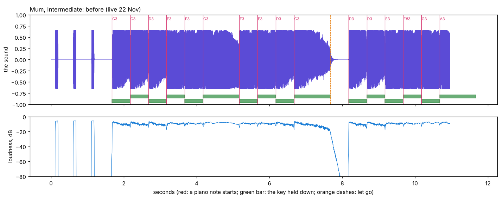
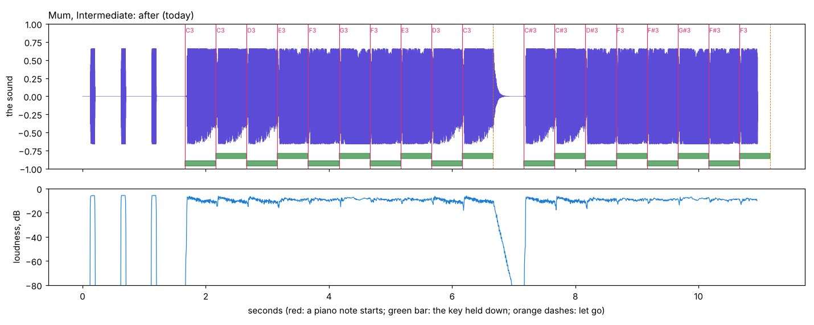

**Mum, Intermediate.** Before, the top note (G3) and the last (C3) held twice as long, and the second round started a whole step up, on D3. After, every note is the same length, and the second round starts a half step up, on C♯3.

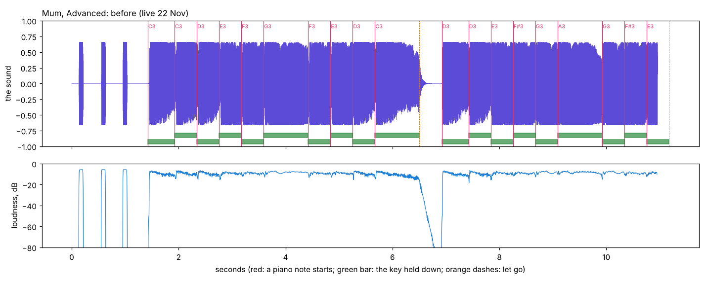
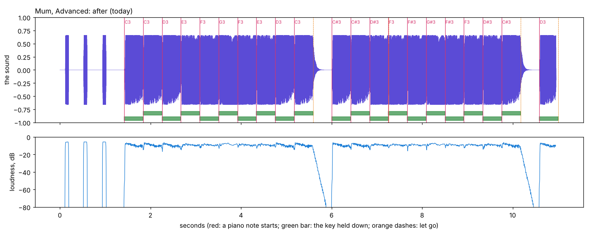

**Mum, Advanced.** Before, the lead note (0.5 s) was longer than the notes of its round (0.42 s). After, it's the same.

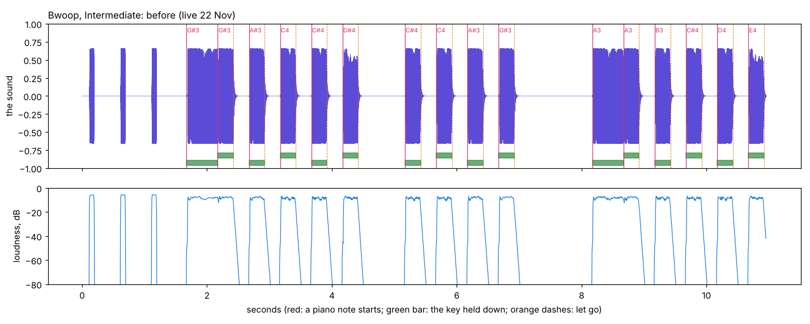
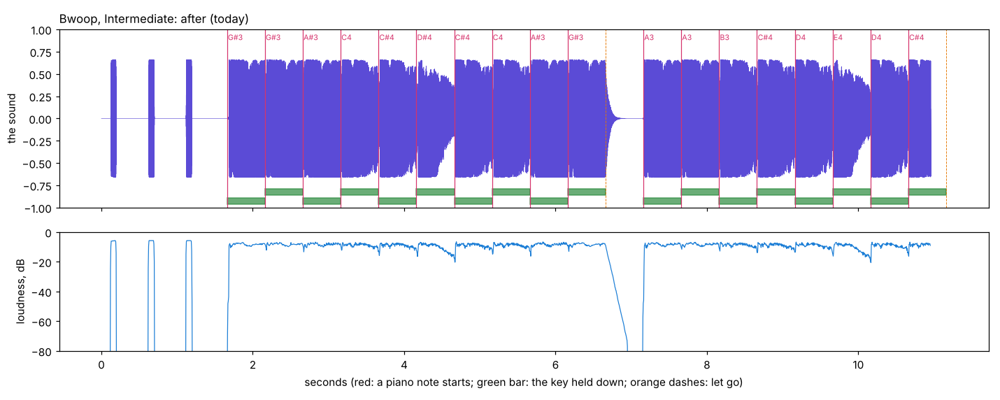

**Bwoop.** Before, every note was cut off after a quarter of a second while still loud (the cliff in the loudness), then silence until the next. After, each note sounds for its whole beat and fades under the next.

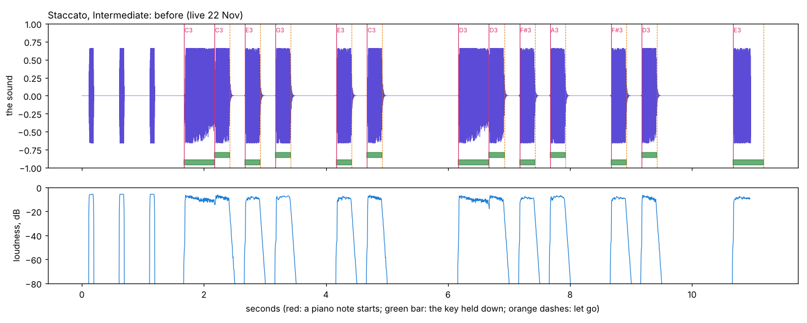
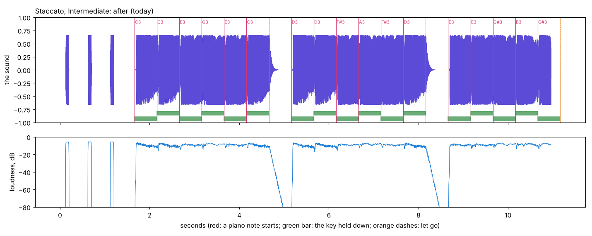

**Staccato.** The same as Bwoop.

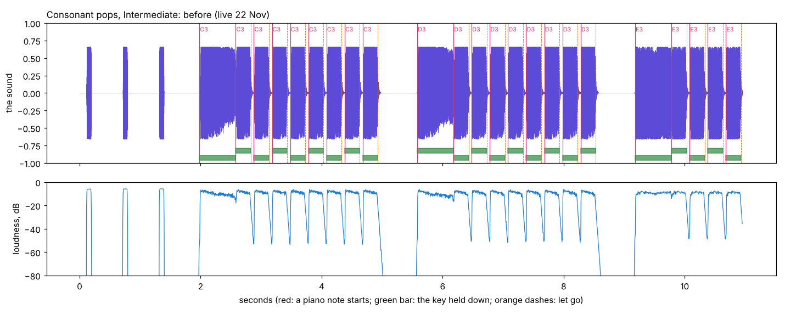
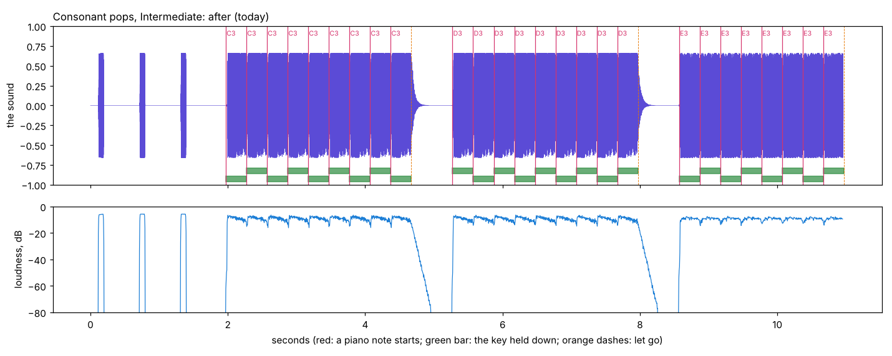

**Consonant pops.** Its notes are half a beat, 0.3 s. Before, each was cut at 0.25 s; after, each sounds its whole 0.3 s and fades under the next.

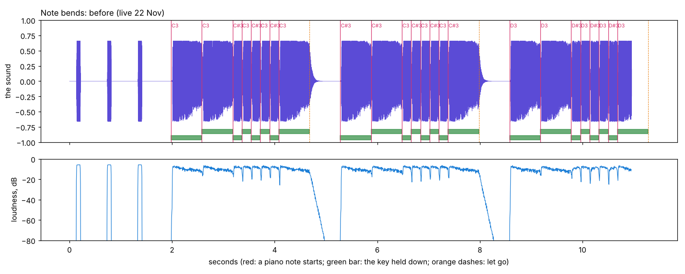
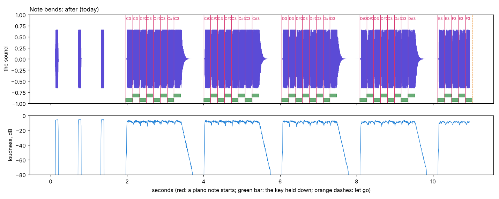

**Note bends.** Before, a longer first and last note with quick cut-off flicks between. After, seven even quick notes a round.

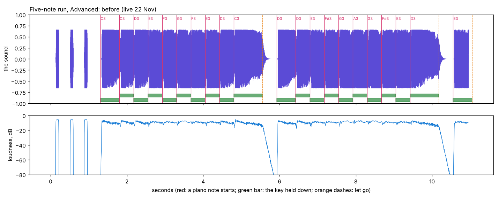
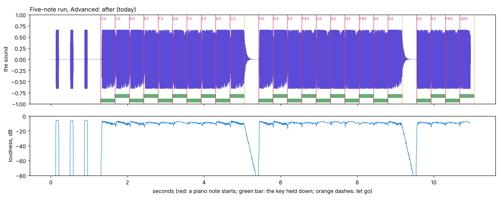

**Five-note run, Advanced.** Before, the last note held twice as long and the lead was longer than a note. After, all the same.

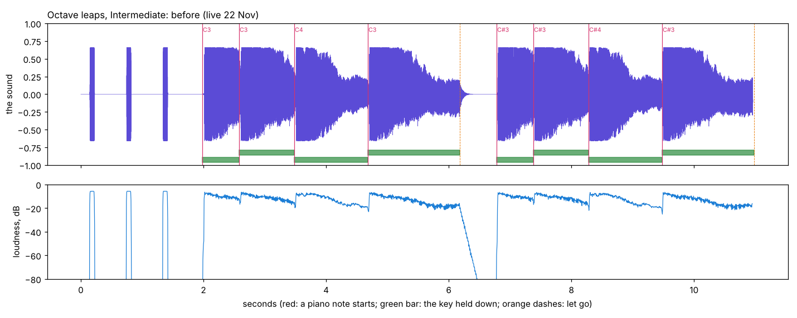
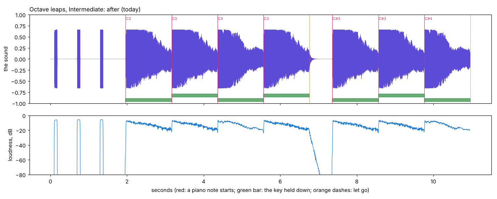

**Octave leaps.** Before, its three notes were 0.9, 1.2 and 1.5 s and the lead 0.6 s. After, all four 1.2 s.

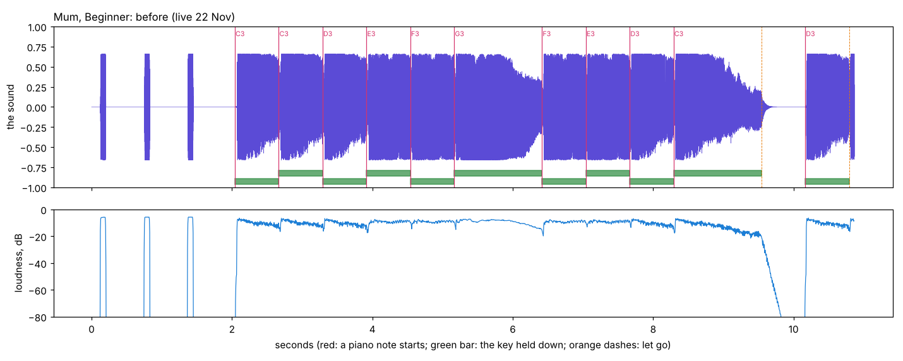
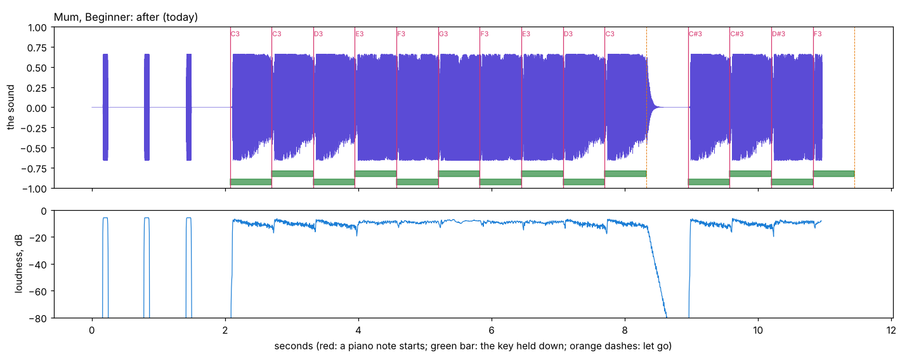

**Mum, Beginner.** Every note and the lead 0.625 s.

### Every changed exercise with a real voice

Every exercise whose pattern changed was sung by a real voice in the built app, at every level, arriving 0.09 s after each piano note, as in your takes. At Beginner, each was also sung a half step off. The pass mark is the usual one: 85% or more counted when sung right, and 15% or less when a half step off.

All 40 scored exercises that move round by round were sung at every level they have: 118 levels in all. **Every level passes.** Sung right, every note counted at every level but two: Bwoop at Advanced (35 of 36, 97%) and Consonant pops at Advanced (101 of 104, 97%; it was 104 of 104 on 22 Nov). Sung a half step off at Beginner, none counted, except Consonant pops (1 of 104, 1%, as on 22 Nov).

Tension check, Chewing hum, Blah and Note bends only show your line and aren't scored, so there's nothing to count. The chromatic run and Turns have no Beginner level, as before.

### Listed lengths

Shorter rounds and Mum's climb back down change how long the routines take. At the default range: Daily warm-up 12 minutes (was 10), with the "Ah" tension check first 13 (was 11), Intermediate warm-up 16 (was 15), Advanced warm-up 14 (was 15), Quiet warm-up 12 (was 11), Cool-down 3 (was 4).

## Mum: the app and the course

Compared with the course's Mum figures in both breakdown docs (Blueprint for Men, "Track 2"; and the Intermediate course's "Mum with neck movement", block 3, which has the same timing):

| | The course | The app now | Before today |
|---|---|---|---|
| Pattern | 1-2-3-4-5-4-3-2-1 | the same | the same |
| Climb | a half step a round, up to the top and back down | the same | a whole step a round on a wide range, up only |
| Starting note | C3 for every man | one half step above the bottom of your measured range | the same |
| Top | G4 for men | the top of your measured range | the same |
| Note spacing | about 0.41 s | 0.625 s Beginner, 0.5 s Intermediate, 0.42 s Advanced | the same |
| Note length | the same for every note (the Intermediate course's top note "slightly longer") | every note the same | the top and last notes twice as long |
| A round every | 5.4 s going up, 5.3 s coming down | 6.9 s Beginner, 5.5 s Intermediate, 4.6 s Advanced | 8.1, 6.5 and 5.5 s |
| Between rounds | about 1.7 s, with the cue note about 0.8 s before the round | one note's quiet, then the lead note, then the round straight after | the same |
| How the notes ring into each other | not described in either doc | each key held until the next is pressed, then fading over about a quarter of a second under it | the same |

**Fixed today:** the climb (a half step a round, up and back), and every note the same length.

**Not changed, because they clash with decisions you've already made:**
- **Speed.** The course's 0.41 s matches Mum at Advanced (0.42 s). Intermediate is 0.5 s, because on 21 Nov you set Intermediate to today's speed with a notch either side. **Suggestion:** keep the levels; Advanced is the course's speed.
- **The gap between rounds.** The course leaves about 1.7 s between rounds, with a short pause after its cue note. The app leaves one note's quiet and then the lead, about 1 s at Intermediate. You said today that the rest between rounds stays. **Suggestion:** if you want Mum to match the course here too, I'd lengthen its rest to about 1.7 s, with the lead note ending 0.4 s before the round.
- **Starting note and top.** The course starts every man on C3 and stops at G4. The app fits Mum to your own measured range, which you chose for every exercise.

I couldn't compare how the course's notes ring into each other: neither doc describes it, and I have no recording of the course here.

## What I decided

- **Note bends:** its first and last notes were a beat long, with quick flicks in between. Since every note of a round now has to be the same length, they're as quick as the flicks: seven quick notes, note, neighbour, note and so on, 0.18 s each.
- **Short notes:** the piano plays them whole, but the sung note and its bubble stay short, as you asked on 20 Nov.
- **The fade when a key is let go:** 40 dB in 0.18 s, 60 dB in 0.28 s, like a key whose damper falls on the string. It's the fade the app already used for every note but the short ones. I haven't measured a real piano's damper; I have no recording of one here.
- **A problem on Learn a song** still shows while the song plays, because it needs to say what to do.
- **Hold notes' lead note** stays a second: one held note is 4 to 10 s, too long to be its lead.

## Held, and clashes

- The speed and the gap between rounds on Mum (above).

## Not tried on a real phone

Everything was measured in Chrome made to behave like an Android phone, not on your Samsung. On the phone I haven't heard or seen:
- the even notes;
- the shorter lead at Advanced;
- the whole short notes;
- Mum's climb back down;
- Learn a song's line.

## Checks

- 355 unit checks pass. The type check and the code-style check are clean (one old warning, from before this round, about a comment).
- In Chrome made to behave like a phone, signed in as the test singer: Train 86 of 86, Takes 21 of 21, Android 28 of 28, the browser checks 15 of 15, Learn a song 19 of 19, the note map 14 of 14, the library 7 of 7, and loudness 13 of 13, sung with a real voice.
- The old app's own checks all pass, so it is unchanged.
- Real voice: 118 levels of 40 exercises, and every level passes (above).
- Broken builds: all 262 broken rules were caught, and all 336 broken copies of the app.
- A restart of the machine stopped the broken-rule run partway, and left one rule it had broken on purpose. I put that file back as it was and ran the whole set again.
- The test takes were deleted after the runs, and the two test accounts hold none. Your and Briar's accounts weren't touched.

## Mistakes of mine

- When I made every note the same length, I didn't update two of my own checks that still expected the old lengths and Mum's old climb. The full run caught them, and I updated them.
- My first guess at why a take got stuck (the upload hanging when the signal goes) was wrong. A test disproved it, and the store's own records showed the real cause.
- My first version of the stuck-take check couldn't tell the old app from the new. I fixed it, and saw it fail on the old app before trusting it.
- I left Consonant pops out of the first real-voice list. I caught it by comparing with the full list, and sang it.
- I first wrote the real-voice totals as 46 exercises and 124 levels. The true count is 40 and 118, corrected before this report.
- When I fixed the Today card, I didn't look for other broken builds aimed at the same lines. One of them no longer broke anything you'd see, and the broken-build run flagged it. I re-aimed it, and it's caught.

## Your taps

First, close Chrome fully: swipe it away from your recent apps, then open the app again, so you get today's version. Wear your wired headphones throughout.

From 22 Nov (again, after closing Chrome):

1. Train, Agility, Five-note run, gear, Advanced, Start. Before each round you'll hear its first note on its own, as short as the round's notes, then the round. Sing each round from its first note, on time. Its first bubble should fill green.
2. While that runs, look at the map: thin bubbles with a line through the middle, and the view sliding up as the rounds climb. Every note, the last included, is the same length.
3. Agility, Note bends, Start: quick flicks between the note and its neighbour, seven even notes a round, ending on the note. Your line is shown and there's no score.
4. Pitch, Match the tone, Beginner, Start. Each tone lasts 6 s and the notes go up in order. At the end you get a score and how it landed.
5. Match the tone, Advanced: your line stays hidden while the tone plays, and appears once it stops.
6. Range: the Octave leaps row reads "Advanced · Levels Beginner to Advanced · Scored on pitch". Tap it, Start: low, high, low, all three notes the same length (they used to be three different lengths, the last the longest).
7. Agility, Three-note run, gear, Advanced, Start: a notch faster than Intermediate. Sing it through.
8. Sing, Learn a song, open one of your songs. Under its name there's nothing, or "Reading the singer's line…" with how far it has got. Tap Start: that line disappears while the song plays and nothing moves. The map's rows are as far apart as on Train, and before each phrase the view slides to show it. "Any octave" is in the sound card below.

New this round:

9. Tone, Mum, gear, Intermediate, Start. Every note is the same length, the top and the last too. Each round starts a half step higher than the one before; after the top it comes back down a half step a round.
10. Range, Bwoop, Start. The piano plays whole notes one after another, with no cut and no silence between them; what you sing is still a short "bwoop".


# Report, 24 Nov 2026, commit 9dc5287

Vibrato is built and live: an Advanced exercise in Tone, as you approved on 16 Nov. I built the measuring first and proved it before building the exercise around it. Main hadn't moved since b01b8ef, apart from my own 23 Nov report. Both fixes from the 23 Nov report are kept: the stuck take and the Today card count. Nothing that waits on your phone check was changed: the bubbles, the zoom and Mum's gap between rounds are as they were.

## What works

1. **Vibrato, in Tone, last in the list.** Its row reads "Advanced · Wobble measured".
2. **A round.** First a moment's quiet, then the lower note alone (the lead). Then the two notes, a half step apart, take turns: four notes at 0.6 s each, four at 0.4 s, eight at 0.2 s. Then the piano holds the lower note for 4 seconds, while your wobble carries on. Each round starts a half step higher, from two half steps above the bottom of your range to two below the top.
3. **"ah", "oh" or "ee".** "ah" is the usual one. "oh" and "ee" are in the gear, and the app remembers your choice.
4. **The wobble shows on the map.** On this exercise only, your line is drawn from every reading, so the wobble you sing is the wobble you see. Everywhere else the line is smoothed, as before. The smoothing flattens a wobble to about half its width.
5. **What it measures, on each held note:** how fast the wobble goes (cycles a second) and how wide it is (cents, top to bottom; 100 cents is a half step). Each sits beside its typical range from the project's research report: about 4.5 to 6.5 a second, and about 50 to 120 cents. The result card says "Typical, not a target." Nothing anywhere says whether it is good.
6. **Over time, as Match the note does it.** Each held note's wobble at its start, middle and end, and last time's numbers beside this time's. A held note that didn't wobble says "no wobble". One where you were still going back and forth says "still two notes taking turns".

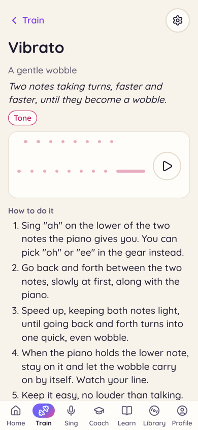
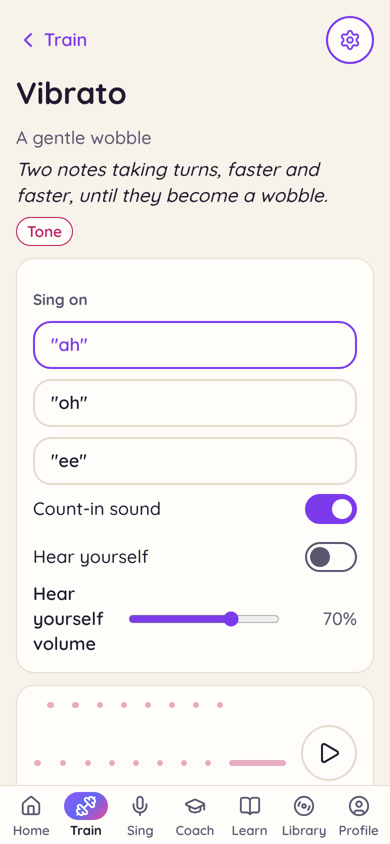
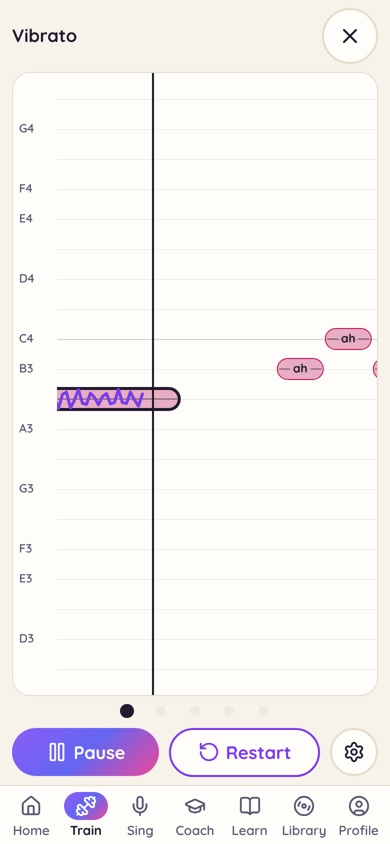
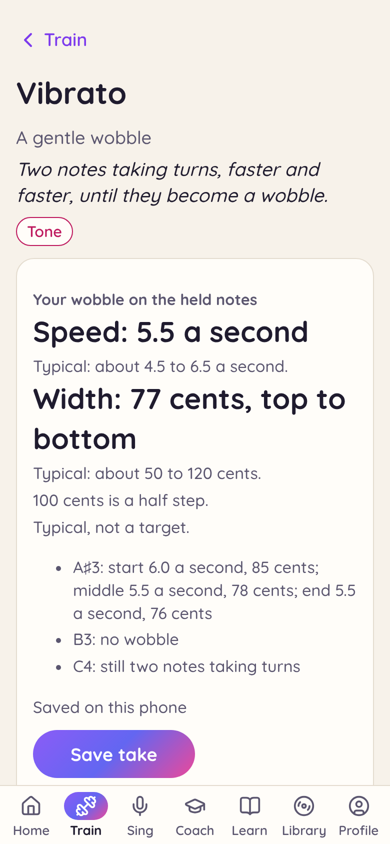

## How the measuring was proved

The pitch line takes 20 readings a second, so a wobble of 5 a second gets only 4 readings a cycle. Taking the highest and lowest single readings misses the true top and bottom. So the app measures from whole cycles instead: over about a second of readings it fits one smooth wave, on top of the note's own slow drift. The speed is the wave that fits best, and the width is read from the wave, not from any one reading. It measures from the line's own readings, before the smoothing.

**1. Sounds of known speed and width.** 125 voice-like sounds, played through the app's own pitch reader: five notes from A2 to A4, speeds from 4 to 7.5 a second, widths from 30 to 150 cents.
- **The app's measure:** speed exact every time. Width typically within 2 cents, 7 at worst.
- **Highest less lowest single reading:** read 14 cents low on average, up to 51 cents low.
- **The smoothed line:** read 72 cents low on average. It all but hides the wobble.

**2. Real voices, with a known wobble put on them.** I took 8 real sung notes from the two test songs, 4 from each. I made each one steady, then gave it a wobble of known speed and width, by playing it slightly faster and slower in turn (a sound played 1% faster is 1% higher). That was 72 cases: speeds 4.5, 5.5 and 6.5 a second, widths 40, 70 and 110 cents.
- Speed within 0.01 a second.
- Width typically within 2 cents, 5 at worst.

**3. Telling slow turns apart from a wobble.**
- **The same 8 real notes taking turns with the half step above**, at 1, 1.5, 2 and 3 times a second: none of the 32 read as a wobble. 26 read as two notes taking turns, and 6 (at once a second) as no wobble.
- **The 8 notes made steady:** all 8 read as no wobble.

**4. The singers' own vibrato, in the test songs.** Every note the singers hold for 1.2 seconds or more, a second at a time. I compared each second with a separate, much finer measure: 500 readings a second, with the tops and bottoms of each cycle found directly.
- **Where the fine measure finds a wobble** (24 seconds), the app finds it in 15. There, speed is typically within 0.4 a second (1.5 at worst) and width within 4 cents (38 at worst).
- **The 9 it misses** are narrow, uneven wobbles of 22 to 38 cents, under the typical range. The app reports those as "no wobble".
- **Where the fine measure finds no wobble** (3 seconds), the app never claims one.

**5. Would reading more often help?** On those same seconds, reading 40 or 100 times a second found 12 and 14 of the 24, against 14 at today's 20. The misses come from how uneven those wobbles are, not from too few readings. So the reading rate is unchanged, and the change costs the phone nothing extra.

**6. In the app, a real voice through the microphone.** Three rounds:
- **A wobble of 5.5 a second and 80 cents** measured 5.5 and 77.
- **A steady hold** measured "no wobble".
- **Turns carried on through the hold** read "still two notes taking turns".
- **A second session, 6 a second and 60 cents,** measured 6.0 and 58, with last time's numbers beside it.
- **The line on the map** swung about 77 cents of the 80 sung. A build drawing the smoothed line showed about 43, and the check fails on it.

The first version wasn't good enough on real singers. It took a held note's slow drift for the wobble, and found only 2 of the 10 notes with vibrato. The second version made fast turns read as a wobble. The proofs caught both, and both are fixed above.

## The page, word for word

**Vibrato**
*A gentle wobble*
Two notes taking turns, faster and faster, until they become a wobble.

**How to do it**
1. Sing "ah" on the lower of the two notes the piano gives you. You can pick "oh" or "ee" in the gear instead.
2. Go back and forth between the two notes, slowly at first, along with the piano.
3. Speed up, keeping both notes light, until going back and forth turns into one quick, even wobble.
4. When the piano holds the lower note, stay on it and let the wobble carry on by itself. Watch your line.
5. Keep it easy, no louder than talking. If no wobble comes, hold the note steady; that's fine.
6. Stop when it stops feeling easy; you don't have to finish the climb.

Under "More about this":

**You're doing it right when**
Your line turns from two clear steps into one quick, even wave, and keeps waving on the held note while your volume stays the same.

**Watch out for**
Shaking your jaw or your head to make it wobble, pushing louder to make it wobble, and forcing it in a part of your range where it doesn't come. Leave that round and try the next.

**Why it helps**
A wobble tends to come by itself once your voice is free and easy; it isn't something you make. This lets you see yours, how fast and how wide it is, and grow it a little at a time.

**The gear:** "Sing on": "ah", "oh", "ee".

**The result card** (the numbers are the ones in the last picture above)
- Your wobble on the held notes
- Speed: 5.5 a second
- Typical: about 4.5 to 6.5 a second.
- Width: 77 cents, top to bottom
- Typical: about 50 to 120 cents.
- 100 cents is a half step.
- Typical, not a target.
- Then a line for each held note: "A♯3: start 6.0 a second, 85 cents; middle 5.5 a second, 78 cents; end 5.5 a second, 76 cents", "B3: no wobble", "C4: still two notes taking turns".
- With a last time: "Speed: 6.0 a second (last time 5.5 a second)", and "Last time kept on this phone."

A check holds the page to your rules. Outside "Watch out for", no line mentions the jaw, head, throat, voice box, belly or any muscle. No line anywhere says whether the sound is good or correct.

## What I decided

- **Lead note:** one note of the first speed (0.6 s), as everywhere.
- **Even notes:** every note within a speed is the same length. The round as a whole can't be, because speeding up is the exercise. The held note is a hold.
- **Levels:** none. Nothing is scored, and how fast the wobble goes is your own. A level that set a speed would be telling you how fast to wobble.
- **How fast the piano goes:** it stops at 2.5 back-and-forths a second, slower than a wobble. Going from there into a wobble is up to you, as you described it.
- **The bubbles** show the notes but don't fill, as on Note bends. Any octave isn't in the gear, since nothing is scored on the note.
- **The first 0.4 s of each held note isn't measured**, while the note is found.
- **Not in any routine.** It's not quiet (it's sung on a vowel), so it has no "Quiet" tag.
- **Kept on the phone:** last time's speed and width. The results list online gets the session as done, with no numbers, as for other exercises that aren't scored.

## Held

- **Saving the speed and width online**, so they follow you to a new phone. The results table has no place for a speed. Adding one changes the database, which I don't do without you. **Your decision: add it, or keep it on the phone.**
- **Whether the piano's three speeds suit you:** for your phone check.

## Not tried on a real phone

Everything was measured in Chrome made to behave like an Android phone, not on your Samsung. On the phone I haven't heard or seen:
- the round;
- the wobble on the map;
- the result card.

No one has sung this exercise for real yet. The real voices here are recordings made to follow the round. I also don't yet know whether your phone's microphone changes a wobble's width. A tap below will show it.

## What was measured

- **Unit checks:** 369 pass, 14 of them new for Vibrato. The type check is clean, and the code tidiness check finds no errors.
- **The app in a phone-like browser, real voices throughout:** first screens 15 of 15, Android 28 of 28, library 7 of 7, note map 14 of 14, Learn a song 19 of 19, takes 21 of 21, loudness 13 of 13, Train 88 of 88, and the old app all good. Train includes two new Vibrato checks: three rounds sung, and a second session with last time beside it. One Train timing check failed once while the lab was running; run alone, it passed twice.
- **Broken builds, the core:** 281, each a rule deliberately broken. The first run missed 2, both Vibrato: the hold measured from its very first moment, and the piano never speeding up. My checks for those were too loose. I tightened both, and both are now caught.
- **Broken builds, the app:** 348. The first run missed 1, which couldn't break anything as written (below). Re-aimed, it is caught, so all 348 are.
- **Test takes:** none left online on either test account.

## Mistakes of mine

- **The first measure took a note's slow drift for the wobble.** It found only 2 of the 10 held notes with vibrato in the test songs. The proof on real singers caught it, before anything was built on it.
- **My fix for that made two notes taking turns three times a second read as a wobble.** The turns proof caught it, and the turns rule fixed it.
- **A note in the code said a wobble must explain "at least half" of the movement.** The measure in fact asks for a third. I corrected the note.
- **I ticked a line on the checklist ("the map draws every reading") before a check for it existed.** The checklist test caught it. I then built the check: it measures how far the line swings, and it fails on a build that draws the smoothed line.
- **I first wrote the misses as "16 to 38 cents" wide.** On a re-run they were 22 to 38, and that is what's above.
- **I ran the lab while the browser checks were running,** against my own rule, since both lean on timing. One timing check failed. Run alone, it passed twice.
- **I misread a count of the code tidiness check as errors.** There were none.
- **Two of my Vibrato checks were too loose.** One allowed the measuring to start before the note settles. The other allowed the piano to never speed up. The broken builds caught both, and I tightened them.
- **My report first lacked the heading every report needs ("What was measured").** The report check caught it before it went anywhere.
- **I wrote a broken build that couldn't break anything.** The line stores each reading twice, once when it arrives and again when a better version comes, so dropping only the first changed nothing. It now drops both, and the check catches it.

## Your taps

Wired headphones on, as always. First, close Chrome fully: swipe it away from your recent apps, then open the app again, so you get today's version.

1. Train, Tone, Vibrato (last in the list). Read the page (tap "More about this" for the rest of it), tap Start and sing two or three rounds. Take turns between the two notes with the piano, speed up until it wobbles, then stay on the lower note when the piano holds it. Watch your line wobble on the map. Tap the cross. You'll see your wobble's speed and width beside the typical ranges, and each held note's start, middle and end.
2. Open Vibrato's gear, pick "oh", tap Start and sing one round. Each note should say "oh". Then tap the cross: this time last time's numbers are beside the new ones.
